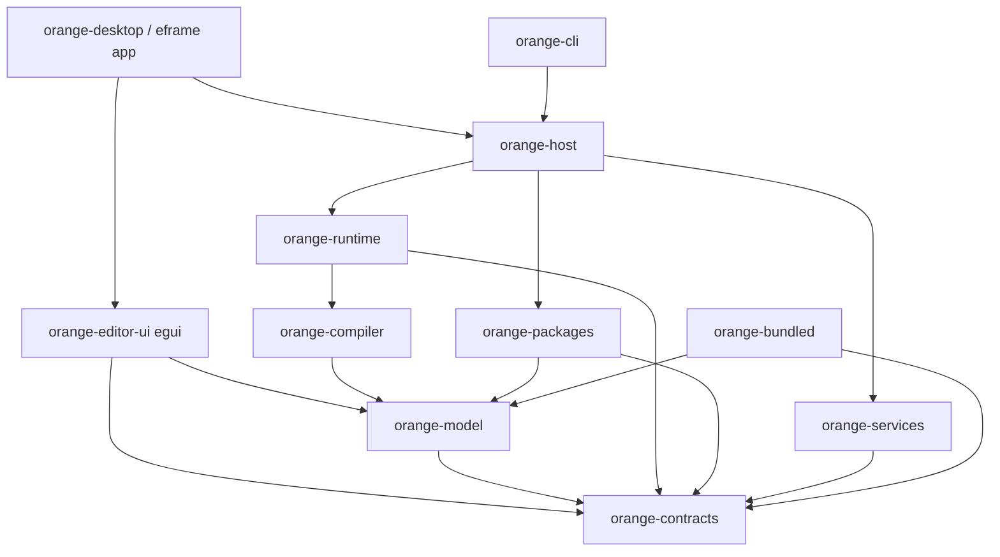
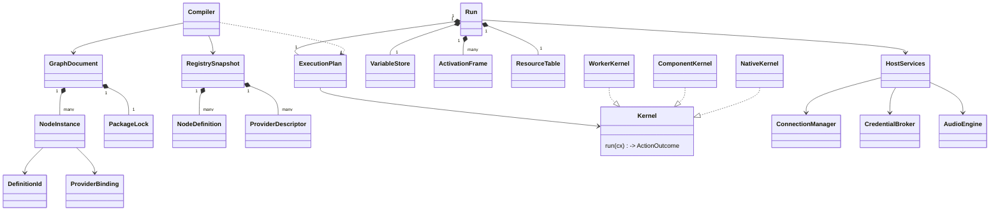

# Architecture and ownership

`orange-model`, `orange-compiler` (restricted pure exports), `orange-bundled` (native scalar operations/conversions) and `orange-runtime` (initial entropy primitives only) are implemented Cargo packages; the remaining boundaries below are proposed. Separate a crate when dependency/lifetime/testing boundaries justify it; internal modules may start together to avoid unnecessary build overhead. Dependency arrows mean compile-time use. The project uses no game engine (ADR-02): the selected editor UI is egui, hosted by eframe in the desktop app, and core crates have no UI, window or engine dependency. Downstream products add engines, scenes and other domains in their own crates (ADR-21).

Physical source placement follows [15](15-monorepo-layout.md): application libraries under `app/crates`, desktop/CLI under `app/apps`, installable expansions under `plugins`, and exported public SDK artifacts under `sdk`. These folders share one repository while preserving the dependency/runtime boundaries below. No Cargo members are created by the source-layout decision.

Implemented native prerequisite (N1a): `orange-bundled` depends on `orange-model` and publishes ordinary `org.orange.math` definition/provider metadata plus resolved scalar kernels. Resolution checks exact provider/build digest, definition/config version and specialization before execution. A resolved kernel retains its immutable registry snapshot and performs scalar dispatch without parsing or registry lookup. This is not the final compiler/runtime kernel ABI, package loader or service layer; the full crate graph above remains the target architecture.

## Foundation application and general capabilities

ADR-22 selects a usable basic application as well as reusable libraries. The editor, language and general file/network/input/audio capabilities are foundation deliverables. Concrete capability services stay outside model/compiler/runtime; installing a specialized plugin adds domain-specific nodes and event sources through public contracts. OBS, Twitch, browser-canvas servers and website-specific clients are not host responsibilities or release dependencies.

The host owns an input-trigger service and audio capture/playback services. Keyboard, manual/button, timer and package event sources enter the same bounded run-owned event queues; no input hook or audio callback executes graph code. Node configuration and accessible controls are projected through the editor contribution model. Typed callable graphs and insertable event-containing templates follow 11 §14; a visual frame alone supplies neither behavior reuse nor resource ownership.

## Boundaries

| Crate | Owns | Must not own |
|---|---|---|
| orange-model | GraphDocument, stable IDs, type schemas, package locks, migrations and document edits | Engine or UI entities, sockets, credentials, runtime futures |
| orange-contracts | Versioned wire/component contracts, errors, handles, permission vocabulary, declarative editor schema, TextRef/MessageRef | Concrete UI widgets or Rust trait objects crossing package boundaries |
| orange-compiler | Validation, monomorphized type resolution, control/effect regions, compact immutable ExecutionPlan | Network/audio actions, editor state |
| orange-runtime | Run/activation state, scheduler, variables, continuations, child task/resource ownership, inspection stream | UI or frame dependence |
| orange-services | File, connection, vault, HTTP/WebSocket, input-trigger and audio playback/capture/analysis services; platform adapter modules | Graph edits or arbitrary plugin UI |
| orange-packages | Package store, validation, registry transactions, SDK compatibility, component instances, provider selection | Implicit graph rebinds or vault bypass |
| orange-host | Composition root, dedicated async runtime, policy enforcement, service injection, locale/catalogue service and clean shutdown | Specialized integration request logic |
| orange-bundled | Standard node definitions plus compiled trusted kernels and service implementations | Private alternative type/graph semantics |
| orange-editor-ui | egui editor: document commands/history, workspace/panels, view model, accessible interaction model, diagnostics projection | Engine mutation during drawing |
| orange-desktop | Main thread/window/input, eframe app hosting `orange-editor-ui` | Graph execution scheduler |
| orange-cli | Headless loading, run/stop, structured output and exit status | GPU/window initialization |

Ownership: one composition root owns service lifetimes. Each run owns an immutable `RegistrySnapshot`, compiled plan, variable store, cancellation tree, resource table and subscription leases. Shared connections are host resources leased to runs; dropping one run cannot close another run's lease. Registry generations own installed package instances; package files are immutable and content-addressed. Removal hides new contributions immediately and deletes code only after all generation references are released.

## Rust relationships (conceptual, not compiled API)

`Kernel`, `FileService`, `CredentialBroker`, `ConnectionManager`, `AudioControl`, `AudioCapture`, `InputTriggers`, `SceneBridge`, `PackageStore` and `Clock` are internal Rust traits for substitution/tests. External components use versioned serialized/component interfaces, not these Rust traits. Kernels come in three shapes ([12 §10](12-graph-data-structures.md)): a pure kernel returns `Result<(), NodeError>`; an action kernel returns `Outcome(OutcomeIx) | Suspend(PendingOp) | Fail(NodeError)`, so it selects exactly one declared outcome; an iterator kernel provides `open/next/close`. Control intrinsics (Branch, Switch, Sequence, Fork, loops) are compiled control instructions, not kernels. Resources are non-forgeable table handles with owner/run/generation checks. Document, registry, plan and run-state layouts are defined in [12](12-graph-data-structures.md), and their semantics in [11](11-graph-language.md). `Value` is immutable or uniquely owned; `VariableStore` is mutated only through runtime commands. `Arc` shares immutable plans/large values; no shared mutable graph behind a lock on the execution path.

## Thread and runtime model

- Main OS thread: eframe window/input/render integration and the egui editor with AccessKit. It consumes bounded view changes and sends document/runtime commands. Never waits synchronously for graph, file, network, vault or decoder work.
- Dedicated **Tokio** host runtime: I/O reactors, timers, authenticated sessions and async continuations. Feature/version/MSRV pin must be verified in WU-01; network dependencies never run on the UI thread. Tokio explicitly provides its own I/O/timer/scheduler runtime services ([runtime documentation](https://docs.rs/tokio/latest/tokio/runtime/), resolved 1.54.0 on 2026-10-20; version pin pending).
- Run actors on the bounded compute executor: each run is one logical actor that executes one strand segment at a time and owns its plan, run state, activations and queues ([11 §9](11-graph-language.md), ADR-14). Different runs execute in parallel. Run state is never locked.
- Bounded compute executor: run actors, offloaded heavy pure programs, component calls and decoding, with cooperative yielding, or process termination for uncooperative trusted workers. Blocking OS calls use bounded blocking workers; cancellation can abandon their results but may not interrupt an OS syscall.
- Audio callback threads: preallocated sample buffers and bounded nonblocking commands only. Decoder/control resampling preparation occurs off callback threads. Capture and playback callbacks exchange preallocated blocks with bounded workers; level analysis and event decisions occur off callback threads. No general guest invocation, vault call, mutex wait, file read or ECS query in callbacks.
- Optional external package workers: versioned IPC with heartbeats and bounded frames. Worker exit faults only affected package activations; host handles and child operations are revoked.

Bridge messages carry `RunId`, `Generation`, `ActivationId`, sequence and a bounded payload/reference. UI inspection updates may coalesce by node; effect completions and errors use lossless bounded paths with producer backpressure. Sender shutdown wakes pending receivers. Host adapter messages are applied at documented host boundaries; headless runs see `CapabilityUnavailable` if they explicitly request rendering.

## Editor foundation decision

Selected, conditional on probe P-02 ([09](09-feasibility-probes.md)): **egui for the editor UI and custom graph canvas, hosted by eframe, with a host-owned declarative extension UI model** (ADR-02). The `orange-editor-ui` crate depends on egui only, so downstream products can embed the same editor in their own window or engine. No egui API is claimed compiled here.

Alternatives and fallback order are in ADR-02 (Slint first). Do not lock the document/runtime/package APIs to widget entities, so a failed UI experiment does not invalidate the engine.

Canvas uses stable document IDs and persistent view state; spatial index for node/port hit-testing; visible region + margin culling; cached edge paths invalidated only when endpoints/viewport change; virtualized palette/inspectors; batch drawing; independent text editing sessions with focus/caret/IME ownership. Pan updates transforms/culling, not graph definitions. A document transaction emits changed IDs and revisions; the adapter patches affected elements. Nonselected offscreen node controls are not instantiated. Selection and validation never rely solely on orange/red colors.

Native dialogs, clipboard, DPI, screen-reader traversal/action names, keyboard-only workflows and cross-platform composition are **required capability tests**, not presumed features of a UI toolkit. A screen reader must reach nodes, ports, errors and logical connections using a structured accessibility representation even if the canvas is custom rendered. WU-02 stop/go precedes committing the large editor UI.

All product-owned visible and accessible text follows [13](13-internationalization.md). Host modules validate and resolve immutable package catalogues; the editor keeps locale/search/text metrics in view state. Core errors/diagnostics emit stable keys and typed redacted arguments. Locale switching patches text/accessibility without graph transactions, recompilation, preview evaluation or changing provider pins. P-02 includes expansion, CJK/RTL, plural/fallback and language switching during IME; UTF-8 input alone cannot pass the i18n gate.

## Architecture invariants

1. Core crates build/test without UI, GPU or network access.
2. Each side effect has one owning activation and one cancellable lifetime.
3. Graph/package IDs outlive processes; runtime/entity IDs do not.
4. Editors, workers and components request service operations through checked handles.
5. Package install and provider choice are registry transactions; running snapshots do not mutate.
6. Native host privileges are explicit; guest permission policy never claims to sandbox native code.
7. `orange-model` and `orange-compiler` own the graph language in [11](11-graph-language.md). Packages extend it only through the surface in [11 §16](11-graph-language.md), never by adding port kinds, control intrinsics or scheduling rules.

Associated requirements: FR-01–07, FR-34–41, FR-44–51. Validation and consequences: [03](03-data-and-execution.md), [04](04-expansion-plugins.md), [06](06-quality-and-validation.md), [11](11-graph-language.md), [12](12-graph-data-structures.md), [13](13-internationalization.md), ADR-01/02/03/08/13–17 in [08](08-decisions.md).

E1a dependency boundary: orange-compiler depends on orange-model and exposes trusted PureKernelResolver/PureKernel interfaces; orange-bundled depends on orange-compiler to implement them. The compiler has no dependency on the concrete bundled provider, UI, host services or guest loader. The native adapter resolves exact provider locks from the document and types from fresh signatures, never cached type_args. PurePlan retains an Arc snapshot and immutable executable bindings. The diagram remains the broader target; these provisional pure-fold interfaces do not freeze the final runtime/component ABI.
