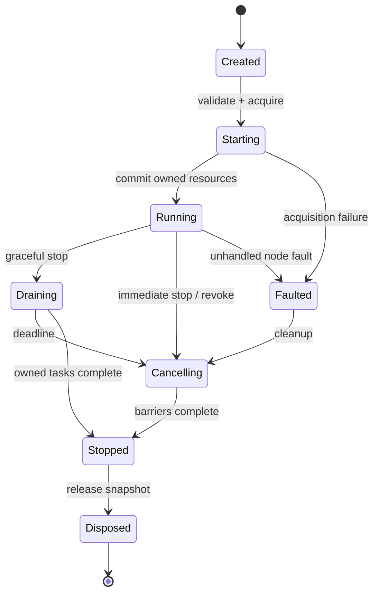
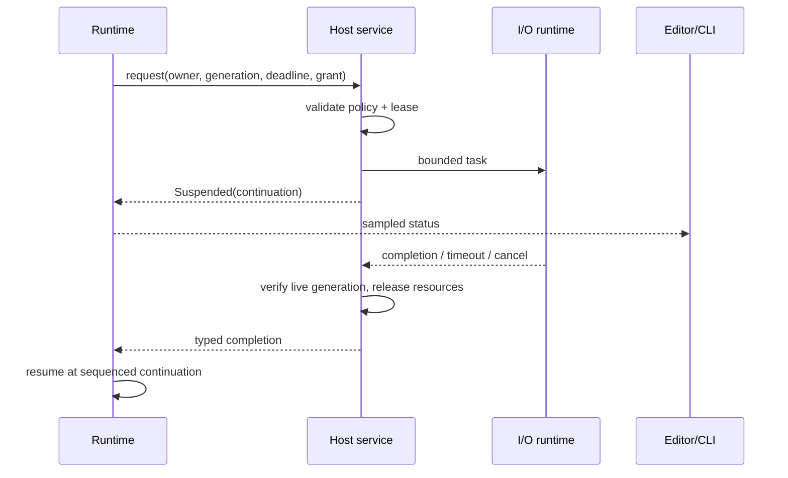

# Data, compilation and execution contracts

This is the proposed v1 contract baseline. JSON examples are documentation, not executed schemas. **Graph semantics are normative in [11](11-graph-language.md)** (node kinds, ports, types, conversions, regions, cycles, ordering, events, state) and **layouts are normative in [12](12-graph-data-structures.md)**. This document keeps the value policy, persistence, compiler pipeline and run lifecycle. On conflict, 11/12 govern and this document must be corrected. IDs use a constrained ASCII namespace (`org.orange.math/add-i64`) and immutable UUID instance/member IDs where user-created; examples shorten instance IDs to `n1`, `v1` for readability. Display labels may change without changing IDs. Definition version, configuration version, codec version, graph format, provider/package version and host API version are separate compatibility axes.

## Value and type model

| Type/condition | Contract |
|---|---|
| `core/bool@1`, `core/i32@1`, `core/i64@1`, `core/u32@1`, `core/u64@1`, `core/f32@1`, `core/f64@1` | Integers have checked arithmetic by default (`wrapping`/`saturating` are explicit config); overflow and division by zero fail. IEEE-754 f32/f64 are supported, but default finite math nodes reject non-finite inputs and results; explicit IEEE nodes expose NaN, infinity and their comparisons. Negative zero persists. Full catalog, including `duration`, `timestamp`, `map` and `result`: [11 §5.2](11-graph-language.md). |
| `core/string@1`, `core/bytes@1` | UTF-8 strings; byte buffers are not strings. Length/index nodes explicitly choose bytes, Unicode scalars or grapheme clusters; user-facing substring defaults to grapheme clusters. Invalid UTF-8 decode errors unless replacement is explicitly selected. No implicit normalization or locale collation. |
| `core/list@1<T>`, `core/map@1<K,V>`, schema `record`, schema `enum`, `core/option@1<T>` | Homogeneous list; insertion-ordered map with hashable non-float keys; stable field and variant IDs; an enum carries a tag ID plus its declared payload; Option carries Some/None. A missing record member differs from a present None. Unknown variants survive storage, but at run time they take the explicit switch fallback or fail. Editors may display short forms such as `list<T>`; documents use only canonical forms. |
| `core/json@1` | Dedicated JSON null exists only here; exact source-number text is retained where needed for loss detection. JSON number → i64/u64/f64 conversion is explicit and checked. |
| Resource reference | `ResourceHandle(kind, owner, generation)` in memory only. Saved config stores a re-resolvable asset/profile descriptor, never the live handle. |
| `NodeError` (`core/error@1`) | Separate outcome path (implicit `failed` exec output) with a stable namespaced code, node, activation, safe message and typed details. It becomes data only through `core/try` → `core/result@1<T>`. Never conflated with None, missing, JSON null, empty string or NaN. |

No implicit numeric widening, string parsing or bool/numeric conversions. Every conversion is a visible converter node from the registry in [11 §6](11-graph-language.md). Generic operations declare constrained type parameters and specialize at compile time ([11 §5.5](11-graph-language.md)). Ordinary f64 arithmetic uses IEEE-754 rounding (nearest, ties to even for standard basic operations) and does not emit an error for every inexact result. Math-domain/nonfinite policy and explicit conversion loss are distinct. Transcendental functions may vary in last bits across platform libraries; deterministic replay is scoped to the locked implementation/platform unless a reproducible kernel is explicitly selected. Explicit conversion nodes select exact/reject, truncate, floor, ceiling or round-to-even behavior and return loss metadata when a lossy conversion is requested. Formatting defaults to invariant locale, shortest round-trippable f64 and UTF-8; UI presentation may use the user locale under [13](13-internationalization.md), without altering values. Locale-aware graph parse/format/collation requires explicit node configuration and pinned locale-data/provider versions; it never reads UI or machine defaults. Parsing reports offset and expected format without exposing secret payloads.

Seeded random is a `volatile` (`entropy`) node that uses a recorded algorithm/version and run seed. Each draw comes from `stream(seed, node_id, activation_seq, invocation_in_activation)`. It is evaluated once per epoch, so two inputs of one action see one value ([11 §7.4–7.6](11-graph-language.md)). Deterministic execution order is required for replay. Default interactive seed is generated per run and recorded in run metadata. Cryptographic random is a separate host capability and never marketed as reproducible.

Internal values use small tagged inline scalars and immutable reference-counted buffers/strings/records for larger data. Clone shares immutable storage; mutation consumes ownership or uses copy-on-write. Lists of samples/bytes can use typed contiguous buffers. Host/guest transfers copy unless a specifically validated borrowed/buffer API applies; no general zero-copy promise across Wasm or worker boundaries. Custom codecs enforce depth/size/recursion budgets and return structured decode errors. Secret bytes are broker-owned, excluded from ordinary Value and inspection.

### First bundled scalar kernels (N1a)

`orange-bundled` publishes version-1/config-version-1 `org.orange.math/add`, `subtract`, `multiply`, `divide` and `not`. Numeric inputs are `a`, `b`; outputs are `sum`, `difference`, `product`, `quotient`, respectively. Not has `value: bool` and `result: bool`. They are pure computed-output definitions with no effects, suspension, clock, entropy or I/O. Generic numeric contracts remain replaceable, while the bundled provider explicitly lists only i32/i64/u32/u64/f32/f64 specializations. A package-owned `num` implementation never selects native scalar code.

Numeric config uses `orange.config-schema/v1`: `int_overflow` is checked/wrapping/saturating (default checked), and `float_policy` is finite/ieee (default finite). Missing values adopt these fixed execution defaults without rewriting saved config; unknown properties/values or wrong JSON types are rejected before execution. Integer policy applies only to integer kernels and float policy only to float kernels. Not accepts an empty config only. Integer division by zero is always `core/DivideByZero`; signed MIN/-1 reports `core/NumericOverflow` in checked mode, yields MIN in wrapping mode and MAX in saturating mode. Division truncates toward zero. Finite float kernels check non-finite inputs first (`core/NonFinite`), then a zero divisor (`core/DivideByZero`), then non-finite results (`core/NonFinite`). Explicit IEEE policy permits NaN/infinity and zero division under native f32/f64 semantics. Operations retain their selected precision and signed zero; no implicit widening occurs. Determinism remains scoped to the locked native implementation/platform.

The host authenticates the native build digest supplied to `MathPackage`; the library checks its canonical lowercase SHA-256 syntax, not executable authenticity. The provider is `org.orange.math`, package version equal to the crate version, ID `native-v1`. Resolver inputs include the exact locked ProviderKey and fresh type arguments; it rejects missing/different providers, versions and unsupported specializations rather than substituting bundled code. A resolved kernel retains an Arc to its registry snapshot across publication of later builds. Scalar evaluation has no registry lookups, string parsing or host calls. Wrong arity/value variants return a typed contract fault (`core/InternalFault`) without coercion or exposing inputs. This API executes individual scalar kernels only; graph validation evidence, plan publication, constant-error folding, lazy/control evaluation and run ownership remain separate responsibilities.

## Definition, graph, profile and package consistency

The definition example uses the bundled math provider. `port_id` and the implementation slot are stable contract IDs; labels are TextRef objects with namespaced catalogue keys and safe source fallback ([13](13-internationalization.md)). Pure nodes have no exec ports or service access. One generic definition with a constrained type parameter replaces per-type definitions such as `add-i64`. The full field list and async/iterator/entry examples are in [12 §4](12-graph-data-structures.md).

```json
{
  "definition_id": "org.orange.math/add",
  "definition_version": 1,
  "config_version": 1,
  "kind": "pure",
  "label": {"key": "org.orange.math/add-label", "fallback": "Add"},
  "type_params": [{"name": "T", "constraints": ["num"]}],
  "ports": [
    {"port_id": "a", "direction": "input", "kind": "data", "type": "$T", "label": {"key": "org.orange.math/add-port-a", "fallback": "A"}},
    {"port_id": "b", "direction": "input", "kind": "data", "type": "$T", "label": {"key": "org.orange.math/add-port-b", "fallback": "B"}},
    {"port_id": "sum", "direction": "output", "kind": "data", "type": "$T", "source": "computed", "label": {"key": "org.orange.math/add-port-sum", "fallback": "Sum"}}
  ],
  "config_schema": {
    "type": "object",
    "properties": {"int_overflow": {"enum": ["checked", "wrapping", "saturating"], "default": "checked"}, "float_policy": {"enum": ["finite", "ieee"], "default": "finite"}},
    "additionalProperties": false
  },
  "errors": ["core/NumericOverflow", "core/NonFinite"],
  "determinism": "deterministic",
  "cost": "scalar",
  "implementation_slot": "node:org.orange.math/add@1",
  "editor": {
    "category_id": "org.orange.math/category-math",
    "category": {"key": "org.orange.math/category-math", "fallback": "Math"},
    "control": "standard-node",
    "search_aliases": [{"key": "org.orange.math/add-alias-0", "fallback": "plus"}, {"key": "org.orange.math/add-alias-1", "fallback": "+"}, {"key": "org.orange.math/add-alias-2", "fallback": "sum"}]
  }
}
```

The saved graph uses explicit type tags. i64/u64 are decimal strings in JSON, so non-Rust readers cannot round large integers. f32/f64 values persist as canonical hex bit strings (`bits`), including negative zero and non-finite values; a decimal display field is optional and non-authoritative. The full literal table is [12 §6.1](12-graph-data-structures.md). Runtime codecs use compact binary representations. Every selected provider is locked, even if bundled. Only `core/` language intrinsics have no provider. Every non-intrinsic node references a signature snapshot, so a missing package still shows its ports. Resolved generic arguments are persisted in `type_args`. `exports` name the outputs that `evaluate`/preview can compute outside an activation. They replace the earlier `entrypoints` list, because activations now start from entry nodes ([11 §10](11-graph-language.md)). A complete example with variables, events, entries and edges is in [12 §6](12-graph-data-structures.md).

```json
{
  "format": "orange.graph",
  "format_version": 1,
  "graph_id": "5d1c7e8a-3b2f-4c11-9e0a-7f6d2b9c4a10",
  "revision": 1,
  "package_lock": [
    {"id": "org.orange.math", "version": "0.1.0", "content_digest": "sha256:1111111111111111111111111111111111111111111111111111111111111111"}
  ],
  "type_lock": [{"type": "core/i64@1", "codec": "orange.value.v1"}],
  "variables": [], "events": [],
  "signatures": {
    "s-add-i64": {"kind": "pure", "ports": [
      {"port_id": "a", "direction": "input", "kind": "data", "type": "core/i64@1"},
      {"port_id": "b", "direction": "input", "kind": "data", "type": "core/i64@1"},
      {"port_id": "sum", "direction": "output", "kind": "data", "type": "core/i64@1", "source": "computed"}
    ]}
  },
  "nodes": [
    {
      "id": "n1", "definition_id": "org.orange.math/add", "definition_version": 1,
      "config_version": 1, "config": {"int_overflow": "checked"}, "type_args": {"T": "core/i64@1"},
      "provider": {"package": "org.orange.math", "version": "0.1.0", "id": "native-checked"},
      "signature": "s-add-i64",
      "inputs": {"a": {"type": "core/i64@1", "value": "2"}, "b": {"type": "core/i64@1", "value": "3"}}
    }
  ],
  "edges": [], "functions": [],
  "exports": [{"id": "preview", "node": "n1", "port": "sum"}],
  "editor": {"nodes": {"n1": {"x": 0, "y": 0}}, "viewport": {"x": 0, "y": 0, "zoom": 1}}
}
```

Digests above and below are **synthetic format examples**, never installable artifacts or integrity evidence. Unknown JSON fields are preserved under a bounded opaque extension map; unknown major format is opened read-only, not rewritten. Missing providers/codecs preserve raw definition/config/payload/edges with an unresolved diagnostic. App has a basic decoder for the envelope even when custom codecs are absent. No arbitrary code runs simply because a document was opened.

Connection example is workspace-scoped. `options` schema is owned by `org.orange.websocket/profile@1`; the synthetic local device protocol is an application layer on that session, not an alternative transport. The broker applies the selected generic authentication policy without exporting the token to the plugin.

```json
{
  "format": "orange.connection", "format_version": 1,
  "id": "local-device", "scope": "workspace", "revision": 1,
  "adapter": {"id": "org.orange.websocket/client", "schema_version": 1},
  "endpoint": "ws://127.0.0.1:9001",
  "tls": {"mode": "not-applicable-loopback"},
  "auth": {"kind": "org.orange.auth/bearer@1", "credential_ref": "credential://user/local-device/token"},
  "options": {"connect_timeout_ms": 5000, "max_message_bytes": 1048576, "subprotocols": []},
  "retry": {"mode": "connect-only", "max_attempts": 5, "base_delay_ms": 250, "jitter": true}
}
```

WSS/HTTPS is the default for remote endpoints; plaintext loopback is an explicit profile choice suitable for a user-configured local device. A credential reference is an identifier, not permission or possession. Grants bind package identity, profile, operation and destination; importing this profile requires credential remapping. [04](04-expansion-plugins.md) defines a synthetic expansion manifest; neither example commits the product to a specialized integration.

Graph archive v1 contains `graph.json`, `package-lock.json` if externalized, and optional assets addressed by hashes; metadata remains readable without unpacking executable code. Initial implementation may use a directory bundle for development, with one validated archive transport for sharing. Reject traversal, symlinks/reparse redirects and decompression bombs. Save document plus lock into an immutable bundle generation and atomically replace a small current-generation manifest using a verified per-OS file primitive; never assume replacing populated directories is atomic. Embedded assets are optional, referenced files are not silently copied. Profile/credential storage stays outside the graph archive. [05](05-services-and-platforms.md) defines durability/recovery limits.

Type migration: pure, versioned transforms operate on a copy, preserve IDs and record source/target versions. Definition/config migration cannot perform network/file side effects beyond the controlled document write. Preview changes and diagnostics before committing a provider rebind. Unknown variants/fields are never silently dropped. A failed migration retains original bytes and lock. Maximum document/depth/asset limits are adjustable policy with explicit refusal errors, not an unchecked parser allocation.

Renaming display text does not change stable definition, port, field or variant IDs. Changing a stable ID requires an explicit migration under ADR-06/07; opening a document must not silently redirect its provider or rewrite its identities. The declarative mapping schema, collision/chain handling and migration commands remain to be specified and tested in WU-03 before SDK freeze. Existing migration policy is specified here; a working redirect or migration engine is not yet implemented.

## Compiler

1. Parse envelope with size/depth checks; resolve exact package/type/provider locks against a registry snapshot.
2. Validate schemas, signature snapshots, required inputs, the port connection matrix and cardinality ([11 §4](11-graph-language.md)), resource ownership and capability availability.
3. Check persisted `type_args` against constraints, and specialize generic types; reject implicit conversions and illegal data/exec/event connections ([11 §5–6](11-graph-language.md)).
4. Build regions and dominator trees, and check value availability. Classify cycles: the data dependency graph D must be acyclic, every control cycle must contain a `suspends: always` node, and the call graph must be acyclic ([11 §7–8](11-graph-language.md)). Feedback is legal only through registers, variables, zones, loop nodes or suspension points.
5. Assign compact node/port/value-slot indices, stability classes, memo bits, control blocks and continuation tables ([12 §9](12-graph-data-structures.md)). Resolve node names, types and dispatch once, outside execution.
6. Fold `const`-class values, eliminate unreachable pure work, cache or fuse eligible standard kernels, and prepare bounded pools. Never fold volatile (random/clock/state) or I/O nodes as pure, and never remove observable errors (a folded error is kept as a run-time error plus `W-CONST-ERROR`).
7. Produce an immutable plan, source map and resource requirements. Edits invalidate the affected region roots and dependent type/effect analysis; layout edits never recompile.

Compiler entry uses fresh semantic readiness (`is_ready_for_lowering()`); a completed plan additionally requires compiler-owned constant evaluation and error preservation. The model validator does not manufacture that proof, so its final compilation-readiness predicate remains false until that phase exists. Admission quotas and cooperative cancellation for semantic analysis are specified in [12 §3.2](12-graph-data-structures.md).

Pure data dependencies are pulled on demand from a consumption site (an exec node's input gathering, a loop condition, a Watch, an export or preview). Each consumption opens an epoch. State-read and clock volatile nodes are read in the epoch prologue, which gives one consistent snapshot. Memoization uses compile-time stability classes (`const` once per plan, `activation` once per activation, `epoch` once per epoch) held in bitsets, not keyed lookups, so the warm path neither hashes nor allocates (NFR-05). A pure error propagates to its consuming node, which takes its `failed` outcome with node provenance. Debug builds can retain intermediate values; production inspection is sampled and bounded.

Cheap operations dispatch as direct compiled kernel IDs or cached function-table indices; no hashmap lookup/name parsing per invocation. Eligible native pure regions execute in one batch; guest-provided regions can be packaged as one component call when contracts permit. The compiler does not fuse across effect, error-observation, resource or debug-break boundaries. Tiny guest nodes are measured separately: crossing a Wasm boundary per add/string character is not a performance strategy. Standard built-in scalar math remains native; a selected guest replacement may cost more, and must report that cost rather than silently invoke another provider. No claim of Rust-over-C# speedup is made.

## Control, effects, variables and events

Each action/async node has an implicit `in`, its outcome outs (default `then`), an implicit `failed` (with `error` data) and, for async, `cancelled`. Exactly one outcome fires per execution. Its data outputs are available only where that outcome dominates the consumer ([11 §7.2](11-graph-language.md)), so a node that did not execute can never supply a stale value. Reading an effect's output never reschedules it. A control token plus ActivationId executes the effect once locally; replay after process crash is not automatic. Remote systems may have committed work when cancellation/timeout occurs; return `OutcomeUnknown` when appropriate. Retry nodes require method-specific idempotency or a deduplication key.

Branches choose one path. Sequence runs its steps in order, and each step's region (including its awaits) completes before the next starts. Fork runs branches concurrently with `all`/`any`/`race`/`detach` joins. Enum switches handle the known cases plus unknown/default, or are exhaustive against a locked schema. Count, for-each, while and package iterator loops are structured regions with an explicit yield point per iteration. Loop-carried values use locals or registers; pure iteration uses zones. Break/continue target the innermost enclosing loop and never cross a function boundary. A while loop without a finite `max_iterations` is rejected for 1.0. A synchronous control cycle is rejected, while a cycle through a suspension point (for example Wait) is legal and cancellable ([11 §8](11-graph-language.md)). Default compute slice budget is proposed 1 ms or 1,024 operations, whichever occurs first; tune via NFR tests, not assumed timing guarantees. UI and cancellation work retain scheduling opportunity.

A variable declaration stores a stable ID, type, scope, initialization policy, persistence flag and conflict policy ([12 §3.1](12-graph-data-structures.md)). Names are display-only. Scopes: `local` (activation or function call), `run`, `workspace` (shared). An uninitialized read fails with `core/UninitializedVariable`; Option must be declared when absence is valid. `Get` and `Read` are UI aliases for the same `volatile` read operation. It is pulled in the prologue of each consuming epoch, so a Get feeding a later action sees writes already committed. `Set` replaces. `Update` performs an atomic add/min/max/bitwise/append/compare-and-set. Run and local writes commit immediately in the run actor, because only one segment runs at a time. Two Fork branches writing the same variable fail compilation unless both use the same commutative update or the variable declares last-writer-wins. Workspace reads use the latest published snapshot; workspace writes are async and serialized in the host, with read-your-writes after `then`. This gives per-operation atomicity, not cross-resource transactions or deterministic order between independent external runs ([11 §11](11-graph-language.md)).

Persistent variables checkpoint only on explicit command or clean stop policy; never store secrets in generic state. Runtime state is distinct from editor undo. Checkpoint restoration is opt-in at run start, validated against type/schema/package versions; no replay of prior effects. Host external writes enter the same sequenced command queue and are recorded in the run trace.

Events create activations through entry nodes. Reentrancy per entry is `queue` (default: serial FIFO by source-local sequence), `drop`, `replace` or bounded `parallel` ([11 §10](11-graph-language.md)). Custom events are declared per graph. Emit only enqueues, so a handler never runs inside the emitter. Event-chain loops are bounded by causal depth (proposed 64). No global ordering promise across unrelated remote sources; host assigns a monotonic ingestion sequence for inspection. Default event queue proposal: 256 events per subscription, 1 MiB aggregate metadata/payload references, with per-profile configurable bounds. Backpressure is used when the protocol permits it; otherwise user chooses drop-oldest, drop-newest, coalesce-latest or fault, with counters. Broker acknowledgement/flow control remains protocol-specific. Timer missed-tick policy is explicit skip/coalesce/catch-up-with-bound; default coalesce, monotonic clock.

## Run lifecycle and async continuation



Pause is **not supported in 1.0** as a whole-run semantic: network peers and audio devices cannot be globally frozen. Debug breakpoints suspend eligible graph continuations, while owned subscriptions still obey bounded queue policy. Restart creates a new RunId/generation and reinitializes resources; stale completions are rejected.

Start is staged: validate plan/capabilities → acquire leases → activate subscriptions → publish Running. Partial failure unwinds acquired resources in reverse order. Graceful stop rejects new triggers, stops subscriptions, drains already accepted activations for a configurable deadline (proposed 2 s), then cancels leftovers. Immediate stop cancels children immediately. Default listener/request/reconnect tasks are children of run/session owners and do not detach silently. Stop waits for task/handle barriers, not for a rendered frame. App shutdown also stops the Tokio runtime, package workers and audio engine. A blocked OS call may outlive its logical run on a bounded worker; its result is discarded and the outstanding condition reported, never falsely described as physically interrupted.



Cancellation propagates parent → child; completion races resolve once through the continuation state machine. A stopped owner cannot receive new callbacks. Handle generation prevents stale use even if indices are reused. Unhandled errors fault that activation by default; entrypoint policy decides whether run remains subscribed or terminates. Fatal host integrity failures terminate safely; ordinary errors are not evidence that native crashes are isolated.

Requirements: FR-04–16, FR-19, FR-34–38, FR-44–50. Test families V01/V02/V03/V05/V08 and the G-suite in [11 §18](11-graph-language.md). ADR-01/04/05/06/13–16 in [08](08-decisions.md).
