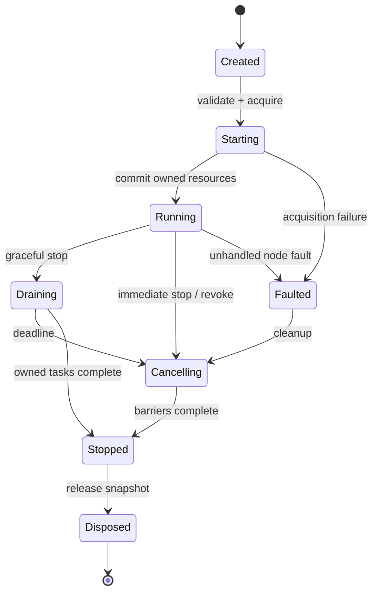
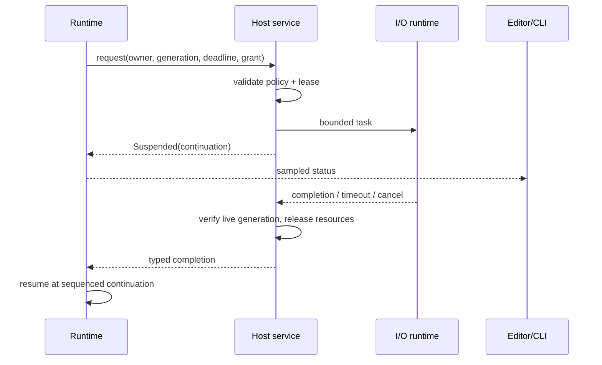

# Data, compilation and execution contracts

Current executable scope (2026-10-24): checked root data plus the bounded headless control/runtime subset in "E3 runtime prerequisites" below. Earlier named slice checkpoints retain their historical limitations; they are not statements that the later control runtime is absent. Fork/functions, general events/resources/services and full qualification remain open.

This is the proposed v1 contract baseline. JSON examples are documentation, not executed schemas. **Graph semantics are normative in [11](11-graph-language.md)** (node kinds, ports, types, conversions, regions, cycles, ordering, events, state) and **layouts are normative in [12](12-graph-data-structures.md)**. This document keeps the value policy, persistence, compiler pipeline and run lifecycle. On conflict, 11/12 govern and this document must be corrected. IDs use a constrained ASCII namespace (`org.orange.math/add-i64`) and immutable UUID instance/member IDs where user-created; examples shorten instance IDs to `n1`, `v1` for readability. Display labels may change without changing IDs. Definition version, configuration version, codec version, graph format, provider/package version and host API version are separate compatibility axes.

## Value and type model

| Type/condition | Contract |
|---|---|
| `core/bool@1`, `core/i32@1`, `core/i64@1`, `core/u32@1`, `core/u64@1`, `core/f32@1`, `core/f64@1` | Integers have checked arithmetic by default (`wrapping`/`saturating` are explicit config); overflow and division by zero fail. IEEE-754 f32/f64 are supported, but default finite math nodes reject non-finite inputs and results; explicit IEEE nodes expose NaN, infinity and their comparisons. Negative zero persists. Full catalog, including `duration`, `timestamp`, `map` and `result`: [11 §5.2](11-graph-language.md). |
| `core/string@1`, `core/bytes@1` | UTF-8 strings; byte buffers are not strings. Length/index nodes explicitly choose bytes, Unicode scalars or grapheme clusters; user-facing substring defaults to grapheme clusters. Invalid UTF-8 decode errors unless replacement is explicitly selected. No implicit normalization or locale collation. |
| `core/list@1<T>`, `core/map@1<K,V>`, schema `record`, schema `enum`, `core/option@1<T>` | Homogeneous list; insertion-ordered map with hashable non-float keys; stable field and variant IDs; an enum carries a tag ID plus its declared payload; Option carries Some/None. A missing record member differs from a present None. Unknown variants survive storage, but at run time they take the explicit switch fallback or fail. Editors may display short forms such as `list<T>`; documents use only canonical forms. |
| `core/json@1` | Dedicated JSON null exists only here; exact source-number text is retained where needed for loss detection. JSON number → i64/u64/f64 conversion is explicit and checked. |
| Resource reference | `ResourceHandle(kind, owner, generation)` in memory only. Saved config stores a re-resolvable asset/profile descriptor, never the live handle. |
| `NodeError` (`core/error@1`) | Separate outcome path (implicit `failed` exec output) with a stable namespaced code, node, activation, safe message and typed details. It becomes data only through `core/try` → `core/result@1<T>`. Never conflated with None, missing, JSON null, empty string or NaN. |

No implicit numeric widening, string parsing or bool/numeric conversions. Every conversion is a visible converter node from the registry in [11 §6](11-graph-language.md). Generic operations declare constrained type parameters and specialize at compile time ([11 §5.5](11-graph-language.md)). Ordinary f64 arithmetic uses IEEE-754 rounding (nearest, ties to even for standard basic operations) and does not emit an error for every inexact result. Math-domain/nonfinite policy and explicit conversion loss are distinct. Transcendental functions may vary in last bits across platform libraries; deterministic replay is scoped to the locked implementation/platform unless a reproducible kernel is explicitly selected. Explicit conversion nodes select exact/reject, truncate, floor, ceiling or round-to-even behavior and return loss metadata when a lossy conversion is requested. Formatting defaults to invariant locale, shortest round-trippable f64 and UTF-8; UI presentation may use the user locale under [13](13-internationalization.md), without altering values. Locale-aware graph parse/format/collation requires explicit node configuration and pinned locale-data/provider versions; it never reads UI or machine defaults. Parsing reports offset and expected format without exposing secret payloads.

Seeded random is a `volatile` (`entropy`) node that uses a recorded algorithm/version and run seed. Each draw comes from `stream(seed, node_id, activation_seq, invocation_in_activation)`. It is evaluated once per epoch, so two inputs of one action see one value ([11 §7.4–7.6](11-graph-language.md)). Deterministic execution order is required for replay. Default interactive seed is generated per run and recorded in run metadata. Cryptographic random is a separate host capability and never marketed as reproducible.

Internal values use small tagged inline scalars and immutable reference-counted buffers/strings/records for larger data. Clone shares immutable storage; mutation consumes ownership or uses copy-on-write. Lists of samples/bytes can use typed contiguous buffers. Host/guest transfers copy unless a specifically validated borrowed/buffer API applies; no general zero-copy promise across Wasm or worker boundaries. Custom codecs enforce depth/size/recursion budgets and return structured decode errors. Secret bytes are broker-owned, excluded from ordinary Value and inspection.

### First bundled scalar kernels (N1a)

`orange-bundled` publishes version-1/config-version-1 `org.orange.math/add`, `subtract`, `multiply`, `divide` and `not`. Numeric inputs are `a`, `b`; outputs are `sum`, `difference`, `product`, `quotient`, respectively. Not has `value: bool` and `result: bool`. They are pure computed-output definitions with no effects, suspension, clock, entropy or I/O. Generic numeric contracts remain replaceable, while the bundled provider explicitly lists only i32/i64/u32/u64/f32/f64 specializations. A package-owned `num` implementation never selects native scalar code.

Numeric config uses `orange.config-schema/v1`: `int_overflow` is checked/wrapping/saturating (default checked), and `float_policy` is finite/ieee (default finite). Missing values adopt these fixed execution defaults without rewriting saved config; unknown properties/values or wrong JSON types are rejected before execution. Integer policy applies only to integer kernels and float policy only to float kernels. Not accepts an empty config only. Integer division by zero is always `core/DivideByZero`; signed MIN/-1 reports `core/NumericOverflow` in checked mode, yields MIN in wrapping mode and MAX in saturating mode. Division truncates toward zero. Finite float kernels check non-finite inputs first (`core/NonFinite`), then a zero divisor (`core/DivideByZero`), then non-finite results (`core/NonFinite`). Explicit IEEE policy permits NaN/infinity and zero division under native f32/f64 semantics. Operations retain their selected precision and signed zero; no implicit widening occurs. Determinism remains scoped to the locked native implementation/platform.

The host authenticates the native build digest supplied to `MathPackage`; the library checks its canonical lowercase SHA-256 syntax, not executable authenticity. The provider is `org.orange.math`, package version equal to the crate version, ID `native-v1`. Resolver inputs include the exact locked ProviderKey and fresh type arguments; it rejects missing/different providers, versions and unsupported specializations rather than substituting bundled code. A resolved kernel retains an Arc to its registry snapshot across publication of later builds. Scalar evaluation has no registry lookups, string parsing or host calls. Wrong arity/value variants return a typed contract fault (`core/InternalFault`) without coercion or exposing inputs. This API executes individual scalar kernels only; graph validation evidence, plan publication, constant-error folding, lazy/control evaluation and run ownership remain separate responsibilities.

### Initial core converter execution (N1b)

`resolve_core_conversion(snapshot, config, provider)` binds only the existing registered Core implementation of `core/i32-to-i64`, `core/i64-to-i32`, `core/f32-to-f64` or `core/f64-to-f32`, contract version 1. It checks endpoint types/class and complete saved options against the snapshot. It never fills new-binding defaults or substitutes Core for a selected package provider. `ResolvedConversion` retains the Arc snapshot and entry; `evaluate` accepts one Value of the source type and returns `ConversionOutput { result, loss }` or a typed `ConversionError`. Graph/node version checks and fresh analysis remain caller responsibilities. No graph compilation or constant-folding evidence is produced.

The exact float range/NaN/rounding/loss rules are normative in [11 §6](11-graph-language.md). Loss metadata is always present on f64→f32 success, contains only `{"lost": boolean}` and compares original bits with exact widening of the output. It excludes raw values and is prebuilt as two shared immutable JSON Values at binding, so evaluation performs no JSON parsing, registry/name lookup or new buffer construction. Checked range failures use `core/OutOfRange`; wrong runtime Value variants use `core/InternalFault`. Integer/float widening and checked integer narrowing have no loss output. Conversions beyond these four, package execution, compiler lowering and reference graph evaluation remain separate work.

## Definition, graph, profile and package consistency

The definition example uses the bundled math provider. `port_id` and the implementation slot are stable contract IDs; labels are TextRef objects with namespaced catalogue keys and safe source fallback ([13](13-internationalization.md)). Pure nodes have no exec ports or service access. One generic definition with a constrained type parameter replaces per-type definitions such as `add-i64`. The full field list and async/iterator/entry examples are in [12 §4](12-graph-data-structures.md).

```json
{
  "definition_id": "org.orange.math/add",
  "definition_version": 1,
  "config_version": 1,
  "kind": "pure",
  "label": {"key": "org.orange.math/add-label", "fallback": "Add"},
  "type_params": [{"name": "T", "constraints": ["num"]}],
  "ports": [
    {"port_id": "a", "direction": "input", "kind": "data", "type": "$T", "label": {"key": "org.orange.math/add-port-a", "fallback": "A"}},
    {"port_id": "b", "direction": "input", "kind": "data", "type": "$T", "label": {"key": "org.orange.math/add-port-b", "fallback": "B"}},
    {"port_id": "sum", "direction": "output", "kind": "data", "type": "$T", "source": "computed", "label": {"key": "org.orange.math/add-port-sum", "fallback": "Sum"}}
  ],
  "config_schema": {
    "type": "object",
    "properties": {"int_overflow": {"enum": ["checked", "wrapping", "saturating"], "default": "checked"}, "float_policy": {"enum": ["finite", "ieee"], "default": "finite"}},
    "additionalProperties": false
  },
  "errors": ["core/NumericOverflow", "core/NonFinite"],
  "determinism": "deterministic",
  "cost": "scalar",
  "implementation_slot": "node:org.orange.math/add@1",
  "editor": {
    "category_id": "org.orange.math/category-math",
    "category": {"key": "org.orange.math/category-math", "fallback": "Math"},
    "control": "standard-node",
    "search_aliases": [{"key": "org.orange.math/add-alias-0", "fallback": "plus"}, {"key": "org.orange.math/add-alias-1", "fallback": "+"}, {"key": "org.orange.math/add-alias-2", "fallback": "sum"}]
  }
}
```

The saved graph uses explicit type tags. i64/u64 are decimal strings in JSON, so non-Rust readers cannot round large integers. f32/f64 values persist as canonical hex bit strings (`bits`), including negative zero and non-finite values; a decimal display field is optional and non-authoritative. The full literal table is [12 §6.1](12-graph-data-structures.md). Runtime codecs use compact binary representations. Every selected provider is locked, even if bundled. Only `core/` language intrinsics have no provider. Every non-intrinsic node references a signature snapshot, so a missing package still shows its ports. Resolved generic arguments are persisted in `type_args`. `exports` name the outputs that `evaluate`/preview can compute outside an activation. They replace the earlier `entrypoints` list, because activations now start from entry nodes ([11 §10](11-graph-language.md)). A complete example with variables, events, entries and edges is in [12 §6](12-graph-data-structures.md).

```json
{
  "format": "orange.graph",
  "format_version": 1,
  "graph_id": "5d1c7e8a-3b2f-4c11-9e0a-7f6d2b9c4a10",
  "revision": 1,
  "package_lock": [
    {"id": "org.orange.math", "version": "0.1.0", "content_digest": "sha256:1111111111111111111111111111111111111111111111111111111111111111"}
  ],
  "type_lock": [{"type": "core/i64@1", "codec": "orange.value.v1"}],
  "variables": [], "events": [],
  "signatures": {
    "s-add-i64": {"kind": "pure", "ports": [
      {"port_id": "a", "direction": "input", "kind": "data", "type": "core/i64@1"},
      {"port_id": "b", "direction": "input", "kind": "data", "type": "core/i64@1"},
      {"port_id": "sum", "direction": "output", "kind": "data", "type": "core/i64@1", "source": "computed"}
    ]}
  },
  "nodes": [
    {
      "id": "n1", "definition_id": "org.orange.math/add", "definition_version": 1,
      "config_version": 1, "config": {"int_overflow": "checked"}, "type_args": {"T": "core/i64@1"},
      "provider": {"package": "org.orange.math", "version": "0.1.0", "id": "native-checked"},
      "signature": "s-add-i64",
      "inputs": {"a": {"type": "core/i64@1", "value": "2"}, "b": {"type": "core/i64@1", "value": "3"}}
    }
  ],
  "edges": [], "functions": [],
  "exports": [{"id": "preview", "node": "n1", "port": "sum"}],
  "editor": {"nodes": {"n1": {"x": 0, "y": 0}}, "viewport": {"x": 0, "y": 0, "zoom": 1}}
}
```

Digests above and below are **synthetic format examples**, never installable artifacts or integrity evidence. Unknown JSON fields are preserved under a bounded opaque extension map; unknown major format is opened read-only, not rewritten. Missing providers/codecs preserve raw definition/config/payload/edges with an unresolved diagnostic. App has a basic decoder for the envelope even when custom codecs are absent. No arbitrary code runs simply because a document was opened.

Connection example is workspace-scoped. `options` schema is owned by `org.orange.websocket/profile@1`; the synthetic local device protocol is an application layer on that session, not an alternative transport. The broker applies the selected generic authentication policy without exporting the token to the plugin.

```json
{
  "format": "orange.connection", "format_version": 1,
  "id": "local-device", "scope": "workspace", "revision": 1,
  "adapter": {"id": "org.orange.websocket/client", "schema_version": 1},
  "endpoint": "ws://127.0.0.1:9001",
  "tls": {"mode": "not-applicable-loopback"},
  "auth": {"kind": "org.orange.auth/bearer@1", "credential_ref": "credential://user/local-device/token"},
  "options": {"connect_timeout_ms": 5000, "max_message_bytes": 1048576, "subprotocols": []},
  "retry": {"mode": "connect-only", "max_attempts": 5, "base_delay_ms": 250, "jitter": true}
}
```

WSS/HTTPS is the default for remote endpoints; plaintext loopback is an explicit profile choice suitable for a user-configured local device. A credential reference is an identifier, not permission or possession. Grants bind package identity, profile, operation and destination; importing this profile requires credential remapping. [04](04-expansion-plugins.md) defines a synthetic expansion manifest; neither example commits the product to a specialized integration.

Graph archive v1 contains `graph.json`, `package-lock.json` if externalized, and optional assets addressed by hashes; metadata remains readable without unpacking executable code. Initial implementation may use a directory bundle for development, with one validated archive transport for sharing. Reject traversal, symlinks/reparse redirects and decompression bombs. Save document plus lock into an immutable bundle generation and atomically replace a small current-generation manifest using a verified per-OS file primitive; never assume replacing populated directories is atomic. Embedded assets are optional, referenced files are not silently copied. Profile/credential storage stays outside the graph archive. [05](05-services-and-platforms.md) defines durability/recovery limits.

Type migration: pure, versioned transforms operate on a copy, preserve IDs and record source/target versions. Definition/config migration cannot perform network/file side effects beyond the controlled document write. Preview changes and diagnostics before committing a provider rebind. Unknown variants/fields are never silently dropped. A failed migration retains original bytes and lock. Maximum document/depth/asset limits are adjustable policy with explicit refusal errors, not an unchecked parser allocation.

Renaming display text does not change stable definition, port, field or variant IDs. Changing a stable ID requires an explicit migration under ADR-06/07; opening a document must not silently redirect its provider or rewrite its identities. The declarative mapping schema, collision/chain handling and migration commands remain to be specified and tested in WU-03 before SDK freeze. Existing migration policy is specified here; a working redirect or migration engine is not yet implemented.

## Compiler

1. Parse envelope with size/depth checks; resolve exact package/type/provider locks against a registry snapshot.
2. Validate schemas, signature snapshots, required inputs, the port connection matrix and cardinality ([11 §4](11-graph-language.md)), resource ownership and capability availability.
3. Check persisted `type_args` against constraints, and specialize generic types; reject implicit conversions and illegal data/exec/event connections ([11 §5–6](11-graph-language.md)).
4. Build regions and dominator trees, and check value availability. Classify cycles: the data dependency graph D must be acyclic, every control cycle must contain a `suspends: always` node, and the call graph must be acyclic ([11 §7–8](11-graph-language.md)). Feedback is legal only through registers, variables, zones, loop nodes or suspension points.
5. Assign compact node/port/value-slot indices, stability classes, memo bits, control blocks and continuation tables ([12 §9](12-graph-data-structures.md)). Resolve node names, types and dispatch once, outside execution.
6. Fold `const`-class values, eliminate unreachable pure work, cache or fuse eligible standard kernels, and prepare bounded pools. Never fold volatile (random/clock/state) or I/O nodes as pure, and never remove observable errors (a folded error is kept as a run-time error plus `W-CONST-ERROR`).
7. Produce an immutable plan, source map and resource requirements. Edits invalidate the affected region roots and dependent type/effect analysis; layout edits never recompile.

Compiler entry uses fresh semantic readiness (`is_ready_for_lowering()`); a completed plan additionally requires compiler-owned constant evaluation and error preservation. The model validator does not manufacture that proof, so its final compilation-readiness predicate remains false until that phase exists. Admission quotas and cooperative cancellation for semantic analysis are specified in [12 §3.2](12-graph-data-structures.md).

Pure data dependencies are pulled on demand from a consumption site (an exec node's input gathering, a loop condition, a Watch, an export or preview). Each consumption opens an epoch. State-read and clock volatile nodes are read in the epoch prologue, which gives one consistent snapshot. Memoization uses compile-time stability classes (`const` once per plan, `activation` once per activation, `epoch` once per epoch) held in bitsets, not keyed lookups, so the warm path neither hashes nor allocates (NFR-05). A pure error propagates to its consuming node, which takes its `failed` outcome with node provenance. Debug builds can retain intermediate values; production inspection is sampled and bounded.

Cheap operations dispatch as direct compiled kernel IDs or cached function-table indices; no hashmap lookup/name parsing per invocation. Eligible native pure regions execute in one batch; guest-provided regions can be packaged as one component call when contracts permit. The compiler does not fuse across effect, error-observation, resource or debug-break boundaries. Tiny guest nodes are measured separately: crossing a Wasm boundary per add/string character is not a performance strategy. Standard built-in scalar math remains native; a selected guest replacement may cost more, and must report that cost rather than silently invoke another provider. No claim of Rust-over-C# speedup is made.

## Control, effects, variables and events

Each action/async node has an implicit `in`, its outcome outs (default `then`), an implicit `failed` (with `error` data) and, for async, `cancelled`. Exactly one outcome fires per execution. Its data outputs are available only where that outcome dominates the consumer ([11 §7.2](11-graph-language.md)), so a node that did not execute can never supply a stale value. Reading an effect's output never reschedules it. A control token plus ActivationId executes the effect once locally; replay after process crash is not automatic. Remote systems may have committed work when cancellation/timeout occurs; return `OutcomeUnknown` when appropriate. Retry nodes require method-specific idempotency or a deduplication key.

Branches choose one path. Sequence runs its steps in order, and each step's region (including its awaits) completes before the next starts. Fork runs branches concurrently with `all`/`any`/`race`/`detach` joins. Enum switches handle the known cases plus unknown/default, or are exhaustive against a locked schema. Count, for-each, while and package iterator loops are structured regions with an explicit yield point per iteration. Loop-carried values use locals or registers; pure iteration uses zones. Break/continue target the innermost enclosing loop and never cross a function boundary. A while loop without a finite `max_iterations` is rejected for 1.0. A synchronous control cycle is rejected, while a cycle through a suspension point (for example Wait) is legal and cancellable ([11 §8](11-graph-language.md)). Default compute slice budget is proposed 1 ms or 1,024 operations, whichever occurs first; tune via NFR tests, not assumed timing guarantees. UI and cancellation work retain scheduling opportunity.

A variable declaration stores a stable ID, type, scope, initialization policy, persistence flag and conflict policy ([12 §3.1](12-graph-data-structures.md)). Names are display-only. Scopes: `local` (activation or function call), `run`, `workspace` (shared). An uninitialized read fails with `core/UninitializedVariable`; Option must be declared when absence is valid. `Get` and `Read` are UI aliases for the same `volatile` read operation. It is pulled in the prologue of each consuming epoch, so a Get feeding a later action sees writes already committed. `Set` replaces. `Update` performs an atomic add/min/max/bitwise/append/compare-and-set. Run and local writes commit immediately in the run actor, because only one segment runs at a time. Two Fork branches writing the same variable fail compilation unless both use the same commutative update or the variable declares last-writer-wins. Workspace reads use the latest published snapshot; workspace writes are async and serialized in the host, with read-your-writes after `then`. This gives per-operation atomicity, not cross-resource transactions or deterministic order between independent external runs ([11 §11](11-graph-language.md)).

Persistent variables checkpoint only on explicit command or clean stop policy; never store secrets in generic state. Runtime state is distinct from editor undo. Checkpoint restoration is opt-in at run start, validated against type/schema/package versions; no replay of prior effects. Host external writes enter the same sequenced command queue and are recorded in the run trace.

Events create activations through entry nodes. Reentrancy per entry is `queue` (default: serial FIFO by source-local sequence), `drop`, `replace` or bounded `parallel` ([11 §10](11-graph-language.md)). Custom events are declared per graph. Emit only enqueues, so a handler never runs inside the emitter. Event-chain loops are bounded by causal depth (proposed 64). No global ordering promise across unrelated remote sources; host assigns a monotonic ingestion sequence for inspection. Default event queue proposal: 256 events per subscription, 1 MiB aggregate metadata/payload references, with per-profile configurable bounds. Backpressure is used when the protocol permits it; otherwise user chooses drop-oldest, drop-newest, coalesce-latest or fault, with counters. Broker acknowledgement/flow control remains protocol-specific. Timer missed-tick policy is explicit skip/coalesce/catch-up-with-bound; default coalesce, monotonic clock.

## Run lifecycle and async continuation



Pause is **not supported in 1.0** as a whole-run semantic: network peers and audio devices cannot be globally frozen. Debug breakpoints suspend eligible graph continuations, while owned subscriptions still obey bounded queue policy. Restart creates a new RunId/generation and reinitializes resources; stale completions are rejected.

Start is staged: validate plan/capabilities → acquire leases → activate subscriptions → publish Running. Partial failure unwinds acquired resources in reverse order. Graceful stop rejects new triggers, stops subscriptions, drains already accepted activations for a configurable deadline (proposed 2 s), then cancels leftovers. Immediate stop cancels children immediately. Default listener/request/reconnect tasks are children of run/session owners and do not detach silently. Stop waits for task/handle barriers, not for a rendered frame. App shutdown also stops the Tokio runtime, package workers and audio engine. A blocked OS call may outlive its logical run on a bounded worker; its result is discarded and the outstanding condition reported, never falsely described as physically interrupted.



Cancellation propagates parent → child; completion races resolve once through the continuation state machine. A stopped owner cannot receive new callbacks. Handle generation prevents stale use even if indices are reused. Unhandled errors fault that activation by default; entrypoint policy decides whether run remains subscribed or terminates. Fatal host integrity failures terminate safely; ordinary errors are not evidence that native crashes are isolated.

Requirements: FR-04–16, FR-19, FR-34–38, FR-44–50. Test families V01/V02/V03/V05/V08 and the G-suite in [11 §18](11-graph-language.md). ADR-01/04/05/06/13–16 in [08](08-decisions.md).

### Implemented pure-export compiler slice (E1a)

compile_pure accepts a GraphDocument, Arc registry, unforgeable ValidationAnalysis, trusted resolver and CompileOptions. It rejects stale document state or registry generation before callbacks and requires is_ready_for_lowering. Every root node must be pure with eager, nonvariadic, nonoptional data ports, computed outputs and one of bool/i32/i64/u32/u64/f32/f64/JSON. Unsupported root semantics fail even without an export. Only export-reachable nodes bind and fold. Input selection is incoming edge, instance literal, then fresh descriptor default; shadowed literals are never decoded. Iterative DFS follows persisted export order and declared input order, visiting shared dependencies once. No recursive graph traversal or input-by-output dependency expansion is used in this lowering pass.

Each successful binding must declare exactly the fresh input/output port order. Fold outputs are type checked. The first input fault propagates without calling the dependent operation, retaining producer provenance. Each directly failing folded operation emits W-CONST-ERROR once. Pure dependency callbacks may still fold even when another input fault will determine the consumer result; callbacks must be deterministic and effect free. This is constant evaluation, not runtime pull scheduling.

Graph/port admission, slot and operation counts, retained constant-byte accounting and cooperative cancellation are configurable. Payload size is checked before scalar/JSON decoding; slots are counted before executable callbacks. Callback output bounds are checked after return. Trusted callbacks cannot be interrupted by this interface; these quotas do not bound callback CPU, allocations or process RSS. No guest code is called. Cancellation/failure discards the partial plan. Control, lazy/volatile/function execution, reference-evaluator equivalence and scheduler/memo epochs remain unimplemented.

Persistence versus execution (2026-10-23): the saved JSON envelope is decoded to GraphDocument before semantic analysis and lowering. PurePlan stores typed values and dense slot references; the saved document is not interpreted as JSON on each operation. The importer now decodes GraphDocument directly after its header/version check and removes only the reserved top-level format tag, preserving unknown extension order. JSON serialization still emits the same compact format-v1 bytes. The format evaluation in 10 found a modest raw decode/size benefit for named MessagePack and slower encoding on the measured fixture, so no binary document protocol is introduced. A future compiled-plan cache needs a separate versioned identity/rebinding contract after the plan ABI stabilizes; it cannot serialize native function objects or bypass provider validation.

### Independent pure reference checks (E2a, 2026-10-23)

The test oracle in orange-bundled/tests/support/reference.rs demand-evaluates original graph ports, scans incoming edges directly and memoizes by source NodeId. It does not read PurePlan, slot arrays, constant pools or compiler helpers and does not call native kernel/resolver code. Signed arithmetic uses i128 intermediates and unsigned arithmetic uses u128 intermediates, with explicit range/modulo/clamp policy handling, rather than the native kernels' primitive-width checked/wrapping/saturating operations. The oracle supports the four integer primitives, Add/Subtract/Multiply/Divide, bool Not and i32↔i64 conversion. It shares only fresh semantic analysis, immutable metadata and the canonical literal codec with the compiler path. Matching exported values and fault producer/code are compared with compiled constants; independent known answers remain required.

The oracle deliberately short-circuits later input demands after the first fault. The compiler may fold those effect-free dependencies; their extra work or warnings are not asserted equivalent. Reference sharing counters establish one execution per demanded node in an immutable evaluation instance, not runtime epoch/memo invalidation. The oracle is test-only, deliberately slow and limited to 64 dependency levels; generated DAGs contain 1–24 nodes. It is not a public evaluation service, scheduler or performance implementation. Float/JSON operations, lossy floating converters, control/lazy/volatile/function execution and production runtime equivalence remain outside this evidence. Saved graphs remain JSON, as confirmed by the user; the test oracle introduces no new persistence representation.

### Checked pure-export result views (E2b)

PurePlan::evaluate(document, current_registry, EvaluationOptions) now starts a privately constructed PureEvaluation. It checks document content identity, registry generation, max_exports and cancellation before returning the view. The result set is already fully folded by this restricted compiler: reads do not invoke kernels, decode JSON, resolve providers or allocate a frame/output buffer. This is a pure-export result API, not scheduled execution. Each indexed/ordered read checks the current cancellation signal; already returned immutable references remain valid. Cancellation is cooperative result access, not a terminal actor state or interruption of compilation callbacks. Missing indices return Ok(None), and graph faults remain typed outcomes rather than evaluation-entry failures.

The view borrows the plan, retaining its immutable snapshot and constants. Later graph edits or registry publication do not mutate a started view; starting another view with changed inputs fails freshness. Exact undo may restore the compiled content identity: source_revision remains the compile revision while document_revision records the evaluation entry revision. Export identity, static type, exported port source and original producer fault are exposed separately. No final runtime ABI, full ConstantEvaluation coverage or scheduler gate is implied.

E2c expands the test oracle to f32/f64 Add/Subtract/Multiply/Divide with finite/IEEE policy handling and both Core floating converters. Multi-output memoization now retains distinct result/loss values or the same original fault on each failed output. Converter NaN bits, signed zero, rounding/range and loss JSON are checked exactly; ordinary arithmetic NaNs are compared by classification, with finite values/infinities/signed zero compared exactly. The oracle still avoids native executables and compiler slots, but floating arithmetic uses the same Rust/platform primitives, so this is independent graph/policy coverage rather than a separate IEEE arithmetic implementation or cross-platform determinism proof. General JSON operations, control/state/lazy/functions and scheduling remain open.

### Constant lazy selection (E1/E2d, 2026-10-24)

The pure compiler now supports the existing host-owned core/select, core/and and core/or contracts. After fresh whole-graph semantic validation and potential-cone admission, an iterative demand stack folds the deciding input. Select then demands exactly if_true or if_false; And demands b only when a is true; Or demands b only when a is false. A deciding-input fault demands neither alternative. Selected producer outputs are memoized across consumers/exports, with the original fault identity preserved. Inactive cones perform no executable resolution, compiler literal decoding or kernel calls and produce no compiler constant-error warnings; a separate export can still demand that cone and observe its fault. Static validation still checks inactive authoring inputs/providers/types, and only the existing eight scalar/JSON plan types are accepted.

Preflight quotas intentionally count every producer/slot in the potential export cone before callbacks, including inactive alternatives. Structural admission traverses that cone, checks cycles defensively and releases its temporary traversal buffers before actual lowering. This is conservative admission, not a promise to charge only selected work. Cancellation is polled between demand tasks and before materialization/folding, including after a deciding callback. Callback CPU/allocations remain trusted and non-interruptible. A large inactive JSON literal consumes no compiler constant/decode budget, but remains subject to import and semantic-validation limits.

Language-owned lazy steps retain an ordered projection of only demanded input ports and a compiler-owned projection binding specialized to the immutable constant decision. They are not general runtime branch instructions; changes to the selector require a new plan. Public result reads still borrow fully folded values without executing callbacks. No package gains lazy authority or a generic callback with thunks. core/coalesce/core/try, Option/Result plan values, seeded entropy, volatile epochs, functions and control/actor scheduling remain separate work. This advances E1/E2's lazy acceptance without declaring E2 or E3/R1 complete.

### Constant options and Coalesce (E1/E2e)

Pure plans may retain core/option@1<T> recursively over the existing bool, six numeric and JSON leaves. Model codec/static-type rules remain authoritative: outer None is absent; a present leaf is unboxed; nested options box their inner layer. JSON null is a present JSON value. A Coalesce step demands value first, requests fallback only for outer None, and unwraps exactly one option layer on the present path. A fault is never treated as None. Shared producers still fold once and a separate export can demand an otherwise skipped fallback. Full source semantic validation and conservative potential-cone admission remain required.

This extends immutable constant specialization only. Result/Try capture, dynamic epochs, entropy and scheduled execution remain separate. Persistence stays format-v1 JSON. PlanType now owns recursive Option metadata and no longer implements Copy; EvaluatedExport.ty borrows that metadata from the plan. Downstream Rust code must borrow or explicitly clone PlanType instead of assuming Copy, and compare export.ty with a borrowed expected type. Result reads still allocate no type tree or execution frame.

### Constant Result capture (E1/E2f)

The restricted pure compiler implements core/try with its fresh host-owned value/result signature. It demands the value cone once, turns only a retained ConstantFault into Value::Err(NodeError { code, node: Some(original_producer) }), and leaves the original constant/fault, source map and warning intact. Direct or other consumers of that cone retain the fault. A successful inner Result is ordinary data, so an outer Try preserves Ok(Err) instead of recapturing it. Successful results stay unboxed except when their static payload can expose an Err tag; those use Value::Ok(Arc<Value>) per 12 section 7. Option absence, JSON null and errors stay distinct.

No backend resolution/ABI/output-shape error, malformed kernel-fault envelope, stale evidence, resource limit or cancellation becomes a Result value. Result/error still have no literal form; absent option<Result<T>> can be a valid option literal. PlanType accepts recursively composed Option/Result over existing leaves under the same total depth bound. Error data currently carries code and producer; complete activation/message/detail/cause envelopes remain the runtime/WU-03 contract. There is no scheduled execution, serialized plan ABI or JSON persistence change.

### Versioned entropy primitive (E2g1)

The current algorithm identifier is orange.entropy.sha256-counter@2; @1 lacked the frame field, had no persisted replay data and is not reproduced. For each block, hash the ASCII identifier followed by a zero byte, seed (u64 little-endian), frame ID (32 bytes), node UUID (16 network-order bytes), activation sequence (u64 little-endian), invocation-in-activation (u64 little-endian), and block index (u64 little-endian), in that order, using SHA-256. Split the digest into four successive little-endian u64 words. Block indices start at zero; the final u64::MAX block is readable once and further draws fail rather than wrap. This is deterministic graph entropy, not a credential/secret generator. Record algorithm/version and seed with future run replay metadata; no platform-native endianness, string formatting or global mutable RNG participates.

An immutable EntropyLayout binds private dense EntropySlots by node ID before consumption. ActivationEntropy owns counters for one seed/activation sequence. begin_epoch starts a consumption scope; sample memoizes one raw u64 per bound node per epoch. An undemanded node does not advance, and the first demand in a later epoch uses that node's next invocation. Generation stamps make begin_epoch constant-time without clearing the whole layout. Slots retain their original layout and are rejected by different layout owners. Epoch, invocation and stream counters fail on exhaustion; none reuse earlier identities.

Frame scope: FrameId names the call path of a graph frame. The root frame is 32 zero bytes. FrameId::call(call_site) is SHA-256 over the ASCII orange.entropy.frame@1, a zero byte, the caller frame's 32 bytes and the call-site node UUID, so the same body node reached through different call paths, or the same path in a different order, gets a different stream. ActivationEntropy keeps invocation counters per frame and node: invocation_key_in and sample_in take a frame, and the frame-less forms use the root. Callee frames get counters on first demand, up to the max_frames given at construction; one more is EntropyError::ResourceLimit before allocation or drawing. Root data activations pass zero because they have no callee frames.

These primitives are not graph semantic approval, a general activation actor, scheduled execution, provider binding or entropy-node lowering. The host must still assign unique activation sequences and open the correct graph consumption epochs. Seeded graph integration, full G-02 and E2 acceptance remain open.

### Fresh execution classification (N1/E2g2)

Host NodeDefinition now carries Option<Volatility> (StateRead/Clock/Entropy) and Determinism (Deterministic/Seeded/External/Nondeterministic). Only volatile definitions have a subclass; only host intrinsic registrations may declare StateRead or Clock. Entropy requires Seeded and pure requires Deterministic. Volatile definitions have no exec ports. State/clock readers have no data inputs, including input-bearing templates; Core Get uses typed state-read metadata. Package entropy may have data inputs.

These facts belong to the exact immutable registry generation, not graph signature/editor caches. Existing port-only NodeContract/signature projections do not acquire another persisted source of execution truth. Lowering must use the fresh definition or derive contextual function behavior from accepted bodies. Metadata declares provider obligations; it does not authenticate arbitrary code or prove conformance. No new provider callbacks, graph persistence fields or entropy evaluation are introduced by publication.

### Native entropy binding (N1/E2g3)

EntropySource exposes only next_u64; EntropyKernel evaluates typed input/output slices with that trusted host source; EntropyKernelResolver resolves a separate EntropyBinding after the caller checks fresh semantic evidence. It is separate from PureKernel and has no fold path. The host owns the algorithm, seed and node/activation/invocation scope. Callbacks remain trusted bounded host code; this interface is not a package boundary or CPU/OS sandbox.

MathPackage now registers random_u64_definition alongside math_definitions. org.orange.math/random-u64@1/config 1 has no data inputs, one computed value: u64, Volatility::Entropy and Determinism::Seeded. Configuration is empty; the seed is never a node config/global OS source. The native binder checks exact provider/digest/version, registry support/empty specialization, metadata class and semantic port projection. Presentation labels/groups do not affect binding, while changed semantic output types do. A resolved native binding retains its provider/snapshot. Bad arity draws nothing; source faults leave output unpublished. This is native execution support only: it supplies no general graph epoch/frame, activation sequence allocator, replay log or compiler execution approval.

### Checked root data plan (E1/E2g4b)

compile_data shares fresh semantic/whole-potential-cone admission with compile_pure, extending the admitted root vocabulary to registered Volatile::Entropy/Seeded definitions with supported computed data ports, and to single-output state reads (below). Clock reads, control and functions remain unsupported. Host intrinsics outside the implemented Select/And/Or/Coalesce/Try and explicit conversion vocabulary are rejected before generic callbacks; function calls cannot be smuggled through the ordinary pure resolver. Package ordinary pure/entropy callbacks still use their exact checked ABI.

DataPlan privately owns typed dense slots, source IDs, initial outcomes, ordered exports, constant diagnostics, resource requirements and its registry snapshot/content identity. DataNode stability is Const or Epoch in this root subset. Input references carry dense producer/slot indices; lazy instructions carry numeric operand choices. A compiler-owned constant folder folds proven constant islands once across roots and preserves original fault producers/warnings. It never executes entropy callbacks. Static selectors are folded before choosing dependencies, so inactive alternatives are not bound/folded/materialized. If the selector depends on an epoch, both possible arms remain in the plan; eligible constant islands in those possible arms may fold at compile time, retaining latent errors as outcomes rather than runtime effects.

Initial slot absence means a dynamic value awaiting execution, distinct from the language option None. A constant graph None is an initialized FoldedValue::Value(Value::None). The existing pure-plan borrowed API remains available; DataPlan provides no execution/frame by itself. Entry/pinning, epoch memoization and dynamic error/output publication are implemented by orange-runtime in the frame below; independent seeded root-graph equivalence is recorded under E2g4d. This does not publish a general control plan or global ConstantEvaluation readiness.

### Root data consumption frame (E2g4c)

DataActivation::start owns an Arc<DataPlan> after checking document/registry freshness and entry slot/node/export/work/value limits. It retains the source and entry revisions separately, including exact undo, and active frames consult neither later authoring edits nor later registry publications. The host supplies seed and activation sequence and explicitly calls begin_epoch for a consumption scope. export(index) pulls a root inside that scope; repeated pulls share memoized producers. Constants remain plan-folded. Epoch stamps avoid clearing all values; old-epoch values cannot satisfy a current pull but remain included in retained nominal charges until overwritten. Distinct activations own distinct counters; the host still assigns their sequences.

Execution uses dense input/producer/slot references and preallocated work/scratch storage. Native eager inputs are pulled in declaration order, stopping at the first fault. Select/And/Or/Coalesce demand only the selected arm, including present nested Some(None); Try captures only graph faults and preserves nested Ok(Err) through a static compiled boxing flag. Pure and entropy callbacks have distinct paths. Entropy invocation_key stays stable within an epoch regardless of stream word count. EntropyReplayMetadata records algorithm/version, seed and activation sequence; it is not a full plan/provider/ingestion/clock replay log.

Callbacks publish outputs only after all output types/fault envelopes and the whole node's replacement charge pass. A failing callback's unpublished scratch payloads are released; no partially written result escapes. Limits cover per-epoch operations, nominal retained values across epochs and per-node stream draws. A draw limit is the graph fault core/LimitExceeded; entry/operation/value limits and observed cancellation are infrastructure errors, abort the epoch and cannot be caught by Try. Observed in-stream cancellation stays infrastructure cancellation even if a callback clears the flag. A new explicit epoch can start after the host clears cancellation; terminal run-stop policy remains R1 work. Cancellation is cooperative before/after callbacks, work steps and stream draws, with no interruption/sandbox promise for trusted code. Live frame Debug prints state metadata, not value payloads.

The frame does not own control tokens, functions, variables, event queues, resources, clock/services or async completions. This is synchronous root data evaluation and does not satisfy the broader core checkpoint or actor lifecycle. Runtime source/byte checks and independent seeded graph equivalence remain scoped evidence rather than global compilation/release readiness.

E2g4d supplies source-graph versus DataActivation comparisons for the supported root-data vocabulary across explicit epochs. Reference traversal scans original edges and memoizes by UUID with independent invocation maps; it shares the versioned entropy stream primitive, metadata/literal codec and platform float operations, not compiled instructions, dense epoch scopes or native arithmetic callbacks. Production constants stay compiled once; the intentionally slow oracle may recompute them each epoch. Broader control/functions, actor sequence ownership and complete G-02 replay remain separate work.

Default compiled-plan and evaluation Debug summaries expose metadata/counts instead of graph value payloads, retained registry contents or downstream callback formatting. Kernel binding Debug reports port counts without invoking a kernel's Debug. Explicit typed value and registry inspection remains available to hosts, which own its authorization/redaction/bounds. Raw Value/GraphDocument Debug and arbitrary user formatters are not made safe logging APIs by this scoped change.

Review follow-up epoch boundary policy: cancellation observed by begin_epoch invalidates an already active consumption scope just as export does. Clearing the flag alone cannot resume reads, including missing-export probes; a successful explicit begin_epoch is required. A rejected initial start creates no epoch and consumes no entropy identity. Counter exhaustion on epoch start also prevents reads of the old cached scope.

Scoped entropy budget policy: the first host draw-budget/stream exhaustion is retained for that callback invocation. Callback success or a different callback fault cannot replace it; the node publishes the original host core/LimitExceeded graph fault, with producer identity, and Try may capture it. Cancellation observed during drawing still wins as an infrastructure error, including when a callback ignores the source error and clears the flag. A zero draw budget alone does not fault a callback that requests no draws. This enforcement controls available entropy, not arbitrary native CPU/allocations or preemption.

### E3 runtime prerequisites

Control retained-budget correction (2026-10-24): immutable variable initializers and data constants share `CompileLimits::max_constant_bytes`. Data lowering receives the remaining allowance, rather than a second independent full pool. Cheap graph-count admission precedes initializer decoding. This is a logical retained-value budget, not a process RSS bound.

Control reference qualification (2026-10-24): a test-only source interpreter scans saved control edges and uses lexical regions independently of ControlPlan, runtime cursors and native kernels. Ninety-six bounded generated nested control/state/Wait/seeded cases use proptest 1.12.0 with seed 20261024 and three work budgets. Known answers also cover original faults, loop limits, Error-as-data versus successful Try, snapshot interleaving and deep iterative regions. The source oracle shares validated model metadata, literal decoding and the externally anchored entropy stream primitive; it is not an independent language validator or cryptographic implementation. Segment inspection exposes written variable IDs once per segment; equality, notifications and Watch delivery remain R2b work.

Supported run lifecycle (2026-10-24): `Run::request_stop(Graceful)` releases reserved On Stop activations against the pinned plan, enters Draining once and rejects a repeated graceful request. It drains previously accepted work up to the configured virtual deadline. Immediate stop/fault does not fire On Stop; it retires owned timer identities and runs connected cancelled paths in bounded cleanup mode. Cleanup permits pure/volatile pulls, Branch/Sequence traversal and Set, but rejects new waits/loops and other unsafe operations with core/Cancelled. Cleanup has separate operation fuel and a virtual deadline no later than the remaining drain deadline; a second stop aborts it. Deadline overflow clamps cleanup to the end of the virtual clock range so cancellation remains possible. Cancel flags are observed once per rising signal; clearing a flag does not revive the stopped run. `last_error` records infrastructure failures, while graph faults retain consumer/source IDs in trace. Disposing a Stopped run releases its plan and cells. This qualifies only the supported headless owners, not general service/stream rollback or all R1/R3 families.

While execution (2026-10-24): each condition check opens a fresh consumption epoch. An initial false condition executes no body; a later false condition completes even after exactly max_iterations bodies. A true condition beyond that bound takes failed with core/LoopBudgetExceeded. The body cursor yields before the next condition, survives Wait, and shares the same innermost Break/Continue targeting as Count. Counters and fuel remain owned by the activation/run rather than reset by each resumed pull.

Count/terminator execution (2026-10-24): Count captures its i64 count once, rejects negative counts, and completes zero iterations without publishing an index. Each body instance has a bounded cursor and fresh i64 index; the next iteration yields and starts only after the body, including waits, completes. Break/Continue resolve their innermost loop from fresh region evidence and discard nested Sequence cursors. Break exits to completed; Continue advances that loop. The compiler still rejects Fork/functions, so no unsupported sibling/return semantics are implied.

Virtual time (2026-10-24): exact Wait/Yield now lower to host control operations. A Wait consumes signed nanoseconds; negative duration or unsigned monotonic deadline overflow takes failed with core/OutOfRange. Zero duration still suspends through the timer queue before then. Due waits are resumed by pump, in (deadline, insertion sequence) order, not inline by advance_to. Backwards time is rejected. Timers are bounded, run-owned and non-reused; cancellation/fault retires their frames. Sequence cursors survive suspension and advance after the resumed child ends. This supplies virtual R1 timing only, not native timers or R4 services.

Sequence execution (2026-10-24): the control compiler binds variadic steps in persisted `VariadicState.order`, including sparse/reordered instance IDs. An activation owns a bounded iterative region cursor stack. A step advances only after its child region ends; an unhandled child fault retires the remaining cursors. Empty steps complete without inventing work. Suspension preservation is qualified alongside Wait/Yield, not inferred from token traversal.

Local/run state execution (2026-10-24): the control plan resolves referenced variable declarations to dense cells and compiles initializers through the existing literal codec. Run cells initialize per run and local cells per activation. Get snapshots are frozen at consumption start even across data safe points; Set commits only after a successful complete pull. An uninitialized Get supplies a typed graph fault with the Get producer ID, so the consumer takes failed. `set_input_outcome` is the trusted host/control seam for such faults; a missing host input is still an infrastructure error. Workspace mutation, Update and checkpoint restore remain unsupported by this control compiler. State stores and data-frame retention have separate configurable byte budgets, not a process RSS guarantee.

Bounded scheduling prerequisite (2026-10-24): `DataActivation::poll_export` consumes a caller-owned work-item budget and returns Pending with its stack and epoch retained. A different producer cannot replace a suspended pull (`PullInProgress`); explicit `begin_epoch` abandons the old pull. The synchronous export API drains the same engine. `Run::pump` budgets both control instructions and iterative data work, retaining total run fuel. These are operation bounds, not native callback preemption or measured wall-time guarantees.

First control execution (2026-10-24): `orange-runtime::Run` starts a fresh checked control plan, retains its immutable snapshot and executes exact Entry/Branch outcomes through a host-driven pump. Bounded trace events contain source IDs/outcomes and safe fault provenance. Idle Running remains live until an explicit stop; disposal rejects further execution. Scheduled data safe points, state, structured regions and staged cleanup are subsequent slices, not established by this first executor.

Control lowering preparation (2026-10-24): the compiler now has a private admission/lowering seam for explicit demand roots on the original document. The existing public pure/data entry points retain whole-root admission and saved-export behavior. This internal refactor does not publish a control plan or permit execution of unsupported nodes.

Checked control plan (E3, 2026-10-24): `compile_control` admits exact registered `core/on-start`, `core/on-stop` and `core/branch` into a private-construction `ControlPlan`. Consumption roots retain the original document state, source ports, registry and providers without adding saved exports. Unsupported root controls fail before backend resolution. `PlanType` additionally represents Duration and Error; Error uses the existing typed `Value::Err` representation, distinct by static type from Result. Control execution and remaining families qualify separately.

Owned cancellation: DataOptions carries an optional CancelToken, a cloneable owned stop flag. A DataActivation keeps its own clone and borrows nothing from the host, so a future run actor can own it. cancel and clear change the shared flag; the epoch rules above are unchanged, and clearing still needs an explicit begin_epoch to resume reads. CancelToken::flag lends the same flag to synchronous borrowed APIs such as CompileOptions. It is a flat signal, not the proposed run cancellation tree.

Activation fuel: DataLimits::max_activation_operations (default 10,000,000) bounds the whole activation, alongside the per-epoch max_operations. Each begin_epoch and each node evaluation costs one unit; memoized pulls and constants are free. Fuel never refills. Exhaustion is the infrastructure error FuelExhausted (core/data-fuel-exhausted): Try cannot catch it, and it rejects the current scope and every later epoch start. Bare epoch starts also cost fuel, so a loop that opens one epoch per iteration still ends. fuel_remaining reports what is left.

Host input slots: DataOperation::Input is a node whose value the host or control plane supplies; the data plane never evaluates it. compile_data lowers fresh Volatility::StateRead definitions with exactly one State-sourced output (core/get-variable) to Input, while compile_pure still rejects them. DataPlan::host_inputs lists the Input nodes that some export may demand, in plan order. DataActivation::set_input(index, value) supplies one for the current epoch, at most once. A wrong index, a value of the wrong type or a second supply is InvalidInput, which changes nothing and leaves the epoch usable. A value over the retained-byte limit is ResourceLimit; like any rejected publication, its payload is released at once rather than kept in scratch storage. Pulling an Input not supplied this epoch is the infrastructure error MissingInput { node }, which aborts the epoch. Values never carry over between epochs, and inputs only in an inactive lazy arm need not be supplied. E3 control lowering is expected to reuse this slot for action, payload and iteration outputs; admission still rejects those sources today. The activation does not own or read a variable store: the host decides what each Get observes.

Control review corrections (2026-10-24): consumption snapshots include only potential host inputs of that consumer; publication into charged data slots happens only on actual demand, including lazy arms. Frozen references preserve one consumption snapshot across data safe points. Compiler projection metadata shares identical dependency slices and bounds newly stored projection entries by max_graph_items. Index/Error publication uses precomputed per-owner destinations. A pending Set retains scheduling ownership through internal data slices until commit/failure; no entropy replay or retry is used. Read-only pulls can still interleave, and explicit Yield/Wait releases ownership. The run polls cancellation at each control/timer safe point as well as the data engine's checkpoints, preserving rising-signal and second-stop behavior.

Shutdown reservation: RunLimits::max_stop_activations (default 256) bounds a separate On Stop capacity. Start admits and prepares these frames, their local initializers and ready-queue capacity before returning a live run. Preparation executes no nodes and draws no entropy. Graceful stop cannot fail merely because ordinary activation capacity is saturated; it releases the reserve exactly once. Immediate stop, fault and disposal release unused reserved frames. Existing virtual deadline/fuel limits still bound drain and cleanup. This adds an unfrozen public Rust limit field; embedding hosts constructing exhaustive RunLimits literals must supply it. No saved JSON/schema or dependency changes are needed.

Whole-codebase reuse (2026-10-24): execution preparation shares only immutable lookup/layout metadata and the retained initial nominal charge. Each activation still owns mutable slots, memos, seed/invocation counters, frozen consumption references, fuel and cancellation. Private dense ownership layouts remove local placeholders for run cells and execution-output placeholders for variable readers. A private explicit host-demand result keeps pump(1) progress, lazy demand, Set ownership and fault provenance intact. Existing public resolver and DataPoll contracts are preserved. Compilation combines output slot/producer bookkeeping and retains traversal storage across roots; it does not merge pure and entropy execution ABIs or change provider selection.
