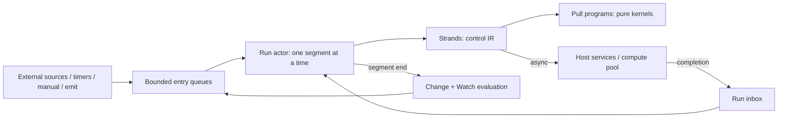
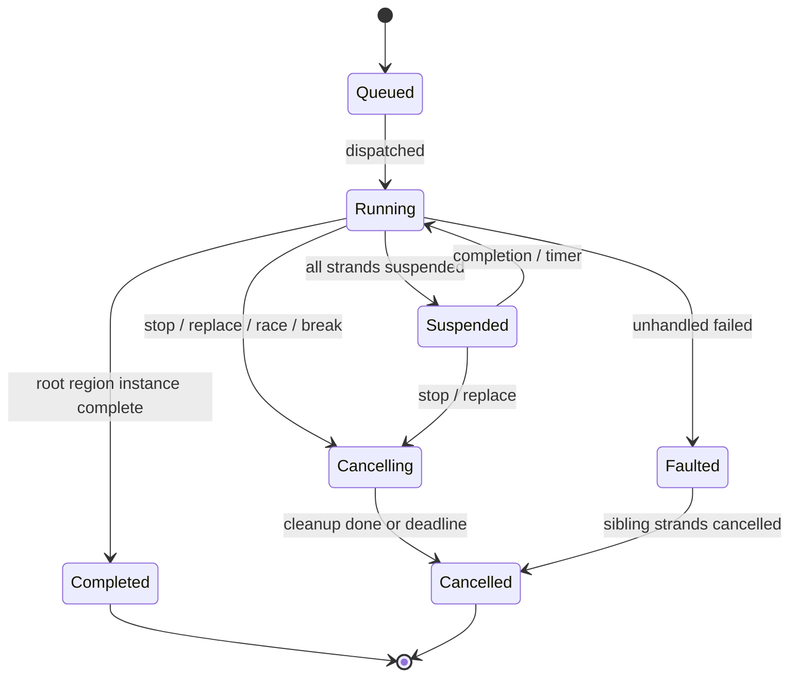

# Graph language and execution semantics

The C11a/C07a/C09a execution profile below records trusted effects, runtime Watch
and host pull streams; C08b/C09b amendments add direct resource values and graph
stream execution. Broader normative rules remain product gates.

## C11a/C07a/C09a executable profile (2026-11-06)

**Trusted effects.** The opt-in control compiler admits registered package Action
and Async leaves with strict required data inputs, execution-sourced data outputs
on `then`, and only the ordinary `in`/`then`/`failed`/`cancelled` control vocabulary.
The exact provider, config, fresh port order and executable context bind before
execution. Action invokes a bounded nonblocking trusted callback once per control
token; Async submits one inert command and parks that same strand. Merely reading
an output cannot resubmit work. An accepted typed success/fault resumes once on a
later pump. Input faults preserve their original producer and submit no command.
Effects in graph-local Action/Async functions retain scoped projections and region
ownership and require the existing fresh host leaf-effect evidence through
`analyze_with_effects`; registered kind alone is insufficient. Unsupported
subscription/custom-outcome forms fail closed; C08b below adds direct handles.
Cancellation retires the operation before running connected bounded `cancelled`
cleanup. These package leaves are not cleanup-safe in this profile. Host executors,
concrete services, replay and worker isolation remain
separate gates; a cancellation signal cannot undo a remote side effect.

**Runtime Watch.** `core/on-watch@1`, config version 1, is a generic host Entry with
required `watch: T` input and payload-sourced `value: T` output, requiring `eq` and
the ordinary saved activation policy. `config.mode` is required and is `changed` or
`rising`; no other config fields are accepted. Rising requires `T = core/bool@1`
(`E-TYPE-MISMATCH` otherwise). Changed compares under host-supported exact Eq;
rising fires only from false to true. The current compiler admits pure cones over
initialized, host-Eq run variables; entropy, clock, locals, register reads and
execution outputs in a watched cone remain refused. The cold baseline is computed
under pump fuel before ordinary strands and does not fire. A failed evaluation
suppresses delivery, preserves the previous successful baseline and exposes the
original producer through `Run::watch_fault`; the next success clears that fault.
The first successful sample is a baseline even after earlier faults.

At a semantic segment end, only Watches whose run-variable dependencies actually
changed are scheduled. Their resumable evaluation holds the post-segment state
stable before the next strand runs. Watch and On Variable Changed deliveries share
one saved `(order, node ID)` ordering, existing bounded handler admission and causal
depth plus one. Origin is `Watch`, target is `Watch(node)`, and source sequences count
admitted deliveries. A refused delivery/depth overflow is counted without faulting
the run. Previous-value cache and staged changes are charged; `watch_evaluations`
counts actual epochs and survives stop. Stop admits no further reactions. Pump
slices do not split a segment. This is runtime C07a; incremental effect-free
authoring preview and its A01/A02 locality qualification remain open.

**Pull streams.** C09a implements an embedding API for typed, run-owned producers,
not graph `stream<T>` values or the §12 node vocabulary. An opaque stream handle can
be claimed once; copying the handle grants no extra consumer. A demand obtains one
item/end/fault or one pending identity. Repeated reads of that pending identity do
not call the producer again. The host supplies one typed completion; duplicate,
foreign, retired and previous-demand completions are refused. Next pulls occur only
on consumer demand. Collection fixes `max_items` for its lifetime, is resumable under
an explicit read budget and returns the whole typed list or a failure, never a
partial list. It reads one extra item to detect exceeding an exact item bound.
Normal end, producer fault, collection refusal, explicit close, stop and run drop
close the producer once. Graph iterator/Break/Return ownership, graph next/collect,
tee, push bridges and concrete adapters remain later C09/C10 increments. The full
affine graph rules in §12 are unchanged and are not claimed implemented by C09a.

Status: **normative proposal for graph format v1**. The document model, type/inference work and partial validator passes exist; complete validation, compiler and runtime remain to be implemented and tested. Section 18 supplies reference scenarios for focused implementation tests. Structure layouts live in [12](12-graph-data-structures.md). On conflict, this document governs graph semantics, [12](12-graph-data-structures.md) governs data layout, and the other document is a defect that must be fixed in the same work unit. MUST, MUST NOT and SHOULD are normative.

**Layering (ADR-21).** §4–§6, §16 and §17 are the shared **substrate** that every execution domain uses: ports, types, conversions, extension surface and diagnostics. §1–§3 and §7–§15 define the built-in **`control` domain** (event activations, exec/data wires, async, structured loops), which a body uses when it declares no `domain` ([12 §3.1](12-graph-data-structures.md)). The core ships no other domain; crates that depend on the core may add domains, bridges and object models, each with its own semantics document. Combined validation currently accepts absence or exact `control` only. Other domain metadata remains preserved but reports `E-DOMAIN-UNSUPPORTED` before control-domain analysis; skipped nodes/functions receive `E-DOMAIN-ANALYSIS-BLOCKED`, and coverage records only the domain check. No control semantics are inferred for foreign domains.

Prior art such as Unreal Blueprints, Blender geometry-node zones, LabVIEW shift registers, Simulink unit delays and RxJS concurrency operators informed the problem list. It is not evidence that these rules perform or are usable. Known pitfalls this design rejects on purpose: pure nodes evaluated again for every consumer (different random values per pin); stale outputs read from nodes that did not execute; "sequence" that moves on while a latent step is still running; glitches in reactive diamonds; recursion with no bound.

## 1. Planes and principles

| Plane | Carries | Evaluation | Lifetime |
|---|---|---|---|
| Data | Immutable typed `Value`s | Lazy pull from a consumption site, memoized by stability class (§7.4) | Slot in an activation frame, or a plan constant |
| Control | Exec tokens with no value; one token per strand | Explicit push along exec edges; order is graph structure | Strand inside an activation |
| Event | `EventEnvelope` with a typed payload | Queued; each accepted event starts a new activation | Bounded queue entry |
| State | Variables, registers, node state (Do Once, Gate…) | Read by volatile nodes at epoch start; written only by actions | Activation, run or workspace scope |

- **P1** The document is the source of truth. A compiled plan is derived and disposable. Runtime state is never written into the document.
- **P2** Definitions, types, providers, ports, converters and constraint implementations are resolved before execution. Execution never looks up names.
- **P3** Effects happen only on the control plane. Reading a value never causes an effect or schedules one again ([03](03-data-and-execution.md)).
- **P4** There is no implicit conversion. Every conversion is a visible node (§6).
- **P5** Synchronous work is bounded per slice. Unbounded behaviour over time is allowed only across suspension points (§8).
- **P6** Given a plan, a seed, a recorded ingestion log and a virtual clock, a run's trace is reproducible for providers that declare `deterministic` (§7.6).
- **P7** Extension uses declared contracts: types, constraint implementations, converters, and pure/volatile/action/async/entry/iterator definitions. Control intrinsics, zones, port kinds and scheduling are owned by the language (§16).
- **P8** Cost is proportional to the change. An edit re-validates only the affected component. Warm execution of scalar values neither hashes nor allocates.

## 2. Execution model: hybrid, not exclusively synchronous or reactive

| Candidate | Strength | Why it is not the core model |
|---|---|---|
| Synchronous call-stack interpreter (node calls next) | Simple, debuggable | Blocks on I/O; long loops freeze the run; recursion depth; cannot wait for events |
| Push dataflow / FRP (every change propagates) | Natural for live values | Effect order undefined; diamond glitches and repeated computation; effects repeat when values propagate again; backpressure unclear |
| Task or future per node | Parallel | Scheduling cost per tiny node; nondeterministic order; locks on shared state |
| ECS system per node | Bevy-native | Coupled to frames; order follows system sets; violates ADR-01 |

**Selected (ADR-13):**

1. **Data is lazy pull**, synchronous inside a slice and memoized, so a diamond is evaluated once.
2. **Control is imperative and token-driven.** A strand follows exec edges. Order comes from structure, never from timing.
3. **Async is cooperative suspension.** An `async` node suspends its strand, and the completion resumes it later. Other strands, activations and the UI keep running. There is no OS thread per node.
4. **Events are push at activation granularity.** External sources, timers, manual triggers and custom emits enqueue envelopes. Each accepted envelope starts an activation.
5. **Reactivity is a layer.** Variable-change and Watch triggers are computed at segment boundaries (§9.2), so they are glitch-free. They are delivered as events. Live preview pulls pure outputs again incrementally (§15).
6. **Streams are pull-based async iterators** with natural backpressure. Push sources convert through explicit bounded buffers (§12).



## 3. Node kinds

A definition has exactly one `kind`. Ports inherited from a kind (§4.1) are implicit and MUST NOT be declared.

A `pure` definition MUST NOT declare a port of kind `exec`. Registry publication rejects this shape with a typed registration error identifying the definition and offending port. This rule checks definition metadata only; it does not discard malformed saved documents, and valid action outcomes and host-owned control intrinsics retain their exec ports.

Registry publication also checks suspension metadata against the declared kind: `async` and `iterator` definitions require `suspends: maybe` or `always`, while `pure`, `volatile`, `action` and `entry` definitions may omit `suspends` or declare `never`. Missing required metadata and incompatible values fail registration with typed errors. This check applies to declared and contextual-port definitions, including host intrinsics; passive saved signature snapshots remain loadable for repair and validation.

| Kind | Exec ports | Suspends | State / effects | Memo | Plugin may contribute | Examples |
|---|---|---|---|---|---|---|
| `pure` | none | never | none | stability class | yes | add, concat, parse JSON, format |
| `volatile` | none | never | reads state, clock or entropy | once per epoch | `entropy` subclass only | Get Variable, Now, Random (seeded) |
| `action` | `in`; outcome outs (default `then`); `failed` | never | may write state or perform a non-blocking effect | n/a | yes | Set Variable, Emit, Log, Register store |
| `async` | as action, plus `cancelled` | `maybe` or `always` (declared) | effects through host services | n/a | yes | HTTP request, read file, Wait |
| `entry` | `then` only; no exec input | n/a | starts activations | n/a | yes, through event-source contract | On Start, On Timer, On Event, keyboard, audio threshold |
| `iterator` | `in`, `body` (region), `completed`, `failed`, `cancelled` | `next` may suspend | open/next/close over a resource | n/a | yes | For Each Line, For Each Stream Item |
| `control` intrinsic | per intrinsic (§8.4) | Yield only | node state for Gate/Do Once/Flip Flop | n/a | **no** | Branch, Switch, Sequence, Fork, loops |
| `zone` intrinsic pair | none | never | none (pure loop) | per iteration | **no** | Repeat, Map, Fold, Filter |
| function call | from the function interface | derived from body | derived from body | per kind | yes (graph-implemented definitions) | `core/call`, package subgraphs |
| editor-only | none | — | — | never compiled | panels only | comment, frame, reroute waypoint (stored on edges) |

`volatile` subclasses: `state-read` (variables, register `current`, node-state outputs), `clock` (Now) and `entropy` (seeded random). `state-read` and `clock` nodes MUST have **no data inputs**; the state they read is chosen by config. They are evaluated in the epoch prologue (§7.4), so every read in one epoch sees one consistent snapshot. `entropy` nodes may have inputs and draw from the host's deterministic stream (§7.6). Plugin volatile definitions are limited to `entropy`. Reading external service state is an `async` action.

**Trusted control boundary.** Packages may contribute definitions within the kinds above, but cannot override control/zone intrinsics, function/cycle legality, or scheduler semantics (§16). Intrinsic status comes from the host's exact intrinsic registry, not a `core/` name prefix or package declaration. Nominal types and constrained nodes remain extensible through their owning type's declared constraints; this does not grant packages authority over control legality.

## 4. Ports

### 4.1 Descriptor

| Field | Rule |
|---|---|
| `port_id` | `[a-z][a-z0-9_]{0,63}`, unique per definition across all kinds. Reserved implicit IDs: `in`, `then`, `failed`, `error`, `cancelled`, `body`, `completed`. |
| `direction` / `kind` | `input`/`output` × `data`/`exec`/`event`. `event` is output-only; registry publication rejects event inputs. |
| `type` | Canonical type expression (§5.1) for data and event payloads; may use the definition's type parameters (`$T`). Exec ports have no type. |
| `source` (data outputs) | Required on every declared data output. `computed` (pure function of inputs), `execution` (written when the node executes), `state` (volatile read of node state), `payload` (entry/event payload), `iteration` (current loop item). |
| `available_on` | Only for execution-sourced data outputs: a nonempty list of distinct existing exec outcome outputs after which the value is defined. Publication rejects invalid placement, empty/duplicate lists and unknown or non-outcome references. Omission means `["then"]` and requires that outcome to exist; definitions replacing `then` with custom outcomes must name them explicitly. Implicit `error: core/error@1` is available on `failed`. |
| `default` | Data-input-only literal used when unconnected and the instance has no literal. Registry publication rejects defaults on output/exec/event ports. For a known concrete declared type, publication requires an exactly matching literal type and a canonical payload accepted by the current core codec and registered record/enum schema. Types without literal representations (including handle, stream, result and error) reject defaults. Generic, malformed and unresolved declared types defer this check until type resolution; publication does not certify their defaults. A `secret-ref` literal is only a reference, never secret material. |
| `optional` | True only on a data input whose type is exactly the `core/option@1<…>` constructor with one argument (including a declared type parameter). Registry publication checks placement and a well-formed outer wrapper; false or absent is inert. Malformed type syntax and inner name resolution remain type-validation responsibilities. An unconnected port with no literal or default receives `None`. |
| `variadic` | `{min, max}` with `max: null` unbounded and `min ≤ max` when finite; registry publication rejects inverted bounds with a typed error naming the definition, port and bounds. Instance ports are `port_id#k` (§4.5). |
| `lazy` | A true lazy flag is permitted only on host-registered intrinsics in v1 (`select`, `and`, `or`, `coalesce`, `try`). Missing or false means non-lazy; package definitions cannot select the host intrinsic registration path. |
| `group`, `label`, `description`, `editor` | Presentation only; `label`/`description` use TextRef ([13 §2](13-internationalization.md)); never semantic. |
| `sensitivity` | `normal` / `sensitive`; drives redaction in traces ([05](05-services-and-platforms.md)). |

Definition publication also checks kind/port compatibility: declared data outputs require `source`, event ports are output-only, true lazy ports require host intrinsic registration, and `pure` definitions cannot declare exec ports (§3). Other dynamic instance, region and execution checks remain validation/compiler responsibilities.

Implicit ports by kind: action/async/iterator/control get `in` (unless the intrinsic names its inputs), `failed` and `error`. Action/async/entry with no declared outcome outs get `then`. Async and iterator get `cancelled`. A definition with declared outcome outs (for example `acquired` and `busy`) replaces `then`. **Exactly one outcome out fires per execution.** `failed` and `cancelled` are outcomes too.

### 4.2 Connection matrix

| From → To | data in | exec in | Anything else |
|---|---|---|---|
| data out | OK if the types are identical after generic resolution (§5.5) | rejected `E-KIND-MISMATCH` | rejected |
| exec out | rejected | OK within the same region (§7.1) | rejected |
| event out | rejected | OK; the target starts a new event region | rejected |

Every "rejected" cell is `E-KIND-MISMATCH`. An edge that starts at an input or ends at an output is `E-PORT-DIRECTION`. Data types that are not identical after resolution are `E-TYPE-MISMATCH` (§5.5).

### 4.3 Cardinality

| Port | Edges | Reason |
|---|---|---|
| data input | ≤ 1 | One value source. Merging values needs `select`, a variable or a register. |
| data output | unlimited; **≤ 1 if the type is a stream** (affine, §12) | Fan-out shares an immutable value. |
| exec output | ≤ 1 | Order would otherwise be ambiguous. Use Sequence or Fork. |
| exec input | unlimited from the same region | Merge is OR: each arriving token executes the node once. |
| event output | ≤ 1 | One handler region per event port. Use Sequence/Fork inside it. |
| self edge | data: rejected unless §8 permits it; exec: an ordinary control cycle (§8) | |

### 4.4 Resolving input values

Order: connected edge → instance literal → definition default → `None` for an optional port → `E-INPUT-REQUIRED`. When an edge is connected, the instance literal stays in the document as **shadowed** and is ignored by the compiler. Disconnecting restores it. Literals exist only for types with a literal codec. Handles, streams, results and errors have none ([12 §6.1](12-graph-data-structures.md)).

### 4.5 Variadic and dynamic ports

- Active variadic counters must be unique and strictly below `next`; holes and reordered counters are valid. Duplicate counters or an inconsistent allocator report `E-VARIADIC-IDENTITY` on the node and base port and block lowering. Imports preserve malformed state for repair. Insert rejects inconsistent state atomically rather than allocating an existing identity. Exhaustion continues to fail without wrapping.
- A finite definition range includes both endpoints; `min == max` and `0..0` are valid, and `max: null` remains unbounded. Registry publication checks that `min` does not exceed a finite `max`. Validation checks each resolved variadic port against its node's persisted instance count (`order.len()`, absent state counts as zero), for input and output ports alike. Counts below `min` or above a finite `max` report `E-VARIADIC-COUNT` on the node and base port. Keys, next-counter values, connected edges and literals do not change the count. Unresolved nodes are skipped until metadata resolution succeeds.
- Variadic instance ports use stable keys `item#k`. `k` is a per-node counter that is never reused, so inserting an item in the middle does not rewrite edges. Order is the persisted instance order, not `k`.
- Ports that depend on config or type arguments (record split, gRPC method fields) come from a **declarative port template** that the host evaluates. No guest code runs to compute ports, which keeps the "opening a document executes nothing" rule ([03](03-data-and-execution.md)).
- Every non-intrinsic node persists a resolved **signature snapshot** ([12 §3](12-graph-data-structures.md)). A missing package still shows ports and edges. If re-resolution differs from the snapshot, it produces a diagnostic. Edges to vanished ports become **orphan edges**: preserved, displayed and not compiled. An edge is orphaned when its endpoint is not a port of the node: an undeclared port, a variadic instance missing from the node's variadic state, or a bare variadic base port. `DocIndex::orphan_edges` applies the same rule as `E-PORT-UNKNOWN`, given the node and its fresh resolved signature, so editors and the validator agree.

## 5. Types

### 5.1 Canonical type expressions

```text
type    = named [ "<" type { "," type } ">" ] | param
named   = namespace "/" name "@" major          ; core/i64@1, org.example/point@2
param   = "$" ident                              ; only inside definitions
namespace = ident { "." ident }   name = ident { "-" ident }   major = 1*DIGIT
```

The editor displays short forms (`list<string>`). Persisted documents and wire contracts use only the canonical form. A type lock records `named` without parameters, plus codec version. Editing never drops or replaces a lock implicitly: copy/paste carries locks to the target, and a different codec for a locked type needs an explicit lock change ([12 §3.3](12-graph-data-structures.md)). Installing package metadata alone never supplies a missing decoder.

### 5.2 Core types (format v1)

| Type | Notes |
|---|---|
| `core/bool@1` | |
| `core/i32@1`, `core/i64@1`, `core/u32@1`, `core/u64@1` | Two's complement; protobuf `int32/sint32/sfixed32` map to i32 losslessly, unsigned to u32/u64 |
| `core/f32@1`, `core/f64@1` | IEEE-754 binary32/binary64; audio samples and protobuf `float` need f32 |
| `core/string@1`, `core/bytes@1` | Per [03](03-data-and-execution.md) Unicode and byte rules |
| `core/duration@1` | Signed nanoseconds in i64; timers and deadlines |
| `core/timestamp@1` | UTC nanoseconds since Unix epoch in i64. Wall-clock data, never used for scheduling. Monotonic instants are runtime-only and never values. |
| `core/list@1<T>` | Homogeneous, immutable, indexable |
| `core/map@1<K,V>` | Insertion-ordered; `K` must implement `hash` + `eq` and must not be a float |
| `core/option@1<T>` | `None` or `Some(T)` |
| `core/result@1<T>` | `Ok(T)` or `Err(core/error@1)`; produced only by `core/try` and by nodes that explicitly return it |
| `core/error@1` | Structured `NodeError` value (§13) |
| `core/json@1` | Per [03](03-data-and-execution.md), including JSON null and exact number text |
| `core/stream@1<T>` | Affine handle (§12) |
| `core/secret-ref@1` | Credential reference; no conversion to string; never a literal secret |
| `core/handle@1<K>` | Opaque generation-checked resource of kind `K` (a handle-kind type such as `org.orange.websocket/session@1`) |
| records / enums | Nominal, schema-defined by a package; stable field and variant IDs ([12 §5](12-graph-data-structures.md)) |

i8/i16/u8/u16, decimals and tuples are excluded from v1. Use i32/u32 with checked conversions, `bytes`, a package type, or records. There is **no `any` type**. Nodes that accept "anything" (Log, Format) use a type parameter with a constraint.

Core map equality compares the same typed key/value bindings independently of insertion order. Iteration and serialization retain insertion order. Thus equal maps may have different iteration order; raw Value structural identity is separate from language equality. Native map keys in the current checked executor are bool, i32/i64/u32/u64, string and bytes, with exact Core Hash/Eq semantics. A package enum also keys executable maps when its `eq` and `hash` are both declared structural derives (§5.4) and every payload is such a key: two keys are then equal exactly when their tags and payloads are, so storage and lookup run no package code. Package-implemented equality/hash still requires its own executable contract.

### 5.3 Versions and identity

Types are **nominal**: two packages' `point` records are different types even with identical fields. The major version is part of the identity. Compatible minor changes are codec-level additions only: new optional fields, or new enum variants under the unknown-variant rule in [03](03-data-and-execution.md). A breaking change requires a new major version plus a migration.

### 5.4 Constraints

| Constraint | Meaning | Core implementers |
|---|---|---|
| `eq` | Total equality used by Switch, map keys, change detection | all except f32/f64 (IEEE `==` is a separate node), handles, streams |
| `ord` | Total order | integers, bool, string (code point order), duration, timestamp; floats only through explicit `total-order` nodes |
| `hash` | Stable hash consistent with `eq` | integers, bool, string, bytes, enums with hashable payloads |
| `num` | Arithmetic family | i32, i64, u32, u64, f32, f64, duration (add/sub only) |
| `int` / `float` | Narrower `num` | integers / f32, f64 |
| `display` | Invariant-locale text formatting | all literal-codec types |
| `serialize` | Persistable codec (variables, checkpoints, JSON) | all except handle, stream, error-with-sensitive details |
| `default` | Has a zero value | scalars, string, bytes, list, map, option |

A package type declares which constraints it implements by supplying a **constraint implementation** (kernels for the constraint's operations). Coherence rule: only the package that owns the type may implement a core constraint for it. A package may implement its own constraint for a foreign type. Conflicts are therefore impossible, not resolved at run time.

Package constraints have a canonical `namespace/name@major` identity distinct from the core constraint names. Registration records an exact provider binding, package content digest and implementation ID for one concrete type/constraint (or numeric-operation) slot. A declared structural derive occupies that same constraint slot; neither registration order nor an explicit implementation may overwrite it. Core type implementations remain language-owned. Capability queries return the selected reference as proof metadata, without loading package code; package identity/authentication and executable conformance are host/SDK work.

Aggregate `eq` requires the contained types to implement `eq`; wrapping a float in a list/option/result/map does not supply total equality. `display` requires a literal codec for every contained value. `serialize` is separate from literal availability: a type-level capability permits a checked serializer, and never proves that a particular error value's sensitive details have been redacted. Empty list/map and `None` defaults do not require a default for their contained types. Rust's structural `Value::Eq/Hash` is not evidence of these language constraints. A public evaluator of `eq` (the bundled `equal`/`not-equal` binding) validates both complete inputs against the bound shape before it compares, so equality never short-circuits past an invalid value and reports `InputContract` instead of a semantic answer (2026-11-05); ordering is scalar and has no such shortcut.

The initial host supports explicit package structural derives for `eq`, `hash`, `display` and `serialize`, checking every field/payload before registry publication. Other derives report unsupported capability; packages may supply explicit implementations instead. The host does not invent a default enum variant or ordering rule. Recursive nominal schemas remain legal, but a cyclic or over-budget automatic derivation has no supported proof and requires an explicit implementation. Constraint-family membership is separate from operation support: `duration: num` supplies add/subtract, not multiply/divide. Capability queries prove declarations only. Equality and order nodes exist: the bundled `org.orange.math/equal` and `not-equal` (`T: eq`) and `less`, `less-or-equal`, `greater` and `greater-or-equal` (`T: ord`), listed in [12 §4.1](12-graph-data-structures.md). They execute the host-owned subset only: Core orders for integers, bool (false before true), string (code point), duration and timestamp; native Core equality of bool, integers, string, bytes, duration, timestamp and option/list/map of them (maps independent of insertion order); and equality of package records and enums whose `eq` is a declared structural derive (equal field presence or tags, then equal members). A type that validation accepts but this subset lacks, such as `list<json>`, a record or enum whose `eq` is a package implementation (also nested inside a derive), `ord` on a package type or json/error/result, is refused at compile time with `KernelUnsupportedType`. Package-implemented constraint kernels, `hash`/`display`/`serialize`/`default` kernels, float total order and value-level serialization checks are later work.

### 5.5 Generics and inference

- Type parameters are declared per definition with constraints (`{"name": "T", "constraints": ["num"]}`). There are no higher-kinded parameters, no subtyping and no variance.
- Inference unifies type expressions over the **connected component** of generic nodes touched by an edit. It visits nodes in stable `NodeId` order, so the result is deterministic. Literals carry explicit types.
- Resolved type arguments are **persisted** on the instance (`type_args`). Loading never depends on re-running the solver. Type-only call-site authoring (§14) persists arguments without manufacturing a call signature. An edit re-infers only the affected component, and the inferred `type_args` and the signature projected from them are committed in the same transaction as the edit. An ambiguous or conflicting component is still saved, with no `type_args` for the affected parameters and `$name` kept in its signature.
- An explicit choice is a **pin**, persisted in `type_pins` and kept until the user removes it. `type_args` holds the resolved value of every parameter, pinned or inferred, and is a cache: inference seeds from pins, typed literals on generic ports, edges and the concrete port types of non-generic neighbours, never from persisted `type_args`, so disconnecting and reconnecting cannot reuse a stale binding. Constraints and listed specializations are checked after solving.
- Unresolved parameter → `E-TYPE-AMBIGUOUS`, and it gets no `type_args` entry; the signature snapshot keeps `$name` for it. The user pins it in the inspector. Conflict → `E-TYPE-MISMATCH` with converter suggestions. Inference never inserts conversions. A new connection whose inference reports a conflict (`E-TYPE-MISMATCH`, `E-CONSTRAINT-UNSATISFIED`, `E-NO-SPECIALIZATION` or `E-TYPE-COMPLEXITY`) is refused, unless the components it joins already reported one: a conflicting document, for example an imported one, can still be edited and repaired. Other edits, such as a disconnect or unpin, are never refused for their inference result.
- Ordinary generic nodes inside function bodies are inferred like the root: an edit inside a body, or a replaced body, re-infers the touched components there. Declaration-level function parameters form one universal scheme shared by its entry and all returns/outputs; body conformance must not independently instantiate each marker. Conformance validates it read-only: the function's own `$T` are rigid within its body (opaque constants equal only to themselves, constraints only as declared and matched exactly; a bare `$T` output may be a stream so it fans out at most once; a compound type over `$T` never satisfies a constraint; map keys and handle kinds over `$T` are rejected) and a call site instantiates them independently. Each call site, in contrast, instantiates that scheme independently in its own node scope.
- A declaration add, type/scope change, or removal also re-infers generic components that consume it through definition-declared typed references. Discovery uses the before and after document, including function bodies; arbitrary config strings are not searched. A removed declaration supplies no contextual port contract. Its dependent components are solved from remaining current evidence, never cached `type_args`; without enough evidence they become `E-TYPE-AMBIGUOUS` with `$name` in the signature. Explicit `type_pins` remain authoritative and can produce the ordinary conflict diagnostic. The declaration edit and derived updates commit as one transaction.
- A disconnect/connect that reuses an edge ID re-infers the components at both its old and new endpoints; a net `changed` edge is not an unchanged inference input.
- Exhausting an analysis resource budget produces `E-TYPE-COMPLEXITY`, with the relevant node/parameter context and limit. It does not fall back to a numeric type or report a semantic mismatch. Provisional implementation budgets are recorded in [10](10-tooling-and-sources.md); a resource failure does not redefine the valid type grammar.
- A generic provider MUST list its supported specializations, or delegate to constraint implementations. The list belongs to the exact provider (binding plus the locked content digest), so two providers of one definition may support different arguments. A missing specialization is `E-NO-SPECIALIZATION` at compile time, never a run-time lookup.
- Numeric authoring presents Float with Single (`core/f32@1`) and Double (`core/f64@1`) precision, alongside integer math (ADR-20). New untyped numbers default to Double; a resolved port or explicit type selection takes precedence. Integer text parses directly as the selected integer type, without a floating intermediate. Saved type identities and visible precision conversions remain governed by §5–6.

### 5.6 Numeric additions to [03](03-data-and-execution.md)

Integer arithmetic config: `int_overflow` = `checked` (default) / `wrapping` / `saturating`. Integer division truncates toward zero. `rem` takes the dividend's sign, and Euclidean `mod` is a separate node. Shifts by ≥ the bit width fail in checked mode. i32/u32 follow the i64 rules. f32 follows the f64 rules and persists as 8-hex-digit `bits`. Mixed-width arithmetic is never implicit.

For the bundled scalar arithmetic, integer zero divisors fail in every overflow mode. Signed MIN/-1 follows the selected overflow policy: error in checked mode, MIN in wrapping mode, MAX in saturating mode. Finite floating arithmetic checks non-finite operands before zero division, then checks the result; explicit `float_policy: ieee` admits native NaN/infinity and division by zero. The stable errors are `core/NonFinite`, `core/DivideByZero` and `core/NumericOverflow`. Precision, signed zero and exact provider choice remain semantic inputs; this kernel implementation does not certify compiler constant folding (03, N1a).

L02a integer vocabulary (2026-11-08): [12 §4.2](12-graph-data-structures.md)
lists thirteen ordinary pure math definitions, with `T: int` and exact native
i32/i64/u32/u64 specializations. They have strict ordered inputs and no coercion.
`remainder` uses truncating division's remainder (the dividend's sign);
`modulo` is Euclidean, with `0 <= result < abs(divisor)` even for negative divisors.
Both reject zero with `core/DivideByZero`. Signed MIN with divisor -1 yields zero
for both: the remainder is representable, independently of quotient overflow.
Neither node accepts overflow config. These rules do not change Divide's MIN/-1 rule.

`negate` and `absolute` accept only `int_overflow` checked(default)/wrapping/saturating.
Signed MIN faults, remains MIN, or becomes MAX respectively. Unsigned Negate is
zero minus value under that policy; unsigned Absolute is identity. `minimum` and
`maximum` return the numeric bound. `clamp(value,min,max)` includes both bounds;
min > max faults with `core/Domain`, without invoking a panicking native clamp.
Bit And/Or/Xor/Not operate on exact-width two's-complement bits.

Shift `count` is always `core/u32@1`, independent of T. Left shift discards high
bits; signed right shift extends the sign, unsigned right shift inserts zeros.
Only checked(default) and wrapping `int_overflow` are supported: checked count
>= bit width faults with `core/OutOfRange`, wrapping uses count modulo width.
Checked shift does not promise preservation of high value bits. Saturating shift
config is rejected, rather than inventing a saturation rule. All other new nodes
have empty config. Kernel errors carry safe static text and no operand values.

L02b float vocabulary (2026-11-08): [12 §4.3](12-graph-data-structures.md)
lists sixteen ordinary pure math definitions with `T: float` and exact native
f32/f64 specializations. Every input and `result` is `$T`; inputs are strict.
Operations that L02a already names for integers use a `float-` prefix
(`float-negate`, `float-absolute`, `float-minimum`, `float-maximum`,
`float-clamp`, `float-remainder`): their NaN and signed-zero rules differ, so
they are separate contracts instead of a widening of the `T: int` definitions.

Every node accepts only `float_policy`: `finite` (default) or `ieee`. Under
`finite`, checks run in IEEE exception order: a non-finite input is
`core/NonFinite`; a pole is `core/DivideByZero` (log of ±0, power of ±0 with a
negative exponent, remainder by ±0); an invalid operand is `core/Domain` (square
root or log of a negative number, power of a negative base with a non-integer
exponent); then a non-finite result (overflow) is `core/NonFinite`. Underflow to
zero or a subnormal is a normal result. Under `ieee`, the native IEEE-754 result
is returned, including NaN and infinities.

`floor`, `ceiling`, `truncate` and `round-ties-even` round to an integral
value of the same type and keep the sign of zero. Negate and absolute act on the
sign bit only, so NaN payloads are unchanged. `float-remainder` is the exact
truncated remainder: it has the dividend's sign and a magnitude below the divisor.
`float-minimum`/`float-maximum` follow IEEE 754-2019 minimum/maximum: NaN
propagates (the first NaN operand) and -0 orders below +0.
`float-clamp(value,min,max)` is maximum(minimum(value,max),min); a NaN bound or
min > max is `core/Domain` under both policies, so the native panicking clamp
is never reached. A NaN value propagates under `ieee`.

Square root, rounding, negate, absolute, minimum, maximum, clamp and remainder are
exact IEEE operations. Exponential, the logarithms and power use the platform
library: last-bit results may differ between platforms, and replay determinism is
scoped to the locked implementation and platform ([03](03-data-and-execution.md)).
The remaining casts are a later L02 increment.

L02c trigonometry, float predicates and XOR (2026-11-08): seventeen more `T: float`
definitions join [12 §4.3](12-graph-data-structures.md). `sine`, `cosine`,
`tangent`, `arcsine`, `arccosine`, `arctangent` and `arctangent2(y, x)` work in
radians, return `$T` and take `float_policy`. Under `finite`, non-finite inputs
fault first; `arcsine`/`arccosine` outside [-1, 1] is `core/Domain`. Inverse
results lie in the principal ranges, and `arctangent2` follows the IEEE signed-zero
quadrant rules (atan2(±0, -x) is ±π; atan2(±0, +0) is ±0). They use the platform
library, so last-bit results are platform-scoped like the logarithms.

Ten predicates return `core/bool@1`, have empty config and never fault: they
answer for NaN and infinities. `float-equal`, `float-not-equal`, `float-less`,
`float-less-or-equal`, `float-greater` and `float-greater-or-equal` are the IEEE
comparisons: NaN is unordered (every comparison is false except not-equal) and
-0 equals +0. `total-order-less` is IEEE 754 totalOrder: -NaN < -∞ < … < -0 < +0 <
… < +∞ < +NaN, with NaNs of one sign ordered by payload; it is a strict total order
on bit patterns. `is-nan`, `is-finite` and `is-infinite` classify one value. These
are the explicit float comparison nodes §5.4 refers to; f32/f64 still implement no
Core `eq`/`ord`, so Switch, map keys and generic `equal`/`less` still refuse floats.

`org.orange.math/xor` is an ordinary eager Pure definition: `a`, `b`, `result`, all
`core/bool@1`, no type parameters, empty config. Unlike the lazy `core/and`/`core/or`
intrinsics, both operands are always evaluated, since both decide the result.

### 5.7 Text vocabulary (L03b, 2026-11-08)

[12 §4.4](12-graph-data-structures.md) lists sixteen ordinary pure `org.orange.text`
definitions. Strings are UTF-8 `core/string@1` values; inputs are strict and nothing
reads a machine or UI locale.

- **Units.** `byte-length` counts UTF-8 bytes and `scalar-length` Unicode scalar
  values. `find` and `substring` take `unit`: `scalar` (default) or `byte`.
  Grapheme clusters are not a unit yet: a base letter plus a combining mark is two
  scalars. `find` returns the first match's index in the chosen unit, or None; an
  empty pattern is found at 0. `substring(text, start, length)` faults with
  `core/OutOfRange` when `start + length` passes the end (or overflows), and with
  `core/Domain` when a byte index falls inside a scalar. Indexes are `u64`.
- **Search and edit.** `contains`, `starts-with` and `ends-with` compare scalar
  sequences exactly, with no normalization; an empty pattern always matches.
  `replace` replaces every non-overlapping match left to right; an empty pattern is
  `core/Domain`. `split` returns every piece, empty ones included (`""` gives
  `[""]`); an empty separator is `core/Domain`. `join` inserts the separator
  between items of a `list<string>`.
- **Unicode rules.** `trim`, `trim-start` and `trim-end` remove Unicode White_Space.
  `to-uppercase`/`to-lowercase` use Unicode default full case mapping (`ß` → `SS`,
  final sigma), never a locale's tailoring (no Turkish dotless i). The Unicode data
  version is the toolchain's `char::UNICODE_VERSION`, so it is part of the locked
  build like other provider code.
- **Size limit.** A result longer than 16 MiB of UTF-8 (`MAX_TEXT_BYTES`) faults
  with `core/LimitExceeded` before it is built. Work is linear in input and output.

## 6. Conversions

1. The compiler never converts. Every conversion is a `core/convert` node that names a **converter registry entry**.
2. Entry fields: `from`, `to`, `class`, provider, policy options. Classes:
   - `lossless-total`: always succeeds without loss. Examples: i32→i64, u32→i64/u64, i32/u32→f64, f32→f64, T→`option<T>`, `display` T→string.
   - `checked-partial`: may fail. Examples: i64→i32 (`core/OutOfRange`), string→i64 (`core/Parse`), json→T, `option<T>`→T (`core/NoneValue`), f64→i64 with rounding mode.
   - `lossy`: may lose information under a declared policy and returns loss metadata. Examples: f64→f32, i64→f64 above 2^53, string→bytes with replacement.
3. **Editor auto-insert:** when an incompatible wire is dropped and exactly one `lossless-total` entry exists for the pair, the editor inserts a visible converter node in the same undoable transaction. If only partial or lossy entries exist, the editor shows a choice and never picks one. Chained conversions are never auto-inserted. With no entry, the connection is rejected with a diagnostic.
4. Ownership: a package may register converters only when it owns `from` or `to`. A competing provider for an existing pair uses override slot `convert:<from>-><to>` ([04](04-expansion-plugins.md)) with the same explicit-rebind rule as other providers.

Entry identity is a stable converter ID plus contract version. Multiple implementations of that same entry are provider alternatives, not additional semantic conversions. Count distinct semantic entries when applying rule 3: a unique lossless-total entry is eligible even when partial/lossy entries also exist, but its exact provider must resolve unambiguously from an explicit new-binding default, sole implementation or user choice. No default is inferred from installation order. Defaults are scoped to the entry contract within the pair slot; existing bindings remain pinned.

The converter node itself is persisted as specified in [12 §5](12-graph-data-structures.md): it names the entry key, the exact provider and the resolved policy choices, and its ports are `value` in, `result` out and, for lossy entries, `loss`. A connection plan fixes the node and edge identities once, and records the document content state and the immutable registry snapshot (which fixes the available providers and generic definitions) it was made against; applying it rechecks both, so a stale plan is rejected instead of re-resolved. Inserting a converter reuses the wire's existing data-input replacement rule (§4.3): the old edge is removed in the same transaction. Shadowed literals stay in the document.

`core/convert` is an exact host-owned registry special form, not an ordinary language intrinsic or package definition. Its definition and config versions are both 1. It always requires a saved signature. An absent provider binding means exactly the registered `Core` implementation; it never means “choose the current default.” A package binding resolves only against the exact provider identity and package digest in the document lock. The host resolves the named entry and derives its pure `value`/`result` ports and conditional lossy `loss` port from that entry. Saved options must name every declared policy with its resolved choice; omitted, unknown or invalid values are errors, even when the registry currently declares a default. Available metadata is authoritative and a differing saved signature reports `E-SIGNATURE-DRIFT` and leaves the node incomplete. If exact package metadata is unavailable, the saved signature remains available for offline edge inspection, but the node is incomplete.

Before selecting a converter, infer generic endpoint types from the evidence that survives removal of replaced edges. Exclude the target literal that the proposed wire will shadow, while preserving it in the document. Explicit pins and other active literals/edges remain evidence; cached `type_args` do not constrain selection. An unresolved endpoint connects directly for joint inference. Thus replacing an unpinned generic node's only i64 source with f64 can change its type without inserting a conversion; a pin or remaining i64 source still requires the normal converter selection.

The initial host policy form is a named finite set of string choices, with an optional default; missing required choices, unknown policy names/values and unsupported forms are rejected. Packages may declare their own finite choices. Lossy entries expose a separate `loss: core/json@1` output for converter-defined loss details. Core precision entries declare f32→f64 lossless and f64→f32 lossy; the latter declares nearest-even rounding and rejection of out-of-range values. The registry metadata does not itself execute converters; the initial four implementations and their runtime loss details are specified below (N1b).

The four initial core converter implementations (N1b) execute i32→i64 exactly, i64→i32 with checked `core/OutOfRange`, f32→f64 losslessly and f64→f32 under the saved nearest-even/reject policies. Float widening preserves sign, signed zero, infinity and NaN signaling/quiet/payload bits; a 23-bit f32 NaN fraction maps into the high 23 bits of the f64 fraction with 29 low zero bits. Float narrowing rejects finite magnitudes greater than the exact f32 maximum, even if a native cast would round such a value down to that maximum; existing infinities are preserved. Finite in-range values use nearest-even rounding, retaining signed zero. A NaN keeps its sign and high 23 fraction bits; when truncation would produce a zero fraction, fraction 1 is used to retain NaN. The lossy success output is `loss: core/json@1` containing `{"lost": boolean}`: true exactly when widening the result back to f64 does not reproduce the original bits, including dropped NaN payload bits and underflow. It contains no raw input/output values. The other three entries have no loss output. These rules execute explicit converter nodes only and do not authorize implicit casts or compiler constant folding.

L02d numeric casts (2026-11-08): the Core registry has exactly one entry for every
ordered pair of distinct i32/i64/u32/u64/f32/f64 types (30 entries), ID
`core/<from>-to-<to>`, contract version 1, all executed by the Core provider:

| Pair | Class | Policies | Errors |
|---|---|---|---|
| i32→i64, u32→i64, u32→u64 | lossless-total | none | none |
| other integer→integer | checked-partial | none | `core/OutOfRange` |
| i32→f64, u32→f64 | lossless-total | none | none |
| other integer→float | lossy | `rounding`: nearest-even | none |
| float→integer | checked-partial | `rounding`: truncate (default) / floor / ceiling / nearest-even | `core/NonFinite`, `core/OutOfRange` |
| f32→f64 / f64→f32 | lossless-total / lossy | as N1b above | as N1b above |

Integer narrowing never wraps or saturates. Integer→float rounds to nearest, ties to
even, and its `loss` output is `{"lost": true}` exactly when the result differs
from the source integer; the comparison is exact, with no float intermediate.
Float→integer rejects NaN and ±∞ with `core/NonFinite`, applies the saved rounding,
then rejects a rounded value outside the target range with `core/OutOfRange`; -0
and values that round to zero yield 0. Rounding is the explicit request, so
float→integer reports no loss. An f32 source is widened exactly before rounding.
Because more pairs now have a unique lossless-total entry, rule 3 auto-inserts
visible converters for them (for example i32→f64); f64→i64 now requires a choice.

L03a text conversions (2026-11-08): the Core registry also has 17 text entries,
executed by the Core provider. Text forms are invariant: they never depend on a
machine or UI locale.

| Entry | Class | Policies | Errors |
|---|---|---|---|
| `core/<T>-to-string`, T = bool/i32/i64/u32/u64 | lossless-total | none | none |
| `core/f32-to-string`, `core/f64-to-string` | lossy | none | none |
| `core/string-to-bool` | checked-partial | none | `core/Parse` |
| `core/string-to-<T>`, integer T | checked-partial | none | `core/OutOfRange`, `core/Parse` |
| `core/string-to-f32`, `core/string-to-f64` | checked-partial | `rounding`: nearest-even | `core/OutOfRange`, `core/Parse` |
| `core/string-to-bytes` | lossless-total | none | none |
| `core/bytes-to-string` | checked-partial | none | `core/InvalidUtf8` |
| `core/bytes-to-string-lossy` | lossy | `invalid`: replace | none |

Bool text is `true`/`false`. Integer text is ASCII decimal: an optional `+` or
`-`, then one or more digits (leading zeros allowed, no whitespace, separators or
other numerals). Display never prints `+` or leading zeros. Syntax is checked
before range, so an overlong invalid literal is `core/Parse` and a valid one outside
the target is `core/OutOfRange`; `-0` parses as 0 for unsigned types.

Float display prints the shortest digits that parse back to the same value, laid out
like ECMAScript Number-to-String: plain decimal when the decimal exponent n satisfies
-7 < n <= 21 (`0.000001`, `100000000000000000000`), otherwise `d.ddde±x`
(`1e+21`, `1.5e-7`). Unlike ECMAScript, negative zero prints `-0`. Non-finite
values print `NaN`, `Infinity` and `-Infinity`. The entry is lossy only because
NaN payloads have no text form: `loss` is `{"lost": true}` exactly for a NaN that
is not the canonical positive quiet NaN. Every other value round-trips bit-exactly.
Float parsing accepts `[+-]?(D+(.D*)?|.D+)([eE][+-]?D+)?`, `[+-]?Infinity` and
`NaN`, ASCII only. It rounds once, to nearest with ties to even, directly in the
target precision. A finite literal that rounds to infinity is `core/OutOfRange`;
underflow to zero or a subnormal is a normal result.

`string-to-bytes` is UTF-8 encoding. `bytes-to-string` rejects any invalid UTF-8
(overlong forms, surrogates, truncation, values above U+10FFFF) with
`core/InvalidUtf8`; `bytes-to-string-lossy` replaces each maximal invalid
subsequence with U+FFFD and reports `lost`. Both decoders are visible, separate
entries, so bytes→string always requires a choice under rule 3. Rule 3 now
auto-inserts converters for integer/bool→string and string→bytes.

## 7. Regions, availability, ordering and determinism

### 7.1 Regions

A **region** is a set of exec nodes executed by one structured construct. Roots: each entry's `then`, each event output, each function entry, each Sequence `then#k`, each Fork `branch#k`, and each loop or iterator `body`. A node's region is found by walking exec edges from roots without entering child-region roots. Rules:

- Every reachable exec node belongs to **exactly one** region. Reachable from two sibling regions → `E-REGION-AMBIGUOUS`. An exec edge leaving its region → `E-REGION-ESCAPE`. Leaving a region is possible only through its terminators: end of strand, Break/Continue (loop bodies), Return (functions).
- Branch, Switch, Gate and async outcomes do not create regions. Their outs stay in the parent region, so they may merge again (exec fan-in).
- A **region instance completes** when every strand inside it has ended, including nested Fork strands. Structured concurrency: nothing outlives its region instance, except subscriptions owned by the run (§10.4).
- Unreachable exec nodes → `W-UNREACHABLE`; they belong to no region and are not compiled.

**Fork execution cohort (2026-10-25).** The headless compiler/runtime now execute explicit all/any/race/detach joins under the existing rules, including nested Sequence/loop ownership, sibling fail-fast, Break/Continue and bounded cancellation cleanup. Branch starts use persisted variadic order. Join notification is distinct from enclosing region retirement. Exact-limit admission, equal-time outcome races, activation-local sharing, aggregate fuel and source-oracle tests are recorded in [10](10-tooling-and-sources.md). This implements the bounded Fork cohort; functions, other controls, general events/resources/services and full-core gates remain open.

**Current region validation (V6).** `validate_regions` walks each body's valid exec and event-to-exec edges iteratively from the roots: exec outputs of `Entry`-kind nodes (including `core/function-entry`), event outputs, `core/sequence` `then#k`, `core/fork` `branch#k` and iterator `body`. A region is keyed by its root output port and records its parent, innermost enclosing loop body, loop depth and owned nodes; nodes reached by several regions get no owner. Where the regions reaching a node are nested, the edges that leave the owning region report `E-REGION-ESCAPE` (subject: source node, port, edge); otherwise the node reports `E-REGION-AMBIGUOUS`. Only the first node where a fault starts is reported, not its downstream cascade. `core/return` inside a Fork branch reports `E-REGION-ESCAPE`. `core/break`/`core/continue` without an enclosing loop body in the same body report `E-BREAK-OUTSIDE-LOOP`. `core/while` without a positive integer `max_iterations` reports `E-LOOP-UNBOUNDED` (G-27). Unreachable resolved exec nodes report `W-UNREACHABLE`, except nodes downstream of an unresolved node. The index is exposed as `ValidationReport.regions`. Its `zones` directory retains each checked pair's exact family, source body, begin/end and immediate parent, plus one innermost owner per body node. Begin projections belong to their own zone; end results belong to the enclosing zone. Captures outside every zone body have no zone owner. A body with a zone structure or paired-type fault publishes no guessed zone directory; this projection alone does not establish metadata completeness, dependency validity or compilation readiness. The same pass reports `E-ZONE-STRUCTURE` for zone pairing, purity, closure and nesting and `E-SWITCH-CASE` for `core/switch` case values (§8.4 "For-each and zone contracts"). Every rule of this section is now enforced, so `Regions` is in the covered checks; run-time region completion remains execution work.

### 7.2 Value availability (dominance rule)

A data value from output `p` of exec node `N` (`source: execution`, `available_on: S`) may be consumed, directly or through pure nodes, by consumer site `X` only if:

1. `N` and `X` are in the same activation tree (same entry or event root, or the same function body). Otherwise `E-CROSS-ACTIVATION`.
2. In the control-flow graph (structured constructs expanded: Sequence steps chained; Fork `all` treated as the sequential composition of its branches for sites reached through its `completed`; sibling branches stay concurrent, so neither dominates the other; loops with a zero-iteration path), **every path from the root to `X` passes through an `S`-outcome edge of `N`**. Otherwise `E-UNAVAILABLE-VALUE`. With back edges, `X` reads the most recent execution of `N` on that path.

Consequences:

| Case | Result |
|---|---|
| Output of an action in a Branch's `true` path, read after the branches merge | Rejected. Use `select`, a local variable or a register. |
| Loop `element`/`index`, or a value computed in the body, read at `completed` | Rejected (zero iterations). Carry it in a local or register. |
| Value from Fork branch A read in sibling branch B | Rejected. |
| Fork branch value read after `completed` with `join: all` | Allowed. With `any`, `race` or `detach`: rejected. |
| Async `then` output read on the `failed` path | Rejected. `error` exists only on `failed`. |
| Entry `payload` anywhere in its activation | Allowed. |
| Constant, literal or volatile cone | Allowed everywhere, including exports, Watch and preview. |
| Event-region node reading the subscribing node's `then` outputs | Rejected (`E-CROSS-ACTIVATION`); share through a run variable. |

Unconnected `failed` means unhandled: the strand faults (§13). Reading an output of a node that did not execute is therefore impossible by construction. It is never a stale or default value.

**Current availability validation (V8).** `validate_availability` runs after the region pass in `analyze_with_effects` and reads `ValidationReport.regions`. For every owned exec node it checks each data input and the pure/volatile cone behind it against the leaf producer's `source`: `execution` outputs must be dominated by an `available_on` outcome edge of the producer (default `then`; implicit `error` on `failed`) within the same activation; `payload` outputs need the producing entry's activation; `iteration` outputs need a consumer inside that iterator's `body` region chain, so `completed` after zero iterations is rejected; `computed` and `state` outputs are unrestricted. Sibling Fork branches stay concurrent and only `join: "all"` makes branch values available at `completed`. A producer in another top-level region reports `E-CROSS-ACTIVATION`; otherwise failures report `E-UNAVAILABLE-VALUE` (subject: consumer node, input port, incident edge). Sequence steps follow persisted variadic instance order, including sparse or reordered keys, rather than numeric counter order. Traversal is iterative.

Dominance is computed with one Cooper–Harvey–Kennedy dominator tree per activation root, over the expanded control-flow graph. For each queried producer, the outcome edges of each queried `available_on` set pass through one group vertex, so a read is available exactly when that vertex dominates the consumer. The dominator graph treats every Fork join as reachable from any branch, so its "available" answers are exact. A "not available" answer is rechecked by a reference walk (reachability that avoids the outcome edges, waiting at `join: "all"` for every branch) only when the body has such a join. The walk is also used when a producer's queried sets overlap or its outcome edges do not all leave its own node. Valid graphs therefore need no walk, and a 4,000-action chain validates in about 29 ms instead of 1.1 s. A property test checks the two paths agree on random graphs with forks, foreign labels and overlapping sets.

### 7.3 Diamonds

| Diamond | Rule |
|---|---|
| Pure: A → B, A → C, (B, C) → D | A is evaluated once per memo scope (§7.4); D sees one consistent A. |
| Volatile: Get V feeds two consumers of one action | One prologue read per epoch, so both see the same V. |
| Volatile across two actions in one strand | Each action opens its own epoch and sees writes already committed (Set → Get observes the new value). |
| Control split → merge (Branch true/false → same node) | Legal; exactly one token arrives. |
| Fork → two branches → same node | Impossible: sibling regions cannot share nodes (`E-REGION-AMBIGUOUS`). Use `completed`. |
| Reactive: V changes, Watch W1 and W2 depend on V, W3 depends on W1 and W2 | Watches evaluate once per segment boundary against one state snapshot. No intermediate mixed state is observable. |
| Event: one emit, two `On Event` handlers | Two activations enqueued in handler `order` (§10.2). |

### 7.4 Pure evaluation

- **Consumption sites:** an exec node's input gathering, a loop condition check, a Watch evaluation, an export or preview evaluation. Each execution of a site opens a new **epoch**.
- **Prologue:** at epoch start, the program's `state-read` and `clock` volatile nodes are read in program order. This gives a consistent snapshot even if the pull yields mid-way (zones, offload).
- **Stability classes** (computed at compile time, per output):
  - `const`: depends only on literals or constants. Folded once per plan. A folded error stays a run-time error at each consumption and produces `W-CONST-ERROR`; it is never hidden.
  - `activation`: depends on payloads, or on `execution` outputs whose producer runs at most once per activation (not inside a loop body or control cycle). Memoized once per activation.
  - `epoch`: everything else. Memoized once per epoch.
- **Order:** depth-first in input port declaration order, with variadic ports in instance order. Lazy intrinsics evaluate only the inputs they select.
- **Errors:** the first error in that order is reported, and the pull stops. Deterministic.
- A pull never executes actions. A pure program flagged `heavy` (cost hint, or a zone over a large input) MAY be offloaded to the compute pool after the prologue. The strand suspends, which is semantically invisible because inputs are immutable.
- Zones check the slice budget at iteration boundaries; partial zone state lives in the frame.

C07b authoring preview (2026-11-07) executes only pure persisted-export cones,
including supported graph-local Pure functions. Fresh semantic analysis and whole
potential-cone admission precede provider callbacks; an unselected volatile/effect
alternative is refused. Unrelated controls/services stay inert. The ordinary lazy
rules, typed values, selected branches, faults and producer identity remain exact.
An unchanged semantic/input match can reuse a pure fold, without invoking language
Eq or retargeting an existing run/provider. Immutable preview publications enforce
document/registry freshness. This is the current pure-export profile, not stateful/
seeded preview or execution of arbitrary control graphs (03/12, evidence10).

### 7.5 Ordering guarantees

| ID | Guarantee |
|---|---|
| O1 | Within a strand, exec nodes run in program order along exec edges. |
| O2 | **Sequence:** `then#k+1` starts only after the region instance of `then#k` completes, including its awaits. |
| O3 | **Fork:** branches start in port order within one segment. After the first suspension, interleaving follows completion order. `completed` fires per join mode: `all` (all branch instances complete), `any` (first completes; the others keep running), `race` (first completes; the others are cancelled), `detach` (fires immediately; branches still complete within the activation). |
| O4 | Pure evaluation order and error choice follow §7.4. |
| O5 | Events from one source are FIFO by `source_seq`. Across sources, order follows the host `ingestion_seq`. |
| O6 | Completions enter the run inbox in arrival order. Independent async operations have no order guarantee, and arrival order is recorded. |
| O7 | Emit only enqueues. A handler never runs inside the emitter's strand: no reentrant call, no stack growth. |
| O8 | Activations started by one envelope are enqueued in ascending handler `order`. `order` is persisted, initialized from a creation counter and editable. |
| O9 | A committed write is visible to every epoch that starts later in any strand of the run. |
| O10 | Change notifications and Watch firings from one segment are enqueued after that segment, in `order`, before the next ready strand runs. |

### 7.6 Determinism and replay

C05 executable profile (2026-11-07): reference-only bounded in-memory histories pin
the exact compiled plan/provider snapshot and seed. They record host command,
clock/pump boundary, ingress and completion order; local graph work is recomputed,
Action outcomes are substituted and Async requests remain internal. Replay exposes
read-only results, so an unfinished request cannot escape to a live executor.
The explicit host archive must preserve exact values under sensitivity policy or
exclude the recording; raw payloads and credentials are not journal entries.
Log full is observable and never silently truncates history. Live cancellation
tokens and resource/stream profiles are refused. This is a sealed complete prefix,
not continuation restoration or portable recompiled-plan replay. See 03/12 for the
bounded API/representation and 10 for actual checks; broader P6 qualification remains.

A run is reproducible when its plan hash, seed, virtual clock, ingestion log (events and completion arrival order with payloads) and every provider declare `deterministic`. A seeded entropy node draws from `stream(seed, node_id, activation_seq, invocation_in_activation)`; the algorithm and version are recorded in run metadata ([03](03-data-and-execution.md)). Replay re-executes local computation only. Remote effects are simulated from the log and never re-sent. A non-deterministic provider marks the trace `replay: partial`.

## 8. Cycles and loops

### 8.1 Classification

| Class | Example | Legal | Mechanism / guard |
|---|---|---|---|
| Data cycle with no state boundary | `a → add → a` | **No**: `E-CYCLE-DATA` with the cycle path | — |
| Data feedback through state | Register `current → add → next`; Get V → … → Set V | **Yes** | `state` and `execution` sources declare no dependency on inputs, so the dependency graph stays acyclic |
| Pure iteration | Repeat, Map, Fold or Filter zone | **Yes** | Implicit back link between begin and end; bounded by count or list length; yields at iteration boundaries |
| Structured control loop | Count, For Each, While, iterators | **Yes** | Implicit back edge; While requires finite `max_iterations`; every iteration is a yield point |
| Control cycle through a suspension point | `Wait 1 s → do work → back to Wait` | **Yes** | Every cycle contains a node with `suspends: always`; it is cancellable |
| Control cycle through only Yield | Busy loop | Yes, with `W-BUSY-LOOP` | Yield suspends with zero delay; it is fair but burns CPU |
| Synchronous control cycle | Action A → B → back to A, no suspension | **No**: `E-CYCLE-SYNC-CONTROL` | Use a loop node or add a suspension |
| Event cycle | Handler of E emits E; A emits B, B emits A | **Yes** | Bounded by causal depth (§10.3) and queue policy |
| Reactive cycle | On V changed → Set V | **Yes** | Causal depth; writing an `eq`-equal value produces no notification |
| Synchronous function recursion | f calls f, or f → g → f | **No in v1**: `E-RECURSION` | Call graph must be acyclic (ADR-15, OPEN-10) |

### 8.2 Formal checks

Every declared data output MUST name one `source` category in §4.1; a missing category is rejected at registry publication so dependency analysis does not guess how that output is produced. This rule applies only to declared data outputs; event, input and exec port metadata is unchanged by this requirement.

- **D** (data dependency graph): an edge `p → q` exists for each data edge, plus `input → output` within a node for every output whose `source` is `computed`. `execution`, `state`, `payload` and `iteration` outputs do not depend on the node's inputs. For a uniquely paired zone, an edge runs from each begin data input to each computed end output: the result needs its count/items/initial prefix. Begin iteration projections still have no input dependencies; zone carry back links are omitted. **D MUST be acyclic.**
Current data-dependency validation constructs D per body from fresh resolved signatures, expands actual persisted variadic instances, and excludes invalid/cross-body connections rather than guessing their semantics. It uses iterative traversal and produces one deterministic closed concrete-port witness per cyclic component, retained in `ValidationReport.data_cycle_paths` and ordered by each witness's first port; `E-CYCLE-DATA` names a witness port with key `core/graph-cycle-data`, empty arguments and safe fallback "Data dependencies contain a cycle." Stored signature fallback is reserved for offline connection inspection, not this pass. Unavailable dependency metadata remains incomplete. This pass implements the data-cycle check only; control cycles, regions, availability and stream/state rules have their own passes (§7, §8, §11).

- **C** (control graph per region, with implicit loop back edges excluded): every cycle MUST contain a node with `suspends: always`. A function-call summary may provide `always` only when every path proves guaranteed suspension; merely finding a Wait somewhere does not prove it. Unknown or incomplete facts cannot certify a cycle.

Current control-cycle validation (V9) is `validate_control_cycles`: it builds C per body from valid exec and event-to-exec edges (iterative Tarjan; no recursion), removes nodes whose resolved `suspends` is `always`, and reports `E-CYCLE-SYNC-CONTROL` (key `core/graph-cycle-sync-control`, subject: first witness node) for each remaining cyclic component, with a closed deterministic node path in `ValidationReport.control_cycle_paths`. `maybe`, unknown and unresolved suspension never certify. A cycle left after removing only non-yield `always` nodes, and not already an error, is certified solely by `core/yield` and reports `W-BUSY-LOOP` (warning, same witness subject).
- **Call graph** over functions and graph-implemented definitions: acyclic.
- An action reading its own previous output through a control cycle fails §7.2 (no dominance on the first pass). Feedback MUST go through a register or variable, which makes the intent explicit.

### 8.3 Loop semantics

- The collection for `for-each` is the immutable value at loop entry. `count < 0` fails with `core/OutOfRange`. The While `condition` is pulled in a new epoch before each iteration.
- An iteration ends when the body region instance completes. Async work in the body is awaited.
- **Break** cancels the remaining strands of the current body instance, including Fork branches, then fires `completed`. **Continue** cancels them and starts the next iteration. Both target the innermost enclosing loop. They may sit inside nested Sequence/Fork/Branch regions, but never across a function boundary (`E-BREAK-OUTSIDE-LOOP`).
- Exceeding `max_iterations` fires `failed` with `core/LoopBudgetExceeded`.
- Loop-carried values use activation-local variables or registers (`scope: activation`). Zones carry typed items explicitly.

**Executable For-each subset (2026-10-26).** Checked list and map modes capture one immutable collection at entry and iterate its original element/entry order with zero-based i64 indices. Empty collections complete without demanding the body. Item/key/value/index projections belong to the lexical loop invocation; nested and sibling loops remain separate. Break and Continue cancel the complete owned body before completion or advance. Canceled waits retain their original lexical iteration frame for cleanup, even if the parent collection has already retired; Count likewise retains its index until canceled body cleanup finishes.

Collection snapshots and current iteration values reserve nominal activation bytes together with local variables and retained Match/Update outputs. Frame replacement reserves quota before changing the index/body target. RAII releases values on normal completion, Break, faults, race cancellation, stop/deadline and disposal. For-each is not permitted to start during cancellation cleanup, matching existing bounded Count/While policy. List/map iteration does not implement affine streams or package-controlled iterator callbacks.

### 8.4 Control intrinsics

| ID | Ports | Semantics |
|---|---|---|
| `core/branch` | in; `condition: bool`; `true`, `false` | Pulls the condition and fires one out |
| `core/switch` | in; `key: $K` (`eq`: int, string, enum); `case#k`; `default` | Enum switches must be exhaustive against the locked schema or have `default`; an unknown variant goes to `default`, else fails with `core/UnknownVariant` |
| `core/sequence` | in; `then#k` (≥2 regions) | O2 |
| `core/fork` | in; `branch#k` regions; `completed`; config `join` | O3 |
| `core/for-each` | in; `items: list<$T>` or `map<$K,$V>`; `body`; `completed`; `element`/`key`/`value`, `index: i64` (iteration) | §8.3 |
| `core/count` | in; `count: i64`; `body`; `completed`; `index` | §8.3 |
| `core/while` | in; `condition: bool`; `body`; `completed`; config `max_iterations` (required, editor default 10,000) | §8.3 |
| `core/break`, `core/continue` | in | Terminators |
| `core/gate` | `enter`, `open`, `close`, `toggle`; `then`; `is_open` (state); config `start_open` | Run-scoped node state |
| `core/do-once` | in, `reset`; `then` | Run-scoped node state |
| `core/flip-flop` | in; `a`, `b`; `is_a` (state) | Run-scoped node state |
| `core/yield` | in; `then` | `suspends: always`, zero delay |
| `core/wait` | in; `duration`; `then` | Async on the monotonic clock; cancellable; `suspends: always` |
| `core/await-event` | in; `timeout: option<duration>`; config `event`; `then`, `timed_out`; `payload` | Resumes on the next matching emit after the wait starts; does not start an activation |
| `core/register` | `store`, `reset`; `next: $T`; `then`; `current: $T` (state); config `initial`, `scope` | Anonymous typed state cell for feedback |
| `core/select`, `core/and`, `core/or`, `core/coalesce` | lazy data inputs | Pure; evaluate only the selected inputs |
| `core/try` | lazy `value: $T` → `result: result<$T>` | Captures evaluation errors of its input cone only |
| `core/match-result` | in; `result`; `ok`, `err`; `value` (on ok), `error` (on err) | Control |
| zones `core/repeat`, `core/map`, `core/fold`, `core/filter` (`-begin`/`-end` pairs) | typed carried items | Body is pure or entropy-volatile only; edges into the body are loop-invariant captures; values leave only through the end node; `E-ZONE-STRUCTURE` otherwise |

**Registered contracts (V5).** Beyond the original control, variable and event intrinsics, the core registers: `core/switch` (action; `in`, `key: $K` with `eq`, variadic exec `case` with at least one instance, `default`; the case and default outs replace `then` and stay in the parent region); `core/gate` (action; exec inputs `enter`, `open`, `close`, `toggle`, implicit `then`, `is_open: bool` with source `state`); `core/do-once` (action; `in`, `reset`, implicit `then`); `core/flip-flop` (action; `in`, outcomes `a` and `b`, `is_a: bool` with source `state`); `core/register` (action; exec inputs `store` and `reset`, `next: $T`, `current: $T` with source `state`, implicit `then`); `core/try` (pure; lazy `value: $T`, `result: core/result@1<$T>`); `core/match-result` (action; `in`, `result: core/result@1<$T>`, outcomes `ok` and `err`, `value: $T` available on `ok`, `error: core/error@1` available on `err`); and the pure `core/select` (`condition: bool`, lazy `if_true`/`if_false: $T`, `result`), `core/and`/`core/or` (`a`, lazy `b`, `result: bool`) and `core/coalesce` (`value: option<$T>`, lazy `fallback: $T`, `result: $T`). Switch case validation, including enum exhaustiveness, is described in V5b below; `gate.start_open` is an optional boolean (absent means closed); register configuration validation is described in V10. Run-time behavior (closed gate, spent do-once) is an execution concern, not validated here.

**For-each and zone contracts (V5b).** `core/for-each` is an iterator (`suspends: maybe`) with `in`, `body`, `completed` and `index: i64` (iteration). Config `mode` is `list` (default) or `map`; any other value is a contract error. In `list` mode (type parameter `T`): `items: core/list@1<$T>`, `element: $T` (iteration). In `map` mode (`K` with `hash` and `eq`, and `V`): `items: core/map@1<$K,$V>`, `key: $K`, `value: $V` (iteration). Only the ports of the selected mode exist. `case` values of `core/switch` live in `config.cases`, an object from the variadic instance key `k` to a JSON value: an integer for integer keys, a boolean for `bool`, a string for `string` keys and enum variant IDs. Two cases with the same value, a case without a value, a value of the wrong JSON kind or outside the resolved Core integer range, or a value for a missing instance report `E-SWITCH-CASE`; other key types are not range-checked. For a key of a registered package enum, each case value is a variant ID of that type's schema: an unknown variant ID reports `E-SWITCH-CASE`, and so do cases that leave a schema variant uncovered while `default` has no exec edge (an unconnected `default` does not count). Cases match the key's variant alone; payloads are never compared and the package's `eq` implementation is not called.

Zones are pure nodes in `-begin`/`-end` pairs. Each carries `config.zone`, a non-empty string; a begin and an end of the same family with the same `zone` in one body form a pair. Ports (all pure, no exec ports):

| Pair | Begin | End |
|---|---|---|
| `core/repeat-begin`/`-end` | `count: i64`, `initial: $A`; `index: i64`, `carried: $A` (iteration) | `next: $A`; `result: $A` |
| `core/map-begin`/`-end` | `items: list<$T>`; `element: $T`, `index: i64` (iteration) | `item: $U`; `result: list<$U>` |
| `core/fold-begin`/`-end` | `items: list<$T>`, `initial: $A`; `element: $T`, `index: i64`, `accumulator: $A` (iteration) | `next: $A`; `result: $A` |
| `core/filter-begin`/`-end` | `items: list<$T>`; `element: $T`, `index: i64` (iteration) | `keep: bool`, `item: $T`; `result: list<$T>` |

The **zone body** is the set of nodes on a data path from a begin output to the matching end input. `E-ZONE-STRUCTURE` (subject: the offending node, or edge source for a leaking edge) is reported when: a begin or end lacks `config.zone`; a zone id has no partner or more than one begin or end of a family; a body node is neither `pure` nor `volatile`; a data edge leaves the body or the begin other than into the end (values leave only through the end node); or zones are not properly nested (a begin inside another zone's body whose end is outside it, or the reverse). Edges into the body from outside are loop-invariant captures and are allowed. Any structure fault is reported once per pair or edge, without its downstream cascade. `core/register` and variables are not zone carry mechanisms: zones carry items only through the pair ports. A direct graph export of a begin projection or body value is also a structure escape. Repeat/Fold initial and final carry types must match exactly; Filter preserves the source list element type (`E-TYPE-MISMATCH` at the end on disagreement). Map may change element type. A root export may consume a closed zone result; zone parameters inside its checked cone are not actor activation outputs. Begin-prefix dependencies are included when checking whether that result captures actor-scoped values.

## 9. Runs, activations, strands and scheduling

### 9.1 Run actor

Each run is a single logical actor (ADR-14). The actor owns the plan, run and local state, node state, activation table, entry queues and inbox. **Only one strand segment of a run executes at a time.** Strands interleave only at suspension, yield and slice boundaries. Run state therefore needs no locks, and order is deterministic given the ingestion log. Different runs execute in parallel on the compute executor. Heavy pure programs (§7.4) and async effects run off the actor and return as inbox messages. Workspace state is owned by a host actor (§11.1).

### 9.2 Segments and the scheduler loop

A **segment** is one uninterrupted logical execution of a strand, from resume to suspend, yield, end, or a scheduler-selected strand switch at a safe point (instruction boundary, loop or zone iteration). A host pump work limit pauses computation cooperatively; it does not by itself split the segment while the same logical strand retains ownership. Pending atomic consumers and synchronous function work retain that ownership until their semantic suspension/completion boundary. Slice budget: proposed 1 ms or 1,024 operations ([03](03-data-and-execution.md)). Loop:

1. Move inbox messages (completions, events, commands) into the ready queue or entry queues, in arrival order.
2. Dispatch entry queues into new activations under their reentrancy mode (§10.1).
3. Run the head of the ready queue (FIFO by ready time) for one segment. A strand that exhausted its slice goes to the tail.
4. Segment end: compute the change set, enqueue On Variable Changed (coalesced per variable: final value, previous = value at segment start), evaluate affected Watches against the consistent post-segment state (O10).
5. Repeat. With nothing ready, the actor sleeps until the inbox wakes it. It never polls.

### 9.3 Activation and strand lifecycle



A strand is `Ready`, `Running`, `Suspended(ContinuationId)` or `Ended`. A fault in one strand cancels its sibling strands in the activation (fail-fast). The activation then applies the entry's `on_fault` policy: `continue` (default; the run stays subscribed) or `stop-run`.

### 9.4 Cancellation and cleanup mode

Cancellation flows run → activation → strand → in-flight operation ([03](03-data-and-execution.md)). A strand suspended at an async node with a connected `cancelled` resumes there in **cleanup mode**. It may run pure, volatile and actions or asyncs declared `cleanup_safe` (Set, Log, Close, Flush). Any other node fails with `core/Cancelled`. Cleanup is bounded by `cleanup_deadline` (the remaining drain deadline, or a proposed 500 ms). A second cancellation aborts cleanup. An unconnected `cancelled` ends the strand.

## 10. Events and triggers

### 10.1 Entries and reentrancy

Every entry has an `activation` policy ([12 §6](12-graph-data-structures.md)):

| Field | Values |
|---|---|
| `mode` | `queue` (default: serial, FIFO), `drop` (ignore while busy, counted), `replace` (cancel the running activation, keep only the latest pending), `parallel` (up to `max_parallel`) |
| `capacity`, `overflow` | Per [03](03-data-and-execution.md): proposed 256; `backpressure` where the protocol allows it, else `drop-oldest`, `drop-newest`, `coalesce-latest` or `fault`, with counters |
| `on_fault` | `continue` / `stop-run` |
| `order` | Handler order (O8) |

For `drop`, **busy means that at least one delivery is pending or its dispatched root is still owned**, including descendant work and cancellation cleanup. A busy delivery is skipped for that handler: increment `dropped`, not `accepted` or `overflows`, and retain no payload for it. This policy takes precedence over pending-capacity overflow, even when `overflow: fault` and the pending queue is full. Payload/type and causal-depth validation still occurs before deciding to skip. A successful Emit advances its ingestion/source metadata even if all matching handlers deliberately skip it. If any target instead refuses the emission under Fault overflow or a hard ingress quota, no staged per-handler loss/counter or queue mutation is committed.

For `replace`, **at most one root remains owned and only the latest pending envelope is retained**. Saved `capacity` must be positive, but the effective pending capacity is one even when a larger value is configured. Latest-only replacement supersedes the configured pending overflow selector: a new valid admitted delivery evicts the prior pending envelope under `fault`, `drop-oldest`, `drop-newest` or `coalesce-latest` alike. Each admitted delivery increments `accepted`; each superseded pending one increments `dropped`, without a capacity overflow; `delivered` increments only when its root starts. Host-owned backpressure remains rejected.

Replace stages all handler dispositions and payload/type/causal/ingress quota checks before publishing any queue mutation, counter or cancellation request. Pending evictions provide their actual replacement credit; the still-owned old active payload does **not**. If old active plus new latest cannot fit the global live-payload limit, the Emit refuses atomically and does not request Replace cancellation. A later refusing fanout target likewise preserves earlier targets and their cancellation state. The ordinary refusal counter and the graph's configured Failed/on-fault path still apply independently; `stop-run` may therefore stop the run even though Replace itself did not cancel a target.

After successful admission, request cancellation of the old root once, retaining its active identity, payload reservation and slot. Apply the targeted cancellation only after the emitting strand and shared frame have returned to actor ownership through the step's transfer/requeue/retirement, before processing another timer, dispatch or graph node. This rule also applies to self-Emit inside functions or Fork children; neither handler nor cleanup nodes run inside Emit. Further admitted latest deliveries while that root is cancelling update pending only and do not cancel its cleanup again. The replacement starts only after full old-root/descendant/frame retirement, including bounded cleanup or its normal truncation. Existing cleanup deadlines and remaining fuel are never replenished by latest replacement. A terminal self-emitter may naturally retire first; its stale request is ignored using the non-reused root identity. Immediate stop/fault clears targeted requests and pending deliveries; Graceful rejects new Emit while draining already accepted latest work to the run deadline.

For `parallel`, `max_parallel` must be a positive integer. It bounds dispatched roots still owned by the handler, not only strands currently running. The root keeps its slot through suspended work, detached descendants and bounded cancellation cleanup. Pending `capacity` counts queued deliveries only; accepted pending work waits when the active bound is reached, with the configured pending overflow policy. Global run activation, region/strand, frame-storage, state and retained-value limits remain independently effective. An eligible handler's next FIFO head becomes eligible after dispatch if another slot remains, or after a root fully retires. Eligible heads follow `(ingestion_seq, persisted-handler-order, node-id)` order; reentrancy never runs graph work inside Emit. A capacity-blocked queue sleeps behind an owned future wakeup rather than spinning.

Under `parallel`, activations interleave at suspension points. Get is re-pulled at every consumption, so a read-modify-write is atomic unless a value was explicitly captured (in a local or action output) before a suspension. Then `W-STALE-CAPTURE` warns and suggests `core/update-variable`. An internal host work-budget boundary during a Set input pull is not a graph suspension: the supported executor retains that action's scheduling ownership until commit/failure, while still returning control to the host and observing cancellation. Consumer state snapshots remain frozen across such slices; inactive lazy inputs are not published into data slots.

### 10.2 Entry catalog

Executable-control prerequisite (2026-10-24): `core/on-start@1` and `core/on-stop@1` are registered host-owned Entry definitions with config version 1, no provider or signature, no payload, and the kind-provided `then` output. Their ordinary persisted activation policy is required. This registration does not implement other entries or generic event delivery.

| Entry | Fires | Payload |
|---|---|---|
| `core/on-start` | Once, when the run enters Running | — |
| `core/on-stop` | Once, when graceful Draining begins (not on cancel or fault); new triggers rejected; Emit fails with `core/RunStopping` | — |
| `core/on-manual` | Editor, CLI or API `trigger(run, node, payload)` | Declared type |
| `core/on-timer` | Interval or once (`core/on-timeout`); monotonic; scheduled against a base time, so no cumulative drift; config `first: immediate/after-interval`, missed-tick `skip`/`coalesce` (default)/`catch-up(max)` | `scheduled_at`, `missed: u64` |
| `core/on-event` | Matching custom emit | Event payload type |
| `core/on-variable-changed` | Segment end, if the value changed (`eq`) | `value`, `previous` |
| `core/on-watch` | Segment end, when the watched cone's dependencies changed and the result changed (`changed`) or became true (`rising`) | `value` |
| Package entries | Event-source contract; the subscription is acquired in the Starting phase ([03](03-data-and-execution.md)) | Declared type |

Custom events are declared per graph: `{id, name, payload type, scope: run | workspace}`. Workspace-scope events go through the host bus to other runs in the workspace, with the same envelope and causal-depth rules.

**Workspace event execution (C12c, 2026-11-08).** Checked workspace Emit remains a
synchronous Action. A matching exclusively borrowed native host bus admits its
complete bounded broadcast before `then`; failures use the normal failed route.
It targets other subscribed runs, excluding the source, and executes no handler
inline. Runs attach exact typed endpoints and hosts explicitly consume single-use
deliveries through ordinary On Event/Await admission. Bus and recipient ingestion
orders are distinct; the source Run/node/scope qualifies cause/source sequences,
and causal depth is never reset. Source virtual time does not move target time.
Finite per-endpoint item/byte overflow policies are separate from checked handler
reentrancy. Global leases include host-drained inflight deliveries; stop/drop/
revocation closes endpoint authority, and owning bus boundaries reclaim queues.
C05 refuses this external profile. Contracts/limits/verification are in03/10/12.

**Foundation trigger authoring (ADR-22; FR-52/54/55).** Manual entries expose an accessible test button. Keyboard and audio-threshold sources are host-backed entry definitions governed by the same acquisition, queue, reentrancy and cancellation rules as package sources; they are not new port kinds or control intrinsics. Configuration is available from the node. Source capture/registration is active only for an owning run. An installed plugin can contribute a different event source with its own typed payload through this same contract. Input-specific acquisition and timing are in 05.

**Manual entry (C04b, 2026-11-06).** `core/on-manual@1` is a registered host-owned Entry with config version 1, no provider or signature and the kind-provided `then` output. Its only config field is optional `payload`, a concrete registered type; it adds a `payload` output of that type, and without it the entry has no data output. A non-string, unparsable, parameterized or unregistered type, or any other field, reports `E-MANUAL-PAYLOAD`; a type over the nesting limit reports `E-TYPE-COMPLEXITY`. Its ordinary persisted activation policy is required and is checked and executed like an On Event handler: each root manual entry is a private one-handler channel that only `Run::trigger(node, payload, wall_ns)` feeds; graph Emit and host event sources cannot reach it. A trigger is admitted through the same staged handler admission as Emit and host ingress (type, overflow policy and item/byte/live-payload quotas before any mutation), never runs graph work inline, and its root starts in a later `pump`. The payload is required exactly when the entry declares a type. Accepted metadata has target `Manual(node)`, origin `Manual`, `source_seq` counting the entry's accepted triggers, no cause, depth zero, `Run::now()` and optional caller wall time. Unknown or non-root entries refuse with `UnknownEntry`; a refused trigger changes no sequence, queue or counter except the overflow counter of an applied delivery limit. Graceful/immediate stop, fault and disposal refuse later triggers with `NotRunning`. Editor test buttons, CLI wiring and key bindings are host work outside this core contract.

**Timer entries (C04b2, 2026-11-06).** `core/on-timer@1` and `core/on-timeout@1` are registered host-owned Entries with config version 1, no provider or signature and the kind-provided `then` output. Durations in their config are canonical decimal nanosecond strings within the `core/duration@1` range. On Timer requires `interval` (positive) and accepts `first` (`after-interval`, the default, or `immediate`), `missed` (`coalesce`, the default, `skip` or `catch-up`) and `catch_up_max` (a positive u32, required exactly with `catch-up`); it outputs `scheduled_at: core/duration@1` and `missed: core/u64@1`. On Timeout requires only `delay` (non-negative) and outputs `scheduled_at`. Any other field or value reports `E-TIMER-CONFIG`. Each root timer entry is a private one-handler channel with its ordinary checked activation policy; only its own schedule feeds it. The schedule starts when the run enters Running at virtual time zero: tick `k` (from one) is due at `offset + (k − 1) × interval`, where `offset` is `interval` (after-interval), zero (immediate) or `delay`, so a late tick never shifts later ones. Each armed entry holds one timer for the whole run (`max_timers`; a run that cannot arm them fails to start); it is schedule, not a pending continuation. At the start of a pump, a due entry is handled with the other due timers: the ticks due at `now` are counted, and the policy admits `coalesce` the latest one, `skip` the latest one only when it is due exactly at `now`, and `catch-up(max)` the latest `min(due, max)` oldest first. Ticks past the `core/duration@1` range are never scheduled. Admission uses the same staged handler admission as Emit; each attempt is one pump work item. A tick's metadata has target `Timer(node)`, origin `Timer`, `source_seq` equal to the tick ordinal, no cause, depth zero, `Run::now()` and no wall time. `scheduled_at` is the tick's scheduled virtual time, and `missed` counts the scheduled ticks since the previous admitted tick that were not admitted: those the policy dropped and those a fault overflow or delivery quota refused. A refusal increments the overflow counter and never faults the run; handler-policy drops after admission are event statistics, not missed ticks. Graceful stop, immediate stop and fault disarm every timer entry, so Draining admits no further ticks. On Timeout fires once and is then disarmed.

**Clock reader (C04b3, 2026-11-06).** `core/now@1` is the registered `clock` volatile intrinsic: no inputs, no config fields, determinism `external` and one output `elapsed: core/duration@1`, the run's virtual time since its clock's zero (the same scale as a timer tick's `scheduled_at`). Like a state read, it is a host input read in the epoch prologue, so every consumption sees the actor clock at that moment and is never folded as a constant; a Wait resumed late or a late timer tick reads the later time. It is admitted in root control/data demands and in Volatile graph-local function bodies, but not in Pure plans. A run clock beyond the duration range yields `core/OutOfRange` at the consuming site. Wall-clock time is not a core clock read: hosts supply `wall_ns` where an API accepts it.

**Variable-changed entries (C06, 2026-11-06).** `core/on-variable-changed@1` is a registered host-owned Entry with config version 1 whose `config.variable` names a run-scope variable with an initial value and a type with `eq`; anything else reports `E-VARIABLE-CHANGED`. It outputs `value` and `previous`, both of the variable type, and needs the ordinary persisted activation policy. The run keeps a watched variable's value from before its first write in a segment. At segment end it compares that value with the final value under the type's `eq`: equal values, including a value restored within the segment, are silent; otherwise every watching entry receives one delivery in handler order, through the same bounded admission as On Event, with origin `Change`, target `VariableChanged(node)`, a per-entry source sequence, the writing activation as cause and its causal depth plus one. A segment ends when its strand suspends, yields, retires or the scheduler selects another strand; a host pump budget alone does not end it. A refused delivery, including one past `max_cause_depth`, counts as an overflow and never faults the run, and no notification is admitted unless the run is Running. Compiler admission requires the type's `eq` to run on the host (`ValueShape::host_eq`); Watch remains open.

**Graph resources (C08a/C08b, 2026-11-07).** A run owns registered handle-kind resources through a generation-checked table. Direct `core/handle@1<K>` values are admitted on trusted effect ports, Action/Async function interfaces and `core/close-handle@1`; a handle-valued effect must have exactly one data result. Async acquisition through `complete_effect_resource` belongs to the executing dynamic region, while `resource_value` on an existing host resource preserves its run owner. Descendants borrow ancestor handles; sibling resources are unavailable. Successful Return transfers returned callee-owned handles to the caller; unreturned resources close on scope retirement. Cancellation retains acquired objects through connected bounded cleanup, then closes them once. The generic Close Handle Action has one required `handle` input, no data outputs/config, ordinary `then`/`failed`, never suspends and is cleanup-safe; authentic already-closed aliases close idempotently. Host revocation invalidates aliases and pending dependent completions. Consumption and publication authenticate issuer, run, generation, exact kind and owner ancestry; a stale reference faults `core/StaleHandle`, wrong owner `core/ResourceOwner`, other invalid references `core/InvalidHandle`. The bounded executable profile excludes resource containers, variables/registers/events, pure handle kernels, serialization and graph streams. [03](03-data-and-execution.md#graph-resource-ownership-c08b-2026-11-07) defines host admission, quotas and cleanup; verification is in 10.

### 10.3 Envelope and causal depth

An event envelope carries run-assigned `ingestion_seq`, an `EventDeclId`, tagged origin, per-source `source_seq`, optional cause activation, `cause_depth`, monotonic time, optional wall time, payload and nominal payload charge. Graph Emit origin carries its source node and static scope, with `cause: Some(activation)`; host origin carries a registered `HostSourceId` and has no fabricated graph node/scope or cause (`cause: None`). Envelopes accepted from host sources have depth zero, use `Run::now()` for monotonic time, and use wall time only when the host explicitly supplies it. Runtime does not read an OS clock. Emit, variable change and Watch envelopes derive their depth from the executing strand's depth plus one; creating an envelope does not itself advance that strand's lineage. Above `max_cause_depth` (run setting; proposed 64; NFR-02 tuning), an Emit fails with `core/RunawayEventChain`, and a notification or Watch is suppressed with a counter and diagnostic. Perpetual behaviour belongs in a timer or a control cycle through Wait, not in an unbounded event chain.

**C04a host ingress contract (2026-11-06; implementation evidence pending).** A host can register only a checked run-scope event referenced by the pinned control plan. `RunLimits::max_host_sources` bounds active registrations (default 64). Registration returns an opaque `RunEventSource` bound to the existing unique, never-reused Run ID and a checked never-reused `HostSourceId`; it exposes its source ID and event ID but has no public constructor or serialization. Same-run revoke returns whether an active registration was removed and is idempotent after closure; revoking prevents future input but does not retract already accepted deliveries. A wrong-Run token is rejected. Source storage contains active registrations only and frees capacity on revoke/stop/fault/dispose without retaining history.

`Run::ingest_event` borrows its typed payload, accepts an optional host-provided UTC nanosecond timestamp, and only stages delivery; it never runs graph code, publishes a waiter or applies cancellation inline. The nonzero per-source sequence must be strictly greater than its last accepted value; gaps represent upstream loss. A refusal advances neither source sequence nor run ingestion sequence/last metadata and mutates no target, timer, acceptance/drop counter or Replace intent. A deliberate Drop/loss after successful admission still advances both sequences and reports accepted event metadata. It stages every matching On Event delivery and registered Await completion atomically against the existing event item/byte/live-payload, state/frame and aggregate quotas. Quota refusal increments the established delivery-overflow counter once; malformed/stale source, sequence, state and type errors use typed fieldless `IngressError` presentation and do not become graph faults or delivery-overflow counts. Stable keys use `core/ingress-*`, except NotRunning (`core/event-run-stopping`) and DeliveryLimit (`core/event-limit-exceeded`) (13).

Same-run revocation returns whether an active registration was removed and is idempotent for an already closed source. Registration and ingress are available only while the Run is Running. Ordinary fault/stop/disposal cleanup removes active sources; a pump-interrupted Run rejects new ingress before its explicit stop/disposal cleanup releases them. Revocation never retracts an event already admitted to handler or waiter ownership.

Host method calls define actor arrival order. A host event accepted before a pump processes an already-due Await timeout wins and removes that timeout; an event arriving after the timeout has been processed cannot resume the waiter. A host-triggered Replace request is applied at the next pump boundary before due timers, dispatch or graph nodes, after whole-run cancellation observation. `pump(0)` executes no graph node or cancellation walk and reports ready if such an intent remains. Existing Emit cancellation still waits until its executing strand/frame returns to actor ownership. These selected ordering rules do not define OS timing or replay. The manual entry remains a separate, not-yet-registered contract.

Run-scope Await Event resumes the same strand rather than creating a causal root. The event completion carries the accepted envelope's depth; the resumed strand continues at `max(its prior depth, event cause depth)`. Timeout preserves the prior depth. Fork branches keep separate causal-depth values; a joined or returned serial continuation inherits the maximum depth of its contributing lineage. This prevents waiting from resetting the chain guard or mutating another live sibling's depth.

### 10.4 Subscriptions

An action or async with `event` outputs (a subscription) is allowed **only in the top-level graph**, never in functions (`E-SUBSCRIPTION-IN-FUNCTION`). Its subscription is owned by the run. It ends when the run stops, or through its `handle` output and a close node. Each event starts an activation of the region rooted at that event port, and that region may read the event's payload outputs only (§7.2).

**Event intrinsic contracts (V4; FR-48).** `core/on-event@1` (entry, `payload` output `source: payload`), `core/emit@1` (action, `suspends: never`, required `payload` input) and `core/await-event@1` (async, `suspends: always`, optional `timeout: option<duration>`, outcomes `then`/`timed_out`, `payload` output available on `then`) use `config.event` and take the payload type from the event declaration; edits to the declaration invalidate its consumers. An unknown or malformed reference reports `E-EVENT-UNKNOWN`. Entries persist an `activation` policy (`capacity` ≥ 1; `max_parallel` ≥ 1 only with `parallel`; host-owned entries reject `backpressure`); violations, and policies on non-entries, report `E-ACTIVATION-POLICY`.

**Await Event contract (C03; 2026-11-06).** `core/await-event` registers its current strand only after the shared activation frame is back under actor ownership. It creates no activation or root. An absent timeout or `None` waits until a matching event or cancellation; nonnegative `Some(duration)` is checked against the run's virtual monotonic time, and zero still suspends before the next actor boundary processes the due timeout. Timeout input faults preserve their original producer. The typed payload output is available on `then` only and is cleared on timeout or rearm.

Each successfully accepted Emit broadcasts once to every waiter already registered for that exact event ID. It has no history, backlog or replay behavior; failed emission wakes no waiter. Handler and waiter fan-out is admitted atomically under the existing pending-item, queued-byte, live-payload, state and aggregate limits. Each waiter retains one nominal payload reservation until its continuation publishes; cancellation before publication discards that accepted completion and counts it as dropped. No handler or Await continuation runs inline in Emit.

The Run actor resolves event/timeout races by its existing order: due timers are handled before a graph node when a pump begins. Therefore a timeout already due wins over an Emit node that has not executed at that boundary; an event accepted before virtual time advances beyond the deadline wins and removes the timeout. Registration tokens are checked, run-local and never reused, so a late timer/completion cannot satisfy a later Await on the same looping strand. Cancellation unregisters the waiter and timer before existing bounded cleanup; Await is not cleanup-safe. `max_strands` bounds live waiter registrations, and timed waiters share `max_timers`. Graceful stop drains accepted waits until its deadline; immediate stop, fault, replacement of an owning root and disposal unregister or discard them.

Causal depth belongs to each strand, not shared activation state. Event-root strands start at the accepted envelope depth; Fork/function/body continuations inherit their lineage; an Await event resumes at `max(prior strand depth, event cause depth)`, while timeout preserves the prior depth. Emit validates the executing strand's depth plus one for the new envelope without changing that strand's lineage; sequential independent Emits therefore retain the same source depth. Serial joins/returns preserve the maximum contributing lineage so Await cannot reset a chain and concurrent siblings cannot rewrite each other's depth. Each completed waiter publication consumes one cooperative pump work item after due timers and before handler dispatch or graph nodes; an Emit that exhausts the pump budget leaves accepted completions pending for the next pump or cancellation. This is the supported C03 contract; execution evidence is recorded in 10, while full FR/NFR qualification remains separate.

## 11. State

### 11.1 Variables

| Scope | Owner | Read | Write | Persistence |
|---|---|---|---|---|
| `local` | Activation or function call frame; initialized at activation or call start | `core/get-variable` (volatile) | `core/set-variable`, `core/update-variable` (sync actions) | never |
| `run` | Run actor; initialized at Starting | same | same; atomic because the actor runs one segment at a time | optional checkpoint ([03](03-data-and-execution.md)) |
| `workspace` | Host actor; shared by runs | volatile read of the latest published versioned snapshot | `core/set-shared`, `core/update-shared` (**async**, serialized by the host; the snapshot is published before `then`, so the writer reads its own write) | optional checkpoint |

`Get` and `Read` remain UI aliases of one operation. An uninitialized read fails with `core/UninitializedVariable`. The v1 operation vocabulary for `update-variable` is `add`, `sub`, `min`, `max`, `and`, `or`, `xor`, `append`, and `compare-and-set`; the current model implementation supports Add/Sub (V1a), Min/Max (V1b), Compare-and-set (V1c), And/Or/Xor (V1d), and Append (V1e). All nine tokens have contextual metadata contracts; the checked Core execution subset below implements their synchronous local/run behavior. Handles and streams may not be stored in persistent or workspace variables (`E-HANDLE-PERSIST`), and streams in no variable at all (`E-STREAM-STORE`).

**Value checkpoints (C13, 2026-11-08).** Persistent run/workspace variables may be
explicitly selected at a clean stopped Run or host Workspace snapshot boundary.
Portable artifacts preserve supported serializable values and exact interpretation
identity, never local state, live resources, effects, event queues or continuations.
Restoration is opt-in bootstrap of a fresh actor with selected values replacing
initializers before the first epoch/Watch; other cells and scheduling state start
normally. It never alters old actors or replays an old execution position. Later
explicit pumping follows fresh On Start semantics. Host selection/storage policy,
wire schema and compatibility checks are in20; executed tests and remaining
durability/embedding/performance gates are in10. No graph node or saved declaration
field is added by this API.

**Get/Set contracts (FR-12/44/45).** Exact host intrinsics `core/get-variable@1` and `core/set-variable@1` use `config_version: 1`, no provider binding, and a canonical `VariableId` in `config.variable`. Get is `volatile`, `suspends: never`, with no data inputs and one data output `value` of the declaration's type, `source: state`. Set is an `action`, `suspends: never`, with one required data input `value` of that type and ordinary implicit action control/error outcomes (§3); it adds no data outputs. Synchronous Set accepts only `local` and `run`; a `workspace` target reports `E-VARIABLE-SCOPE` and stays unresolved. Workspace writes use the separate async shared operations above; Get may resolve a workspace declaration without establishing runtime snapshot availability.

**Update Add/Sub/Min/Max contract (V1a/V1b; FR-12/44/45).** Exact host intrinsic `core/update-variable@1` uses `config_version: 1`, no provider binding, and canonical `config.variable` and `config.operation` fields. It is `action`, `suspends: never`, and resolves local/run declarations to one required data input `value: T` and data outputs `old: T`, then `new: T`; both outputs have `source: execution` and `available_on: [then]`. It has the ordinary implicit action control/error outcomes and no default, optional or lazy port. Add/Sub request exact `numeric-operation/add` or `numeric-operation/subtract` evidence; broad `num` membership is insufficient. Min/Max require the exact `ord` constraint proof; broad `num` or Add/Sub evidence does not substitute. Core integers, bool, string, duration and timestamp can use Min/Max; raw f32/f64 cannot, because the language has not adopted a total-order policy for floats. Nominal package types with exact owned evidence are eligible; proof lookup never loads package code or invokes a comparator. The normative future execution rule is that Min selects the lower value and Max the higher, retaining the old value on ties; this metadata slice does not execute it. Workspace variables report `E-VARIABLE-SCOPE`. Missing/bad operation values report `E-UPDATE-OPERATION`; recognized but not-yet-supported operations report `E-UPDATE-UNSUPPORTED`; known types without the required proof report `E-CONSTRAINT-UNSATISFIED`. Unknown or malformed types report `E-TYPE-MISMATCH`, and type/declaration-depth limits report `E-TYPE-COMPLEXITY`.

**Update Compare-and-set contract (V1c; FR-12/44/45).** `compare-and-set` uses the same identity, scope, kind, suspension and diagnostic rules as the other supported Update operations. It requires exact `eq` capability evidence for the declaration type, not Rust structural equality, Num membership or Ord evidence. Required inputs are `expected: T`, then `value: T`; outputs are `old: T`, `new: T`, then `exchanged: core/bool@1`. Every output has `source: execution` and `available_on: [then]`; all inputs have no default, optional or lazy behavior. Raw floats, handles, streams and aggregates without contained Eq evidence are ineligible. Exact package Eq evidence or a supported structural Eq derive may supply the capability. The future execution compares the current value with `expected` using the pinned Eq implementation: on equality it writes `value` and sets `exchanged` true, including when replacement equals the old value; on mismatch it does not write, sets `exchanged` false and produces the unchanged current value as both `old` and `new`. Both cases complete successfully on `then`; mismatch is not an error. No optional result flag or additional control branch changes this port shape. This slice establishes static contracts only, not execution, atomic mutation, initialization, availability or change notifications.

**Update And/Or/Xor contract (V1d; FR-12/44/45).** `and`, `or` and `xor` use required `value: T` and execution-sourced `old: T`/`new: T` on `then`, with the same local/run scope and action identity rules. Eligible types are exactly `core/bool@1`, `core/i32@1`, `core/i64@1`, `core/u32@1` and `core/u64@1`. Future execution applies logical conjunction/disjunction/exclusive-or to bool, and the corresponding fixed-width bitwise operation to integers (signed values use their two's-complement bit representation). There is no short-circuit/lazy operand or numeric conversion. Other known types, including package nominal types, report `E-CONSTRAINT-UNSATISFIED`; package Int/Num/Eq/Ord or arithmetic-operation evidence does not declare a logical/bitwise kernel. Unknown, malformed and over-budget declared types retain the ordinary type diagnostics. No new package capability is implied by this built-in rule. Execution is not implemented by this metadata slice.

**Update Append contract (V1e; FR-12/44/45).** `append` concatenates two values of the same exact type: `core/string@1` joins text without normalization, `core/bytes@1` joins byte sequences, and `core/list@1<T>` joins lists while preserving element order. It does not append a single list element, coerce values, merge maps or infer a concatenation kernel for a nominal package type. The required `value: T` and execution-sourced `old: T`/`new: T` outputs on `then` keep the ordinary Update shape and local/run scope. For lists, `T` must be a valid registered element type but needs no Eq/Ord/Num evidence; `list<f64>` is eligible and registered package element types are allowed. A valid outer type without these concatenation semantics reports `E-CONSTRAINT-UNSATISFIED`; unknown/malformed or over-budget type expressions retain their type diagnostics. This is operation eligibility only: general variable initialization, persistence, stream/resource storage and value availability rules still require their separate validation passes. No concatenation, allocation budget, mutation or runtime is executed by this slice.

Missing, malformed or undeclared variable references report `E-VARIABLE-UNKNOWN`; an unknown declaration type fails through ordinary type resolution. Neither stored signatures nor `type_args` substitute for the declaration. These contextual contracts are derived read-only validation evidence, never persisted synthetic signatures. The registry computes them on each lookup from the declaration, so a declaration change is visible immediately and nothing can go stale. This projection does not establish local cross-body visibility, region validity, initialization or execution readiness.

**Declaration authoring (FR-12).** The editor exposes variable declaration through a declaration node/control bound to the stable persisted VariableDecl ID. Type, scope and initializer edits are atomic document commands; Get/Set/Update reference that ID, never a name or arbitrary config string. This is an authoring projection, not a new executable Declare intrinsic: drawing/revisiting it never initializes or resets runtime state. Runtime initialization remains at activation/call/run start as above. Enum authoring likewise uses registered schemas with stable variant IDs and explicit constructor/match nodes; it does not introduce implicit string tags. Exact editor serialization and commands are qualified in WU-05 before adoption.

**Shared write contracts (V2; FR-12/44/45/51).** Exact host intrinsics `core/set-shared@1` and `core/update-shared@1` use config version 1, no provider binding and a canonical `config.variable`. Only workspace declarations are eligible; local/run targets report `E-SHARED-VARIABLE-SCOPE`. Both are async with conservative `suspends: maybe`, so they do not certify a guaranteed suspension cycle. Set-shared requires `value: T` and adds no data outputs. Update-shared reuses the same nine operation-specific type proofs, operands and outputs as synchronous Update, including Compare-and-set's expected/value and boolean exchanged result. Their results are execution-sourced on `then` and the ordinary async failure/cancellation outcomes apply. Function analysis rechecks these contracts and propagates their async kind/suspension; workspace writes are not run-variable writes. No host actor, publish-before-then guarantee, atomic mutation, cancellation or persistence behavior is implemented by this metadata slice. General storage/stream/initialization rules remain required separately.

**Executable Update subset (2026-10-26).** Add/Sub execute Core i32/i64/u32/u64/f32/f64 with §5 `int_overflow` (checked default, wrapping, saturating) and `float_policy` (finite default, ieee). Both optional enum strings are semantically checked. Min/Max execute Core integers, bool, string, duration and timestamp, retaining old on ties. And/Or/Xor execute bool and the four integers. Append executes string, byte and homogeneous list concatenation with checked nominal byte admission, including non-Eq element types such as f64. CAS executes bool, integers, string, bytes, duration, timestamp and recursive options/lists/maps over supported Eq leaves; map keys use the checked Core Hash subset above. Fresh language Eq proof remains required; JSON/results/errors and nominal package operation execution remain unsupported.

Each Update reads its local/run cell, then demands strict operands in declared order (`expected`, `value` for CAS), in one epoch with a frozen union snapshot. An input fault prevents later operands and retains its producer; an uninitialized cell faults at Update before operand evaluation. Pending mutations retain segment ownership across pump slices. State and typed old/new/exchanged outputs reserve quota and version as one transaction before publication. CAS mismatch publishes unchanged old/new and false without a write; equal replacement still exchanges and records a write. Reentry releases replaced output charges; local cells and retained Match/Update outputs share the activation limit. Graph-fault paths clear prior Update projections. These are nominal value limits, not allocator/RSS bounds. Outputs remain available only on `then`; change/Watch delivery and workspace actors remain later work.

### 11.2 Write conflicts

Two branches of one Fork that write the same local or run variable or register → `E-WRITE-CONFLICT`. Exceptions: every such write is an `update-variable` with the same order-independent operation (`and`, `or`, `xor`, `min`, `max`, or `add` as described below), or the variable declares `conflict: last-writer-wins`, which accepts order-dependent results explicitly. The Add exception requires exact evidence: the variable has a core fixed-width integer type (`i32`, `i64`, `u32`, `u64`) and every write is a core `update-variable` with `int_overflow: "wrapping"`. Wrapping addition commutes exactly; checked addition can fault at an order-dependent point, saturating addition near a bound and float rounding change the result, and duration arithmetic is checked. A function call or package effect that adds records no overflow policy, so it is no evidence. Even an exempt pair of updates does not make the updates' `old`/`new` outputs or trace order interchangeable; only the final stored value is order-independent. The Min/Max exception applies only to language-owned ordered scalar types (integers, bool, string, duration and timestamp). Package `ord` evidence permits static validation of sequential Min/Max Update but does not certify that comparator ties identify interchangeable values; package Min/Max writes remain conflicting unless last-writer-wins is explicit. Extending that exception requires a future executable conformance contract, not merely an Ord registration. A function call in a branch writes every run variable its body writes, transitively; the callee's locals belong to its frame and never conflict. A register is one node, so two branches reaching it are already `E-REGION-AMBIGUOUS`. Writes from different activations are ordered by the actor and need no rule. Writing an `eq`-equal value produces no change notification.

**Current validation (V10).** `validate_state` implements this section for `set-variable`, `update-variable`, function-call summaries and known package leaf effects; `W-STALE-CAPTURE` warns for a `set-variable` in a region of a `parallel` entry with a suspending node when its value depends on a `get-variable` of the same variable through an action or async output; `E-VARIABLE-PERSISTENT` rejects `persistent` locals; an initializer must carry the declared type and decode (`E-LITERAL-TYPE`). Registers: a stream cell type reports `E-STREAM-STORE`, `scope` must be `run` or `activation` and `initial` a decodable literal of the cell type (`E-REGISTER-CONFIG`); two branches reaching one register are already `E-REGION-AMBIGUOUS`. `validate_streams` implements `E-STREAM-STORE`, `E-HANDLE-PERSIST` and `E-HANDLE-LITERAL` for variable declarations and exports. Resource containment includes registered nominal record fields and enum payloads as well as constructor arguments; schema traversal terminates on recursive types without skipping other fields or variants. Register cell checks use the fresh resolved `current` output type, never a stale saved argument. Both run in `analyze`; `StreamRules` is reported covered, `StateRules` is not because `W-CONST-ERROR` (constant folding) is unimplemented ([08](08-decisions.md)).

C12b graph shared-state profile (2026-11-07): the control compiler/Run now execute
workspace Get and asynchronous Set-shared/Update-shared over the supported native
value/update families. A Run must explicitly attach a compatible host snapshot;
shared initializers are not Run-owned. Single-use host requests serialize through
Workspace; authenticated receipts install the committed (or already newer)
snapshot before `then` and publish typed old/new/exchanged results. Get freezes
the latest host-accepted publication for its complete consumption epoch, including
called readers and lazy potential inputs. The host explicitly forwards later
publications to other runs; no inline/background graph execution occurs.
Cancellation before commit rejects the request; cancellation after commit retires
results without rolling shared state back. Quota refusal keeps the original
request/receipt and pending command unchanged. C05 refuses this external-state
profile. Cross-run workspace events and checkpoints remain open (03/12, evidence10).

C12a host value substrate (2026-11-07): a typed host Workspace actor now publishes
immutable versioned values and serializes native Set/Update/CAS. Old readers keep
their pinned cell/schema reservations; failed writes leave the current version
unchanged. This supplies host value storage only. The existing workspace Get and
async Set-shared/Update-shared graph contracts above still await lowering/Run
integration and the cross-run event bus; no `then` guarantee is claimed by this
standalone actor (03/12, actual checks10).

### 11.3 Node state

Gate, Do Once, Flip Flop and Register store hidden run-scoped slots (Register may use `scope: activation`). They reset at run start, are visible in inspection, and are never persisted in v1.

**Executable state-control subset (2026-10-26).** Gate `enter` (including implicit `in`) fires `then` only while open; `open`, `close` and `toggle` change the flag without firing `then`. `start_open` defaults to false and must be boolean when supplied. Do Once starts armed: `in` passes once; `reset` rearms without firing `then`. Flip Flop starts with `is_a = false`; successive inputs select `a`, `b`, `a`… and publish whether the last selected arm was `a`. Suppressed inputs end that path normally, allowing its owning structured body to finish.

Register `store` (including implicit `in`) pulls `next` from one frozen data epoch and commits before `then`; a pull fault follows `failed` with its original producer. `reset` restores the pinned initial value and fires `then` without demanding `next`. Scope defaults to `run`; `activation` cells are independent per entry activation and shared by its Fork strands. Missing `initial` leaves the cell uninitialized; reading it reports `core/UninitializedRegister` at the register producer. Reset to missing initial restores that uninitialized state. State is owned by each Run, never the reusable plan, and disposal releases it.

Targets retain the destination command after compilation. State writes reserve nominal typed-value quota before commit, sharing run/local budgets with variables and retained Match values as applicable. Register read/compute/write segments remain indivisible relative to other activations across host pump slices; explicit suspension still ends a segment. Inspection exposes run-owned values and per-segment node write intents, including equal-value writes; it does not yet deliver Eq/change/Watch events. Activation values are consumed through typed graph projections. These controls are synchronous cleanup-safe operations under existing cleanup fuel and deadlines.


## 12. Streams

`core/stream@1<T>` is an affine handle: a stream output may have one consumer edge (`E-STREAM-FANOUT`). It cannot be stored in variables, used as a literal, or exported. An export of a stream or handle type, or of a container of them, reports `E-EXPORT-TYPE`. Consumers:

| Node | Kind | Semantics |
|---|---|---|
| `core/for-each-item` | iterator | Pulls the next item only after the body instance completes, which is natural backpressure. End of stream fires `completed`. An item error fires `failed` and closes the stream. |
| `core/next-item` | async | `item: option<T>` on `then`; `None` at end of stream |
| `core/collect` | async | `max_items` required; exceeding it fails with `core/LimitExceeded` |
| `core/close-stream` | action, `cleanup_safe` | Idempotent |
| `core/tee` | action | Two streams with a bounded buffer and an overflow policy; the explicit way to fan out |

Push sources (subscriptions) become streams only through a package node with declared capacity and overflow policy. Cancelling the consumer closes the stream and notifies the producer. Byte and file chunk streams follow the chunk limits in [05](05-services-and-platforms.md).

### C10 executable bounded Tee (2026-11-07)

`core/tee@1`, config version 1, is a synchronous Action (`suspends: never`),
not cleanup-safe. It consumes required `stream: stream<$T>` and atomically exposes
`left: stream<$T>` and `right: stream<$T>` on ordinary `then`, with `failed` on
refusal. Its required `config.capacity` and `config.max_bytes` are positive
integers at most u32::MAX; `config.overflow` is exactly `backpressure`,
`drop-oldest`, `drop-newest` or `fault`. No extra config fields are accepted.
Run caps and supported non-resource item shapes also apply. Both outputs have
independent affine consuming authority. Tee cannot pull during acquisition.

Per-consumer queues have explicit item/byte bounds. Backpressure waits for every
live branch to have room; drop policies affect only full branches; Fault terminates
both with `core/QueueOverflow` without partial new delivery. One separately charged
variable-sized upstream item may wait for byte capacity. Queue bounds exclude
each consumer's separately charged immutable accepted pending result, which cannot
be overwritten by a later drop. Closing one branch unblocks the other, and the
last branch closes upstream once. Normal End drains queues; faults discard unread
queues. Branches transfer through existing function ownership rules, and their hub
retains upstream beyond its original scope. Nesting is bounded at 32.

Host push admission uses the same policies, finite bounds and existing affine read
API. Typed nonzero increasing source sequences establish host ingestion order;
Full/type/quota refusals leave the sequence retryable. Admissions wake actor work
without executing graph continuations. Finish drains; failure/revocation closes
under existing cancellation rules. APIs, counters and nominal limits are in 03/12;
actual service subscriptions remain host/package adapters under §16.

### C09b executable stream profile (2026-11-07)

Direct streams now execute through `core/next-item@1`, `core/collect@1`,
`core/for-each-item@1` and `core/close-stream@1` (config version 1). Each has one
required `stream: core/stream@1<$T>` input; `T` must have a supported executable
non-resource value shape. Next Item is Async (`suspends: maybe`) and publishes
`item: option<T>` on `then`; a present None item stays `Some(None)`, distinct from
end. Collect is Async (`maybe`), requires integer `config.max_items` in
`0..=u32::MAX`, permits no other config field, and publishes `items: list<T>` on
`then`. The run's collection item/byte limits also apply; zero accepts only an
empty stream. Collect reads one extra item to detect exceeding the bound and
never publishes a partial list. For Each Item is an Iterator (`maybe`), with
`body`, `completed`, `item: T` and `index: i64` (iteration outputs, zero-based).
Close Stream is a synchronous cleanup-safe Action, never pulls, and closes an
authentic already-closed alias idempotently. These use ordinary failed/cancelled
routes for their kinds.

A trusted Async may produce a stream as its sole data result through
`Run::complete_effect_stream`. A host stream can be exposed through `stream_value`.
Acquisition belongs to its dynamic region. Graph-local Action/Async functions can
take and return direct streams; unlike borrowed handle arguments, stream arguments
transfer ownership into the callee, whose unreturned streams close at retirement.
Return transfers newly returned streams to the caller before callee cleanup.
No stream container, variable/Register/event payload, pure kernel, literal/export
or arbitrary package-effect stream input is admitted. Existing single-consumer
edge validation remains authoritative. Run/frame/node identity claims one graph
consumer; repeated Next Item execution on that same node retains its authority,
and after normal end it continues to return None without another producer call.

Each pending graph pull parks its strand. Only its exact accepted host completion
or revocation makes it ready; repeated pumps never poll the producer. Publication
is later actor work, including when the result was accepted before cancellation.
Collection consumes at most one read per pump work item. An iterator pulls again
only after its current body and owned descendants retire. Break closes its
unfinished stream; Continue finishes bounded body cleanup before the next pull.
Return, Race/stop/fault cancel pending reads and owned iterator cursors, close once
and preserve captured item/index context through connected bounded cleanup.
Producer errors and invalid items close before following `failed`; quota overflow
uses `core/LimitExceeded`. Host revocation discards an accepted unpublished item.
Producer panics follow the existing terminal interrupted-pump policy. Producers
and closers are trusted bounded/nonblocking code, not physically preempted workers.
C10 above adds Tee and push bridges; actual service adapters remain C11 work. See 03/12 for
admission/representation and 10 for executed checks; performance qualification is
deferred, not inferred from these correctness bounds.

## 13. Errors

`core/error@1` fields: `code` (namespaced, e.g. `core/NumericOverflow`), `node`, `port` (optional), `activation`, `message_origin`, `message_key`, `message_args` (declared named typed redacted arguments), `message` (safe rendered English fallback), typed redacted `details`, and `cause` (optional, depth ≤ 8). These message fields encode MessageRef from [13 §2](13-internationalization.md). Locale-specific human rendering is a host projection; canonical structured errors and replay records exclude that rendering. Language changes never affect error selection or graph string outputs; derived `display` uses stable type/member IDs, not mutable/localized names (G-39, ADR-17).

- A pure error propagates along data edges to the consumption site. The consuming exec node does not execute: its implicit `failed` fires with `error`. If `failed` is unconnected, the strand faults (§9.3).
- `core/try` turns errors in its input cone into `result<T>` values. `core/match-result` branches on them. This is the only way an error becomes ordinary data, which preserves the FR-08 distinction between None, missing, JSON null and Error.
- Errors from a preview or export are shown on the node and in diagnostics. They never fault a run.
- Bundled native kernels MUST NOT panic on any input (property and fuzz tests). Containment limits are those of [04](04-expansion-plugins.md).

Runtime codes defined by the core: `NumericOverflow`, `DivideByZero`, `Domain`, `NonFinite`, `OutOfRange`, `Parse`, `IndexOutOfBounds`, `NoneValue`, `UnknownVariant`, `UninitializedVariable`, `LoopBudgetExceeded`, `LimitExceeded`, `QueueOverflow`, `RunawayEventChain`, `RunStopping`, `Cancelled`, `Timeout`, `OutcomeUnknown`, `StaleHandle`, `CapabilityUnavailable`, `InternalFault` (all with the `core/` prefix).

## 14. Functions (subgraphs)

- A **function** is a graph-local or package-provided body with a typed interface. `core/function-entry` outputs the inputs. Action functions return through `core/return` nodes. Pure functions use a single `core/function-outputs` node.
- The kind is inferred from the body: only pure nodes → `pure`; volatile → `volatile`; actions → `action`; anything with `suspends ≠ never` → `async`; the strongest present wins (async > action > volatile > pure), and a call counts as its callee's kind. The declared kind MUST equal the inferred kind (`E-FUNCTION-KIND`), so callers see a stable interface. The editor updates the declaration and lists affected callers.
- `core/call` identifies its graph-local target with `config.function`, a canonical `FunctionId`; it MUST resolve to a declaration in the same graph. Missing and unknown targets report `E-CALL-TARGET-MISSING` and `E-CALL-TARGET-UNKNOWN`. A target whose declared interface is malformed (non-data or duplicate ports, misplaced output/input metadata, undeclared type parameters) reports `E-FUNCTION-INTERFACE`; a `core/call` with an unsupported definition/config version or a provider binding reports `E-INTRINSIC-UNSUPPORTED`. Calls do not resolve by display name. Function kind and effects come from the validated body/callee summaries, never from the declared kind alone.
- Function analysis summarizes suspension and transitive writes to `run` variables. `core/get-variable`, `core/set-variable`, and `core/update-variable` reference a canonical `VariableId` in `config.variable`; update operations use the stable `config.operation` token from §11.1. Variable names and arbitrary config strings are not scanned. An unresolved reference reports `E-VARIABLE-UNKNOWN`. Local-variable writes stay in the call frame and do not escape the summary.
- A missing external/package body or unavailable leaf semantics makes the summary incomplete (`E-FUNCTION-METADATA-UNAVAILABLE`); it is not treated as an empty effect set or a proven non-suspending body. Hosts may supply explicit leaf semantics such as suspension and run-write facts for trusted native functions. No package code executes during validation or compilation analysis.
- A call's suspension is `never` only when its resolved summary proves no suspension; any possible suspension yields at least `maybe`. Finding a suspending node somewhere in a body does not prove `always`: `always` requires proof on every path. Incomplete facts cannot establish `always`, so they cannot certify a control cycle.
- Function-structure nodes are classified by exact host intrinsic identity: `core/function-entry` declares interface inputs, `core/return` terminates an action-function path, and `core/function-outputs` supplies the single pure-function result. Declared function type parameters and interface types are the authoritative type contract; body analysis validates conformance without trusting a declared kind as inferred evidence.
- **Call-site typing boundary (V3a).** The pure `catalog::call_interface` projection resolves exact host `core/call@1`, config version 1, with no provider, through the canonical typed function reference. It exposes only the target ID, declared parameters/constraints and data input/output descriptors, with source and availability removed. Input/output direction, required type fields, unique non-reserved port identities and declared parameter references must be coherent; malformed interfaces fail closed rather than using saved signatures. The projection does not read the declared function kind or infer execution kind, suspension, effects or output availability. It requires supported control domains. Each call independently solves its declared type parameters from current pins/literals/data edges and constraints. Authoring may persist these inferred arguments, but never manufactures an executable call signature. A successful type projection alone does not resolve a call for execution; see the V3b contract below.
- **Accepted call contracts (V3b).** Combined validation resolves a `core/call` only from its callee's validated summary: the callee must have a complete summary (no recursion, no unavailable leaf facts), a declared kind equal to the inferred kind, a well-formed interface, and a conformant body. The call then has the summary's kind and suspension (`maybe` for async callees, never certifying `always`) and the interface ports instantiated with the call's own type arguments; data outputs are `computed` for pure/volatile calls and `execution` (available on `then`) otherwise. Callees are accepted before callers, so nested calls resolve in dependency order. A call whose callee is recursive, incomplete or nonconformant stays unresolved with `E-DEPENDENCY-UNAVAILABLE`; the callee reports the reason on its own subject. Standalone `validate_nodes` has no summaries and keeps every call at `E-FUNCTION-METADATA-UNAVAILABLE`.
- **Body conformance (V3b).** Inside a function body, `core/function-entry` exposes the declared inputs as data outputs (plus the implicit exec `then`), `core/return` accepts the declared outputs as required data inputs plus exec `in`, and `core/function-outputs` accepts the same required inputs with no exec. Port IDs, directions, kinds and types therefore use the ordinary connection and required-input checks (`E-PORT-UNKNOWN`, `E-PORT-DIRECTION`, `E-TYPE-MISMATCH`, `E-INPUT-REQUIRED`). A body has at most one entry. Pure and volatile functions have no `core/return` and exactly one `core/function-outputs` when they declare outputs; action and async functions have no `core/function-outputs`. Violations report `E-FUNCTION-BODY-MARKER`. Markers are never independently generic: a generic function's `$T` stay in the marker port types as rigid constants (§5.5), so generic functions back executable calls once their bodies conform. Markers in the root body remain `E-INTRINSIC-UNSUPPORTED`.
- **Return coverage (V3b).** For an action or async function with outputs, every exec path from the entry must reach a `core/return` (`E-MISSING-RETURN`, on the node and exec output where a path ends, or on the function when it has no entry or no return). `failed`, `cancelled` and a loop's `body` do not end a path; paths inside a loop body continue the loop; break and continue are terminators; `core/fork` branches are exempt because a return may not appear there. Coverage is unprovable, and the function not accepted, while a reachable node is unresolved.
- Function declaration edits, target changes and removal re-infer referenced caller components in root and function bodies using typed references in both document states. Missing targets supply no saved type evidence. Calls that cease to have a generic interface clear stale inferred arguments; pins and historical signature data remain unchanged. The originating edit and inferred updates are one undoable transaction.
- Each call has its own frame and locals. Run variables are shared with the caller's run.
- A function body has no entries or Watch nodes (`E-ENTRY-IN-FUNCTION`) and no subscriptions (`E-SUBSCRIPTION-IN-FUNCTION`, §10.4). Break and Continue do not cross the boundary. `core/return` MUST NOT appear inside a Fork branch (`E-REGION-ESCAPE`). Every path in an action function with outputs reaches a Return (`E-MISSING-RETURN`). Return cancels any remaining detached strands of the body (`W-DETACH-IN-FUNCTION`). V4b enforces this as a warning on every `core/fork` with `join: detach` in a function body (strictest reading: the fork may leave a strand running at Return or at the end of the body); the fork stays valid. The documented host entries (`core/on-start`, `on-stop`, `on-manual`, `on-timer`, `on-timeout`, `on-variable-changed`, `on-watch`) report `E-ENTRY-IN-FUNCTION` in a function body even where this core version does not register them yet.
- The call graph is acyclic (§8.2). There are no macros in v1. "Collapse to function" is an editor refactoring with an interface preview, and groups or frames are presentation only.
- A package-provided function is a definition whose implementation is a graph, pinned by the package lock like any provider.

### 14.1 Saved specialized nodes and templates

FR-53 exposes the existing function mechanism as a user workflow: select compatible nodes → preview typed inputs/outputs, variable dependencies and inferred effects → save a named versioned callable graph → insert calls from the palette. Workspace-library and package forms retain exact dependency/provider locks, missing-node preservation and migration previews. Local edits do not silently update existing versioned users. Export/import carries the interface, body, dependency metadata and explicit asset/reference remapping; executable code is never run during import. The external library artifact schema must be specified and tested before WU-05 adopts it; this paragraph does not declare a new implemented wire format.

Functions keep the entry/subscription restrictions above. A selection that contains triggers/subscriptions may instead be saved as an explicitly labelled insertable graph template with remapped IDs/references. A template inserts editable nodes; it is not a callable node, does not bypass function restrictions and is not an implied stateful component language. Visual groups remain layout only. Later encapsulated event-driven components require their own language decision and tests. Source selection remains intact if extraction/export fails or is cancelled.

## 15. Live editing and preview

- Document edits never mutate a running plan. A semantic edit compiles a new plan in the background (debounced). Runs started afterwards use it.
- A running run shows **stale plan (revision r)**. Restart is a graceful stop followed by a new RunId. State carries over only through an opt-in persistent checkpoint ([03](03-data-and-execution.md), [04](04-expansion-plugins.md)).
- **Preview** evaluates pinned pure or volatile outputs. Volatile reads come from a selected live run's published snapshot (read-only), or from declared initial values. `execution` outputs show the last inspected value of a selected run, labelled as such, or "unavailable". Entropy nodes use a fixed preview seed. Preview never executes actions or async nodes. Re-evaluation invalidates only the downstream cone of the changed node, runs off the main thread and is budgeted.
- Layout edits (move, waypoint, frame, comment) never invalidate a plan or a preview ([06](06-quality-and-validation.md) NFR-04).

## 16. Language extension surface

| A package may add | Contract |
|---|---|
| Scalar, record, enum and handle-kind types | Type definition + codec + editor description ([12 §5](12-graph-data-structures.md)) |
| Constraint implementations | Only for types it owns (§5.4) |
| Converters | Only when it owns `from` or `to` (§6) |
| Pure, volatile (`entropy`), action, async, entry and iterator definitions | §3; async declares `suspends` and `cleanup_safe`; entry declares an event-source service |
| Graph-implemented definitions | §14 |
| Value editors and inspectors | [04](04-expansion-plugins.md) declarative UI |

A package may **not** add port kinds, control or zone intrinsics, scheduling or reentrancy modes, new cycle-legality rules (except by contributing `suspends: always` async nodes) or availability exceptions. New control shapes use iterators (`open/next/close` lowered to a structured loop), async outcome groups, or functions. Further intrinsics need a host language release (OPEN-12). New execution domains are not package contributions: crates linked by the embedding product add them through the core's public interfaces (ADR-21).

## 17. Diagnostics catalog

Compile diagnostics are `E-` (blocks compiling the affected region) or `W-` (compiles). Each one carries the node, port and edge IDs, and suggested fixes where applicable. Every node a validation report leaves incomplete carries at least one diagnostic that names it: its own resolution failure, or `E-DEPENDENCY-UNAVAILABLE` when an unresolved connected node blocks its check. A language intrinsic that this core version lists but does not register yet reports `E-INTRINSIC-UNSUPPORTED`.

Diagnostics also carry `message_origin`, `message_key`, typed redacted `message_args` and safe English fallback per [13](13-internationalization.md); suggested-fix text is translatable while its command ID stays stable. Existing codes and severity never depend on locale. Golden expectations assert codes, subject IDs, arguments and fix IDs, excluding rendered prose. Package catalogue failures use the separate host/package diagnostic codes in 13, not graph compilation errors.

`E-VARIADIC-IDENTITY` and `E-TYPE-CODEC` are errors with core origin, message keys `core/graph-variadic-identity` and `core/graph-type-codec`, and empty redacted message arguments. The former identifies the node/base port; the latter identifies the document because locks are document-wide. Unsupported codec locks are preserved but block lowering, including when the locked type is unused (12 §6.1).

`E-VARIADIC-COUNT` uses the core origin, message key `core/graph-variadic-count`, empty message arguments and safe fallback "The number of variadic port instances is outside the allowed range." The subject identifies the node and base port. Saved out-of-range state remains editable; validation does not rewrite it.

All variable and event declarations require concrete, well-formed types available in the current registry, even when unused or without an initializer. `E-DECLARATION-TYPE` identifies a declaration whose syntax, identity, arity, parameter scope or type constraints fail; resource depth failures retain `E-TYPE-COMPLEXITY`. Combined analysis may stop before semantic checks with global `E-ANALYSIS-LIMIT` or `E-ANALYSIS-CANCELLED`. Neither failure supplies readiness evidence. Exact admission and diagnostic-envelope contracts are in [12 §3.2](12-graph-data-structures.md) and [13 §2](13-internationalization.md).

| Group | Codes |
|---|---|
| Structure | `E-DOC-DUPLICATE-ID`, `E-PORT-UNKNOWN` (orphan edge), `E-PORT-DIRECTION`, `E-KIND-MISMATCH`, `E-FANIN-DATA`, `E-FANOUT-EXEC`, `E-FANOUT-EVENT`, `E-INPUT-REQUIRED`, `E-VARIADIC-COUNT`, `E-VARIADIC-IDENTITY`, `E-TYPE-CODEC`, `E-LITERAL-TYPE`, `E-SCOPE-EDGE` (edge between function bodies), `W-LITERAL-SHADOWED` |
| Resolution | `E-DOMAIN-UNSUPPORTED`, `E-DOMAIN-ANALYSIS-BLOCKED`, `E-SIGNATURE-MISSING`, `E-PROVIDER-MISSING`, `E-PACKAGE-LOCK-MISSING`, `E-PROVIDER-UNAVAILABLE`, `E-DEPENDENCY-UNAVAILABLE`, `E-INTRINSIC-UNSUPPORTED`, `E-CONVERTER-CONFIG`, `E-CONVERTER-ENTRY`, `E-CONVERTER-OPTIONS` |
| Types | `E-TYPE-MISMATCH`, `E-TYPE-AMBIGUOUS`, `E-TYPE-COMPLEXITY`, `E-CONSTRAINT-UNSATISFIED`, `E-NO-SPECIALIZATION`, `E-HANDLE-LITERAL`, `E-HANDLE-PERSIST`, `E-STREAM-FANOUT`, `E-STREAM-STORE`, `E-SIGNATURE-DRIFT` |
| Regions and availability | `E-REGION-AMBIGUOUS`, `E-REGION-ESCAPE`, `E-UNAVAILABLE-VALUE`, `E-CROSS-ACTIVATION`, `E-BREAK-OUTSIDE-LOOP`, `E-ZONE-STRUCTURE`, `E-SWITCH-CASE`, `E-FOR-EACH-MODE`, `E-MANUAL-PAYLOAD`, `E-TIMER-CONFIG`, `E-VARIABLE-CHANGED`, `W-UNREACHABLE` |
| Cycles | `E-CYCLE-DATA`, `E-CYCLE-SYNC-CONTROL`, `E-RECURSION`, `E-LOOP-UNBOUNDED`, `W-BUSY-LOOP` |
| State and concurrency | `E-VARIABLE-SCOPE`, `E-SHARED-VARIABLE-SCOPE`, `E-WRITE-CONFLICT`, `W-STALE-CAPTURE`, `E-VARIABLE-PERSISTENT`, `E-REGISTER-CONFIG`, `W-CONST-ERROR` |
| Functions and entries | `E-FUNCTION-KIND`, `E-FUNCTION-BODY-MARKER`, `E-MISSING-RETURN`, `E-ENTRY-IN-FUNCTION`, `E-SUBSCRIPTION-IN-FUNCTION`, `E-ACTIVATION-POLICY`, `W-DETACH-IN-FUNCTION` |
| Exports and configuration | `E-EXPORT-TARGET`, `E-EXPORT-DUPLICATE`, `E-EXPORT-TYPE`, `E-CONFIG-INVALID`, `E-CONFIG-SCHEMA-UNSUPPORTED` |
| Function resolution | `E-CALL-TARGET-MISSING`, `E-CALL-TARGET-UNKNOWN`, `E-FUNCTION-INTERFACE`, `E-VARIABLE-UNKNOWN`, `E-EVENT-UNKNOWN`, `E-UPDATE-OPERATION`, `E-UPDATE-UNSUPPORTED`, `E-FUNCTION-METADATA-UNAVAILABLE`, `E-METADATA-STALE`, `E-SUSPENDS-MISSING`, `E-SUSPENDS-INVALID` |

`E-SHARED-VARIABLE-SCOPE` uses the core origin, message key `core/graph-shared-variable-scope`, empty arguments and safe fallback "Shared writes require a workspace variable." It identifies a local/run target of a shared write without exposing configuration values.

For FR-51, `E-VARIABLE-SCOPE` uses the core origin, message key `core/graph-variable-scope` and safe English fallback "Workspace variables require an asynchronous shared write." It uses the existing typed redacted subject arguments; locale and rendering remain host-owned ([13 §2](13-internationalization.md)).

`E-UPDATE-UNSUPPORTED` uses the core origin, message key `core/graph-update-unsupported`, an empty argument map and safe fallback "This variable update operation is not supported by this core version." The code remains reserved for a recognized operation without an implemented contract; all nine current tokens now have a contract, so known operations on ineligible types report `E-CONSTRAINT-UNSATISFIED` instead. Malformed or unknown `config.operation` still reports `E-UPDATE-OPERATION`; neither message exposes raw configuration values.

Converter resolution diagnostics use the core origin and no arguments: `E-CONVERTER-CONFIG` / `core/graph-converter-config` / "Converter node uses an unsupported or malformed config."; `E-CONVERTER-ENTRY` / `core/graph-converter-entry` / "Converter registry entry is unavailable."; and `E-CONVERTER-OPTIONS` / `core/graph-converter-options` / "Converter options are invalid or incomplete." Package lock and exact provider failures use `E-PACKAGE-LOCK-MISSING` and `E-PROVIDER-UNAVAILABLE` respectively. These stable messages describe resolution only; conversion execution remains outside this work unit.

## 18. Reference test scenarios (WU-00)

These scenarios explain intended behavior and guide focused Rust tests as the validator, interpreter and executor are implemented. They do not require separate JSON fixtures, exhaustive case coverage or a second test framework. Test foundational invariants, representative valid/invalid behavior and actual regressions; compare reference and optimized execution on representative graphs. A scenario listed here is not evidence that it ran (ADR-20).

| ID | Fixture → expected |
|---|---|
| G-01 | Pure diamond with a counting kernel → A executed once per memo scope |
| G-02 | Seeded random feeding two inputs of one action → equal values; two actions → different values, both reproducible from the seed |
| G-03 | Set V then Branch on Get V in the same strand → the branch sees the new value |
| G-04 | Action output in a Branch path read after the merge → `E-UNAVAILABLE-VALUE` |
| G-05 | Loop `element` read at `completed` → rejected; register carry → accepted with the correct sum |
| G-06 | `a → add → a` → `E-CYCLE-DATA` with the path; the same loop through a register → legal |
| G-07 | Synchronous exec back edge → `E-CYCLE-SYNC-CONTROL`; through Wait → legal and cancellable within NFR-02; Yield-only → `W-BUSY-LOOP` |
| G-08 | Sequence with an async step → step 2 starts only after step 1's completion (virtual clock) |
| G-09 | Fork `all`/`any`/`race`/`detach` → completion timing and availability per O3/§7.2; race cancels losers |
| G-10 | One node wired from two Fork branches → `E-REGION-AMBIGUOUS` |
| G-11 | Fork branches both Set V → `E-WRITE-CONFLICT`; both `update add` → legal and deterministic sum |
| G-12 | Emit inside its own handler → depth grows; failure at `max_cause_depth`; queue counters correct |
| G-13 | Two On Event handlers → activation order follows `order`, independent of node IDs |
| G-14 | Reentrancy `queue`, `drop`, `replace`, `parallel(2)` under a burst → accepted/dropped/cancelled counts and order exact |
| G-15 | Two variables changed in one segment, Watch on both → one evaluation with both new values (no glitch) |
| G-16 | On V changed → Set V to the same value → no further notification |
| G-17 | Pure error in an input → the consumer's `failed` fires with the first error in port order; unconnected `failed` → activation faults; `on_fault: continue` keeps the run |
| G-18 | `try` / `match-result` → result values round-trip; None, JSON null, missing field and Error stay distinct |
| G-19 | Generic add connected to i64 → `type_args` persisted; disconnect/reconnect deterministic; unresolved → `E-TYPE-AMBIGUOUS` |
| G-20 | i32 → i64 drop → one visible converter auto-inserted in one undo step; i64 → i32 → choice required; no chains |
| G-21 | Package converter between two foreign types → registry rejects it |
| G-22 | Stream wired to two consumers → `E-STREAM-FANOUT`; `tee` → legal with bounded buffer behaviour |
| G-23 | For-each-item over a slow producer → at most one item in flight; cancel closes the producer |
| G-24 | Function recursion (direct and indirect, including through packages) → `E-RECURSION` |
| G-25 | Function declared pure containing Set → `E-FUNCTION-KIND` |
| G-26 | Break inside a Fork inside a loop body → all body strands cancelled; `completed` fires once |
| G-27 | While without `max_iterations` → `E-LOOP-UNBOUNDED`; budget exceeded → `core/LoopBudgetExceeded` on `failed` |
| G-28 | Cancel during an await with `cancelled` connected → cleanup-mode allowlist enforced; deadline aborts |
| G-29 | Missing package → nodes keep their signature snapshot; edges preserved; resolved snapshot drift → `E-SIGNATURE-DRIFT` plus orphan edges, no data loss |
| G-30 | Literal shadowed by an edge → disconnect restores the literal |
| G-31 | Variadic insert in the middle → existing edges unchanged (stable `#k`) |
| G-32 | Replay of a recorded ingestion log → byte-identical trace; a non-deterministic provider is marked `partial` |
| G-33 | Pure zone of 10⁶ iterations → yields within the slice budget; other strands progress (NFR-02) |
| G-34 | Workspace Set Shared then Get → read-your-writes; two runs with update add → no lost update |
| G-35 | Export of an activation-scoped value → `E-CROSS-ACTIVATION`; export of a volatile cone → evaluates |
| G-36 | Layout-only edits → zero recompiles and zero preview invalidations |
| G-37 | Constant `1/0` → `W-CONST-ERROR`, and a run-time error at consumption |
| G-38 | Timer missed ticks under a stalled actor → skip/coalesce/catch-up counts exact on the virtual clock |
| G-39 | Pure-core fixture replaces presentation metadata using English/Spanish/RTL pseudo fixture projections (no real formatter or package host) → identical semantic signatures, document bytes/revision, plan identity, canonical outputs including derived enum/record display from stable IDs, diagnostic codes/arguments and structured replay trace. Missing presentation retains safe fallback/IDs without signature drift. Actual catalogue/rendering integration is L-05/L-08. |

Requirements: FR-02, FR-08–16, FR-44–51 in [01](01-product-requirements.md). ADR-13–17 in [08](08-decisions.md). Implementation is scoped to work unit WU-00; presentation qualification also follows [13](13-internationalization.md).

E1a implementation boundary (2026-10-23): W-CONST-ERROR is now emitted by the pure-export compiler for directly failing constant operations, as a warning with a typed producer-node subject, host origin, core/graph-const-error key, no value arguments and a generic safe fallback. Dependent slots retain the same producer fault in declared input order; exported faults stay observable. Slot typing, edge/literal/default precedence and fresh signature ordering follow the rules above. This implementation supports only root eager pure scalar/JSON exports with trusted host executables, including bundled arithmetic/Not and the four existing Core conversions. Other node/type/port/execution semantics fail explicitly; there is no new language extension point or full compilation-readiness claim.

E1/E2d execution evidence (2026-10-24): the existing lazy contracts for host core/select/and/or are now implemented for immutable pure scalar/JSON export plans. Declared deciding input runs first; only the selected alternative is demanded, and a selector fault stops both alternatives. Selected faults retain their original producer; a separately demanded export still observes a fault from an otherwise inactive arm. Full semantic validation remains required for the source graph, including inactive inputs. This adds no language rule, port/config field, plugin lazy authority or persistence format; coalesce/try, dynamic epochs and seeded entropy remain unimplemented by this compiler.

E1/E2e execution evidence (2026-10-24): core/coalesce now follows the existing section 8 contract in immutable pure-export plans. Only outer None selects fallback; present JSON null and boxed nested Some(None) are present values. Input-cone faults propagate unchanged and never become ordinary option data. The compiler accepts nested options over its existing scalar/JSON leaves and rejects unsupported leaves/Result. No language, literal encoding, port, provider or configuration rule changes; Try capture, entropy and dynamic execution remain open.

Option/Result composition correction (2026-10-28; FR-08/45): `core/coalesce` removes a `Some` box only when its static `T` boxes under the composed rule of [12 §7](12-graph-data-structures.md). Before this fix, Coalesce removed any `Some`, and the option rule looked only at whether the payload was itself an option. As a result, `option<result<option<T>>>` could not represent Some(Ok(None)), and an accepted Some(Ok(Some(None))) came out as Ok(None). Constant projection, dynamic Coalesce, Try, Match-result and value checks now share the same rule, so present values keep their meaning. Saved literals are unchanged, because results have no literal form.

E1/E2f execution evidence: immutable pure-export plans now implement core/try for the supported recursively composed Option/Result scalar/JSON types. Captured values preserve stable error code and original producer node; shared/direct consumers still see their own fault and warnings. Nested Try does not conflate successful Result data with evaluation failure. Section 13 full runtime message/activation envelopes remain open. This changes no Try port/rule or package lazy authority; compiler infrastructure failures remain outside graph catch semantics.

E2g1 primitive evidence: the stream(seed, node_id, activation_seq, invocation_in_activation) contract now has the versioned SHA-256 counter encoding in 03. Activation-owned dense entropy slots memoize a raw sample per consumption epoch and increment only on actual next-epoch demand. The raw utility does not change volatile-node kinds, provider metadata, graph rules or G-02 acceptance; graph lowering/evaluation and host activation ownership remain prerequisites.

N1/E2g2 publication evidence: the existing volatile subclass/host stream contracts are now represented by typed fresh NodeDefinition volatility/determinism fields. Pure requires Deterministic; entropy requires Seeded. Package definitions cannot claim StateRead/Clock; state/clock readers reject data inputs/input-bearing templates, and all volatile definitions reject exec ports. Established descriptor validation precedes the additional classification checks. This adds no graph/config field, lazy authority or provider execution; exact snapshot generation retains the metadata for future lowering.

N1/E2g3 product evidence: org.orange.math/random-u64@1 is a bundled seeded entropy volatile node, config version 1, no data inputs and computed value: core/u64@1. It uses only the host stream through the separate entropy callback ABI; it has no pure/constant-fold fallback. No lazy authority or language/config rule changes. Actual graph epoch evaluation, seeded replay and complete G-02 remain open.

E1/E2g4b lowering evidence: checked DataPlan supports the existing pure/seeded-entropy root computed-data subset. Static lazy demand and constant fault/warning rules remain; epoch-dependent choices retain both possible arms for later demand evaluation. Entropy callbacks do not execute or become constants during compilation. Unsupported host function/control intrinsics fail before generic executable resolution. This is no language/schema extension, package lazy authority or general compilation/actor readiness claim.

E2g4c execution evidence: the supported root pure/entropy subset now runs through DataActivation, using explicit consumption scopes and dense memoization. Known seeded diamonds reproduce the independently pinned stream word, advance across epochs and replay across activations. Dynamic lazy forms retain selected-only demand and first-error provenance; Try does not catch infrastructure cancellation/entry/global-budget failures, while node draw exhaustion remains a graph LimitExceeded fault. Constants fold once per plan; epoch faults are not manufactured into constant warnings. The host must still assign activation sequences/open correct consumption epochs. General control/functions/state/clock/events/services, full error envelopes and actor lifecycle remain open.

### Pure-call execution evidence (2026-10-26 UTC)

`compile_pure` now lowers graph-local calls whose accepted kind is Pure and whose potential bodies use the existing pure executable vocabulary. Each call instance owns its memoization; nested calls preserve original body node IDs. Inputs are strict in interface declaration order. The required inputs of `function-outputs` form one result collection: its first fault in declaration order propagates to all call results, retaining the original failing node. Constant preparation may visit additional effect-free cones, as for existing root folding. Lazy Select/And/Or/Coalesce/Try inside bodies retain selected-only demand; an unselected call has no resolver/fold callbacks. Successful results may alias existing typed slots.

Inference and validation share the exact declaration-owned function-marker projection. Rigid body parameters satisfy only their declared constraints; listed provider specializations are checked after concrete call specialization, before callbacks. Fresh resolved interface types supply specialization evidence; saved `type_args` never supply it. Every function parameter must occur in that interface for this compiler profile. Erased/phantom parameters are explicitly unsupported even when pinned; they need a later authenticated argument-evidence surface.

Preparation and folding use explicit work lists. Potential call expansion, including unselected alternatives and unused nodes in called bodies, is conservatively admitted before callbacks. Recursion remains forbidden; `max_call_depth` defaults to 256. The seeded-volatile extension below is separate; other volatile/state/clock calls, action/async calls, state in calls, package bodies, scheduler action/async call frames and Return cleanup remain unimplemented. This is a pure constant-call milestone, not completion of section14/E3 or general core execution.

Pure-call admission correction (2026-10-26 UTC): wrapping a node in a graph-local function does not broaden executable port semantics. The implemented Pure profile requires Computed data outputs in both root and called bodies; State/Execution/Payload/Iteration outputs are refused before binding. Declaration-owned structural markers retain their existing role. This closes a compiler admission gap without changing the graph language, provider override authority or saved format. Ordered argument/result faults, independent call memoization, lazy demand and immutable running snapshots are unchanged.

### Runtime Pure-call execution evidence (2026-10-26; PR21)

The Pure-call subset above now also lowers through `compile_data` and data consumers in `compile_control`. Epoch-dependent caller values may enter a Pure body without changing its accepted kind or provider authority. Arguments remain strict, including unused arguments; the ordered result collection has one success/failure outcome across all outputs. Faults and Try retain original body producer IDs. Lazy bodies demand only selected runtime arms; eligible constant islands fold once with latent `W-CONST-ERROR` diagnostics. Calls share the existing data evaluator's consumption epoch, resumable work budget and non-refilling activation fuel, with independent memo/slot indices per expanded call instance. Root seeded entropy is read once per epoch across direct and call uses. No new saved syntax, language extension point or function kind is introduced. Beyond the seeded subset below, other volatile/state/clock calls, action/async calls and Return cleanup remain unimplemented.

### Seeded call execution evidence (2026-10-26; PR22)

The DataPlan/control-data profile now executes accepted graph-local Volatile calls limited to Pure nodes and registered seeded entropy. This is a bounded subset of §14, not permission to execute arbitrary volatile/stateful functions. The state-read extension below additionally admits checked single-output State readers; Clock readers and other unsupported semantics remain refused before executable binding; PurePlan continues to refuse Volatile calls. Potential inactive calls remain subject to admission quotas.

Entropy identity includes the original call path and body producer, preserving distinct per-call/node invocation sequences. Actual demand advances that sequence once per consumption epoch; skipped epochs and failed arguments do not advance it. Nested calls and pure generic callees retain ordinary interface/result order. Draw exhaustion remains a graph fault at the original body node, catchable by Try; infrastructure cancellation/fuel remain outside Try. Existing root replay version and values are unchanged. Action/async calls, mutable call locals, other volatile families, package bodies, erased parameters and Return cleanup remain pending.

### Scalar Switch and Match-result execution evidence (2026-10-26; PR23)

The control executor implements Switch for exact Core bool, signed/unsigned32/64-bit integers and string keys. Every case must fit its resolved key type; semantic Core-integer range diagnostics and defensive compiler checks precede executable callbacks. Case tables preserve original instance IDs independently of their sorted key order. Matching an unconnected case never falls through to default. Strings compare exact UTF-8 contents, independent of presentation language. Enum/nominal/custom-key execution remains refused; their general language contracts are unchanged. (Enum keys were added on 2026-11-04; see below.)

Match-result distinguishes an Err data value from an uncaptured upstream fault, which still follows failed. Success/error projections are available only on their declared outcomes; successful None and boxed Ok(error)/nested results preserve their types and original error producers. Prior opposite-outcome projections are cleared. Typed result payloads use charged activation-owned storage; replacement and failure cannot publish partially admitted values. Both controls execute under the existing cooperative pump, fuel, stop and cleanup rules. No new intrinsic, saved field, provider override authority or locale-dependent semantics are introduced.

### Enum Switch execution evidence (2026-11-04)

Switch also executes on a key of a registered package enum. Semantic validation applies the V5b enum rules (variant IDs, duplicates, exhaustiveness or a connected default) with `E-SWITCH-CASE`. The compiler resolves enum port types from the snapshot's locked schemas, lowers each case to its variant's schema tag, sorts the table by tag with original instance IDs, and refuses a partial table without a connected default. Run dispatch compares only the key value's tag; payloads are not read. Checked values carry only tags of the locked schema, so the `core/UnknownVariant` path of §8.4 cannot arise in this profile: an exhaustive switch always matches and a partial one routes the rest to default. Unknown-variant values preserved from a newer minor schema need the codec/migration path of [03](03-data-and-execution.md) first.

Port admission now resolves enum types wherever the profile already admits a checked port shape; only literal and Switch-key use has focused evidence. Enums whose payloads are handles, streams or the enum itself have no executable shape; record payloads resolve since the record execution evidence below. Enum shapes are neither native `eq` nor native `hash`. No new intrinsic, diagnostic code, saved field or runtime operation is introduced.

### Enum declaration and map-key execution evidence (2026-11-04)

Variable declarations (§11.1) and run-scope event payloads (§10.2) of an enum type, or of a container over one, now lower: the compiler resolves the declared type through the plan snapshot's locked schemas, as it already did for ports and literals. Validation is unchanged. A declaration type resolves through the registry (`E-DECLARATION-TYPE`), and an initializer must carry the declared type and decode against the current schema (`E-LITERAL-TYPE`): it names a known variant ID and supplies exactly that variant's payload. Initializers persist variant IDs, never tags, so after a minor update that adds a variant (§5.3) a stored initializer keeps its meaning and decodes to the new snapshot's tag. One that names a variant the snapshot lacks is `E-LITERAL-TYPE` there and never lowers. Get, Set, Emit and On Event carry checked enum values with no runtime change.

A `core/map@1<K,V>` declaration or port with an enum key needs `hash` and `eq` proof for `K` (§5.2; else `E-DECLARATION-TYPE` or the ordinary type diagnostic). It executes when the key is a derived-key enum as in §5.2. The bundled `equal`/`not-equal` nodes accept such maps too, again ignoring insertion order.

Still refused at compile time with the existing typed reason (`UnsupportedNode` for declarations, `UnsupportedPort` for ports, `KernelUnsupportedType` for comparisons): map keys whose enum `hash` or `eq` is a package implementation, also when nested in a derived key, because package kernels cannot run. Compare-and-set on an enum variable executes since the derived-equality evidence below (2026-11-06). Enum Min/Max stay refused because no enum order exists.

### Record execution evidence (2026-11-06)

A registered package record now has an executable shape wherever the profile admits a checked shape: port types and literals, variable declarations and initializers, Get and Set, graph-local call interfaces and run-scope event payloads, and as a member of options, lists, maps, other records and enum payloads. The compiler resolves it through the plan snapshot's locked schemas, as it does for enums; schema-free resolution still refuses every nominal type. Fields are compiled to schema indices. A record value carries its canonical nominal type and one slot per field in schema order. A missing optional field is an absent slot, never None or a default (FR-08). A value checks against the shape when its type equals the shape's, it has exactly the schema's slot count, every required slot is present and every present field checks against its field shape. Literals decode by field ID ([12 §6.1](12-graph-data-structures.md)), so an unknown, missing required or mistyped field is `E-LITERAL-TYPE` and never lowers. A record charges one value, its type text and one value per slot ([12 §7](12-graph-data-structures.md)).

A record whose `eq` and `hash` are both declared structural derives over fields that are keys themselves keys executable maps, exactly like a derived-key enum (§5.2). Field presence is part of the key's identity.

Still refused at compile time with the existing typed reason (`UnsupportedNode` for declarations, `UnsupportedPort` for ports): a recursive record schema, reached directly or through an enum or another record, which is legal metadata (§5.4) but has no executable shape; parameterized nominal types; handle and stream fields; and shapes past the nesting limit. Comparisons and Compare-and-set over records follow the derived-equality evidence below; other Update operations on record variables stay refused. No record construction or field-access node exists yet. No new intrinsic, diagnostic code, saved field or runtime operation is introduced.

### Derived-equality Compare-and-set evidence (2026-11-06)

Compare-and-set (§11.1) and the bundled `equal`/`not-equal` nodes now execute the language `eq` of package records and enums whose `eq` is a declared structural derive (§5.4), provided every member's `eq` is host-executed too: native Core equality, maps keyed by map keys (§5.2), and further derived records and enums. Two enum values are equal when their tags are equal and so are their payloads. Two record values are equal when each field is absent in both or present and equal in both. Members compare under the same rules, so a map inside a payload or field ignores insertion order, and an absent optional field never equals a present one. CAS still compares by structural identity first. Only where a map occurs, at any depth, does a mismatch fall back to the order-independent comparison, so values without maps cost one structural walk. A mismatch leaves the variable unchanged and reports `exchanged = false`, as for Core types.

Still refused at compile time with the existing typed reason (`UnsupportedNode` for CAS, `KernelUnsupportedType` for comparisons): a record or enum whose `eq` is a package implementation, also when it is nested inside a derived type, because package-defined `eq` has no executable contract yet; and members without host equality, such as floats, json, error and result, whatever a derive claims. No order is derived, so Min/Max and the `ord` comparisons stay refused for records and enums. No new intrinsic, diagnostic code, saved field or runtime operation is introduced.

### Constraint comparison execution evidence (2026-11-04)

The bundled math package publishes pure `org.orange.math/equal` and `not-equal` over `T: eq`, and `less`, `less-or-equal`, `greater` and `greater-or-equal` over `T: ord`, each with inputs `a`, `b`, output `result: core/bool@1` and an empty config. They list no specializations, so the declared constraint decides validation (§5.5); binding then accepts only types whose semantics the host owns, and refuses the rest at compile time with `KernelUnsupportedType`.

Order follows the §5.4 `ord` row: integers numerically (unsigned never as signed), string by code point (UTF-8 byte order, so U+FFFF precedes U+10000; no normalization or collation, 13), duration and timestamp by signed nanoseconds, and bool with false before true, as the existing Update Min/Max kernel already does. Equality covers the native `eq` shapes (bool, integers, string, bytes, duration, timestamp, and option/list/map of them; map equality ignores insertion order, §5.2) and package records and enums whose `eq` is a declared structural derive: equal tags, then equal payloads, or equal field presence, then equal fields, under the same rules, recursively. Maps may also be keyed by derived-key records and enums (§5.2).

Not executed, because no semantics is defined: floats and aggregates over them (no Core `eq`/`ord`, rejected by validation with `E-CONSTRAINT-UNSATISFIED`, NaN included; the explicit IEEE comparison and `total-order-less` nodes of §5.6 are separate float definitions); json, error and result, whose Core `eq` is declared without a value rule; an enum or record whose `eq` is a package implementation, also when nested in a derive; and any record or enum order ("the host does not invent ... ordering"). Comparisons charge their node's ordinary work only, not the value size they walk. No intrinsic, saved field, diagnostic code or runtime operation is introduced.

### Volatile state-call execution evidence (2026-10-27)

The checked DataPlan call profile now also accepts single-output State readers using the same exact data-port policy as root readers. Each expanded call instance has its own host-input index and original body producer identity. A direct DataActivation host supplies the value or graph fault once in the consumption epoch. Run resolves exact Core Get nodes in all potential called scopes before kernel binding, refuses workspace/unsupported readers, and maps run reads to the frozen action-input snapshot. A later action opens a new epoch and observes committed writes.

Local declarations read inside a read-only volatile function initialize at the call boundary, independently of activation-local writes in its caller. Since accepted volatile bodies cannot write locals, immutable declaration initializers implement these reads without mutable per-call frames; absent initializers fail at the original Get. Nested functions apply the same rule. Strict arguments precede result/body demand; skipped lazy calls do not demand host inputs. PurePlan remains effect-free and refuses volatile calls. Clock reads, action/async frames, mutable call locals, Return cleanup, package bodies and erased generic parameters remain unimplemented. This is another E3 subset, not core completion.

### Action/async call execution evidence (2026-10-27)

The checked control profile now executes graph-local Action/Async functions over its existing supported native control/data vocabulary. Static (call scope, source node) identities lower to distinct dense controls and host inputs. Generic interfaces specialize independently; potential expansion, unsupported effects, depth/types and retained metadata are admitted before binding. PurePlan and the standalone data-call profile continue to refuse effectful calls. Package bodies and erased parameters remain unsupported.

Strict arguments precede entry, sharing one frozen consumption epoch. Every invocation initializes its own mutable local cells; a nested read-only volatile call still gets its own immutable local initializer. Run variables remain shared. Function-owned scopes retain their segment through synchronous work across host pumps; explicit waits, yields, loop boundaries and Fork scheduling still govern suspension. Original Get/kernel fault producers survive call failure and Try. Call results are execution outputs available only on then.

Return evaluates all declared results in order and preserves the first fault; no earlier result is published when a later one fails. It cancels remaining function-owned detached work and waits for bounded cleanup before resuming the caller. Cleanup retains the original invocation locals, including nested frames whose regions were collapsed by cancellation. Return encountered during cancellation cleanup only ends that canceled cleanup path; it does not evaluate normal result inputs or resume the caller. Outputless functions may finish without Return (including an accepted body with no entry, which executes nothing). A defensive core/MissingReturn fault at the call prevents stale outputs if a result-bearing invocation nevertheless falls through. Calls cannot start during cancellation cleanup.

Return-coverage correction: connected Fork branch bodies need no Return and cannot contain one; their completed path remains subject to coverage. Natural completion follows actual sparse Sequence order and enclosing region continuations, so a suppressed DoOnce/Gate step can continue to a later Return. A direct silent-suppression path ending the function is rejected with E-MISSING-RETURN. Gate commands and DoOnce reset have no then continuation; Enter on an initially open Gate with no close/toggle edges is proven to pass. Otherwise suppression must also reach Return through region completion. Lookup of Sequence continuations and possible Gate writes is prepared once per body rather than rescanning all edges per path. This extends existing body conformance without changing saved syntax or generic provider authority.

Core clock/other volatile families, zones, custom-key (record/package-Eq) dispatch, package-implemented constraint kernels, installed package bodies, full call-stack fault envelopes and the remaining core/R1-R7/API/NFR gates stay open.

Expanded Sequence/Fork target lists charge their actual stable instance count against the compile graph-item quota before allocation, for root controls and every potential function instance. Body metadata admission never grants a volatile reader broader authority merely because it appears inside an action/async scope.


Zone consumption clarification (2026-10-27): begin inputs are strict in declaration order, before checking a Repeat count for negativity; a negative count reports `core/OutOfRange` at the begin marker after earlier input faults. Zero/empty zones return the initial carry or empty typed list without demanding end/body inputs or body-only captures. For an executed Filter iteration, `keep` then `item` are strict; false keep does not suppress an item fault or entropy demand. Captures outside a zone body use the enclosing consumption domain. Body computations and called data scopes use a separate generation for each actual iteration, retaining original source and call identities. Entropy identity remains `orange.entropy.sha256-counter@2`: an actually demanded body entropy instruction advances its existing node/call stream once per iteration; skipped instructions do not draw. A no-input entropy source outside the begin-to-end body cone is a capture, sampled once in its enclosing domain. No new source UUIDs or stream-algorithm replacement is introduced. These execution rules still require the runtime slice and qualification; compiler layouts alone do not prove them.

### Run-scope event execution profile (2026-11-06)

The checked control compiler/runtime execute graph-declared run-scope core/on-event and core/emit. Event payloads use the currently executable ValueShape families, including supported locked-schema enums; stream/handle payloads and workspace event uses are refused before provider binding. On Event is root-only, mode Queue, Drop, Replace or Parallel, positive saved pending capacity and non-backpressure overflow. Parallel additionally requires positive `max_parallel`; Queue, Drop and Replace have one active slot. Replace normalizes its effective pending capacity to one. Emit may occur in supported Action/Async function bodies. Await Event, manual/timer/package sources, workspace delivery, ingestion replay and variable-change/Watch execution remain unsupported by this profile.

Each accepted emission has a monotonic run ingestion sequence, source node and static call scope, per-source sequence, cause activation/depth and current virtual monotonic time. This internal graph-emission record has no host wall-clock reading and is not the complete external/replay envelope. Startup activations have depth zero; Emit increments its cause depth and refuses above max_cause_depth (default64) with core/RunawayEventChain. Plan identity, graph values, ordering and fault codes never depend on locale.

Each handler owns a FIFO pending queue and at most its checked active-root bound (one for Queue/Drop/Replace, `max_parallel` for Parallel). Capacity counts pending deliveries only; Replace always retains only one latest. Handler order is persisted order then node ID; dispatch among eligible queue heads follows ingestion order. Emit stages all handlers before committing: any applicable fault-overflow or global item/queued-byte/live-payload quota failure changes no target queue, staged per-handler counter or cancellation intent and enqueues nothing. A rejection increments its overflow counter. Busy Drop skips before capacity policy and does not count an overflow. Replace supersedes pending envelopes without consulting capacity overflow and defers one targeted cancellation through the full-retirement barrier. For the other policies, on overflow, DropNewest skips the new delivery, DropOldest removes the oldest pending delivery, and CoalesceLatest removes all pending deliveries before keeping the new one. These ordinary lossy overflow policies do not cancel an already running handler.

Handler work is scheduled at a later actor work boundary, never recursively inside Emit. Every root gets fresh activation locals, cells, data/entropy state and a non-reused identity. Cancellation/retirement follows the same ownership tree as existing Fork and function execution. Graceful stop begins On Stop and drains accepted root deliveries to its deadline; Emit while Draining fails core/RunStopping even when emitted by one of those accepted handlers. Their already accepted root delivery still follows its ordinary fault policy. Immediate stop, fault, expired drain/cleanup and disposal retire pending payloads and prevent late delivery. Pending/fixed frame limits are host-selected resource admission, not an OS sandbox or elapsed-time guarantee. ADR-24 and 12 record the concrete layout and public metadata surface.

**C03 contract amendment (2026-11-06; implementation evidence pending).** The preceding dated profile records the implemented subset before Await Event; the selected contract above adds typed run-scope waiting with one owned suspended strand, token-only event/timer indexes, atomic handler-plus-waiter fan-out, per-waiter payload charging, and strand-local causal depth. `ControlOutcome::TimedOut` represents the timeout continuation, and `RunOwnership::event_waiters` exposes only a live waiter count. This does not add manual/timer/package ingress, workspace delivery, replay, reactive notification, a new saved field or dependency. Actual compiler/runtime verification remains to be recorded in 10.
