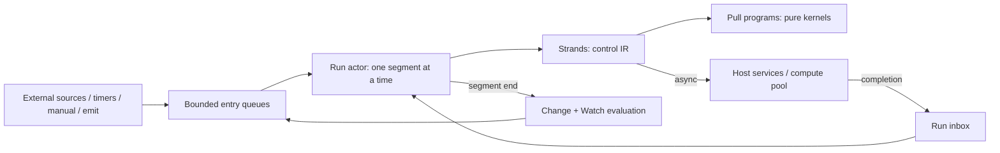
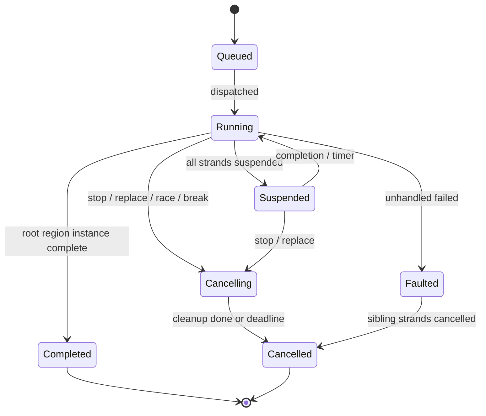

# Graph language and execution semantics

Status: **normative proposal for graph format v1**. The document model, type/inference work and partial validator passes exist; complete validation, compiler and runtime remain to be implemented and tested. Section 18 supplies reference scenarios for focused implementation tests. Structure layouts live in [12](12-graph-data-structures.md). On conflict, this document governs graph semantics, [12](12-graph-data-structures.md) governs data layout, and the other document is a defect that must be fixed in the same work unit. MUST, MUST NOT and SHOULD are normative.

**Layering (ADR-21).** §4–§6, §16 and §17 are the shared **substrate** that every execution domain uses: ports, types, conversions, extension surface and diagnostics. §1–§3 and §7–§15 define the built-in **`control` domain** (event activations, exec/data wires, async, structured loops), which a body uses when it declares no `domain` ([12 §3.1](12-graph-data-structures.md)). The core ships no other domain; crates that depend on the core may add domains, bridges and object models, each with its own semantics document.

Prior art such as Unreal Blueprints, Blender geometry-node zones, LabVIEW shift registers, Simulink unit delays and RxJS concurrency operators informed the problem list. It is not evidence that these rules perform or are usable. Known pitfalls this design rejects on purpose: pure nodes evaluated again for every consumer (different random values per pin); stale outputs read from nodes that did not execute; "sequence" that moves on while a latent step is still running; glitches in reactive diamonds; recursion with no bound.

## 1. Planes and principles

| Plane | Carries | Evaluation | Lifetime |
|---|---|---|---|
| Data | Immutable typed `Value`s | Lazy pull from a consumption site, memoized by stability class (§7.4) | Slot in an activation frame, or a plan constant |
| Control | Exec tokens with no value; one token per strand | Explicit push along exec edges; order is graph structure | Strand inside an activation |
| Event | `EventEnvelope` with a typed payload | Queued; each accepted event starts a new activation | Bounded queue entry |
| State | Variables, registers, node state (Do Once, Gate…) | Read by volatile nodes at epoch start; written only by actions | Activation, run or workspace scope |

- **P1** The document is the source of truth. A compiled plan is derived and disposable. Runtime state is never written into the document.
- **P2** Definitions, types, providers, ports, converters and constraint implementations are resolved before execution. Execution never looks up names.
- **P3** Effects happen only on the control plane. Reading a value never causes an effect or schedules one again ([03](03-data-and-execution.md)).
- **P4** There is no implicit conversion. Every conversion is a visible node (§6).
- **P5** Synchronous work is bounded per slice. Unbounded behaviour over time is allowed only across suspension points (§8).
- **P6** Given a plan, a seed, a recorded ingestion log and a virtual clock, a run's trace is reproducible for providers that declare `deterministic` (§7.6).
- **P7** Extension uses declared contracts: types, constraint implementations, converters, and pure/volatile/action/async/entry/iterator definitions. Control intrinsics, zones, port kinds and scheduling are owned by the language (§16).
- **P8** Cost is proportional to the change. An edit re-validates only the affected component. Warm execution of scalar values neither hashes nor allocates.

## 2. Execution model: hybrid, not exclusively synchronous or reactive

| Candidate | Strength | Why it is not the core model |
|---|---|---|
| Synchronous call-stack interpreter (node calls next) | Simple, debuggable | Blocks on I/O; long loops freeze the run; recursion depth; cannot wait for events |
| Push dataflow / FRP (every change propagates) | Natural for live values | Effect order undefined; diamond glitches and repeated computation; effects repeat when values propagate again; backpressure unclear |
| Task or future per node | Parallel | Scheduling cost per tiny node; nondeterministic order; locks on shared state |
| ECS system per node | Bevy-native | Coupled to frames; order follows system sets; violates ADR-01 |

**Selected (ADR-13):**

1. **Data is lazy pull**, synchronous inside a slice and memoized, so a diamond is evaluated once.
2. **Control is imperative and token-driven.** A strand follows exec edges. Order comes from structure, never from timing.
3. **Async is cooperative suspension.** An `async` node suspends its strand, and the completion resumes it later. Other strands, activations and the UI keep running. There is no OS thread per node.
4. **Events are push at activation granularity.** External sources, timers, manual triggers and custom emits enqueue envelopes. Each accepted envelope starts an activation.
5. **Reactivity is a layer.** Variable-change and Watch triggers are computed at segment boundaries (§9.2), so they are glitch-free. They are delivered as events. Live preview pulls pure outputs again incrementally (§15).
6. **Streams are pull-based async iterators** with natural backpressure. Push sources convert through explicit bounded buffers (§12).



## 3. Node kinds

A definition has exactly one `kind`. Ports inherited from a kind (§4.1) are implicit and MUST NOT be declared.

| Kind | Exec ports | Suspends | State / effects | Memo | Plugin may contribute | Examples |
|---|---|---|---|---|---|---|
| `pure` | none | never | none | stability class | yes | add, concat, parse JSON, format |
| `volatile` | none | never | reads state, clock or entropy | once per epoch | `entropy` subclass only | Get Variable, Now, Random (seeded) |
| `action` | `in`; outcome outs (default `then`); `failed` | never | may write state or perform a non-blocking effect | n/a | yes | Set Variable, Emit, Log, Register store |
| `async` | as action, plus `cancelled` | `maybe` or `always` (declared) | effects through host services | n/a | yes | HTTP request, read file, Wait |
| `entry` | `then` only; no exec input | n/a | starts activations | n/a | yes, through event-source contract | On Start, On Timer, On Event, keyboard, audio threshold |
| `iterator` | `in`, `body` (region), `completed`, `failed`, `cancelled` | `next` may suspend | open/next/close over a resource | n/a | yes | For Each Line, For Each Stream Item |
| `control` intrinsic | per intrinsic (§8.4) | Yield only | node state for Gate/Do Once/Flip Flop | n/a | **no** | Branch, Switch, Sequence, Fork, loops |
| `zone` intrinsic pair | none | never | none (pure loop) | per iteration | **no** | Repeat, Map, Fold, Filter |
| function call | from the function interface | derived from body | derived from body | per kind | yes (graph-implemented definitions) | `core/call`, package subgraphs |
| editor-only | none | — | — | never compiled | panels only | comment, frame, reroute waypoint (stored on edges) |

`volatile` subclasses: `state-read` (variables, register `current`, node-state outputs), `clock` (Now) and `entropy` (seeded random). `state-read` and `clock` nodes MUST have **no data inputs**; the state they read is chosen by config. They are evaluated in the epoch prologue (§7.4), so every read in one epoch sees one consistent snapshot. `entropy` nodes may have inputs and draw from the host's deterministic stream (§7.6). Plugin volatile definitions are limited to `entropy`. Reading external service state is an `async` action.

**Trusted control boundary.** Packages may contribute definitions within the kinds above, but cannot override control/zone intrinsics, function/cycle legality, or scheduler semantics (§16). Intrinsic status comes from the host's exact intrinsic registry, not a `core/` name prefix or package declaration. Nominal types and constrained nodes remain extensible through their owning type's declared constraints; this does not grant packages authority over control legality.

## 4. Ports

### 4.1 Descriptor

| Field | Rule |
|---|---|
| `port_id` | `[a-z][a-z0-9_]{0,63}`, unique per definition across all kinds. Reserved implicit IDs: `in`, `then`, `failed`, `error`, `cancelled`, `body`, `completed`. |
| `direction` / `kind` | `input`/`output` × `data`/`exec`/`event`. `event` is output-only. |
| `type` | Canonical type expression (§5.1) for data and event payloads; may use the definition's type parameters (`$T`). Exec ports have no type. |
| `source` (data outputs) | `computed` (pure function of inputs), `execution` (written when the node executes), `state` (volatile read of node state), `payload` (entry/event payload), `iteration` (current loop item). |
| `available_on` | For `execution` outputs: the exec outcome outs after which the value is defined. Default `["then"]`. Implicit `error: core/error@1` is available on `failed`. |
| `default` | Literal used when unconnected and the instance has no literal. Not allowed for handle or stream types. A `secret-ref` literal is only a reference, never secret material. |
| `optional` | Only if the type is `core/option@1<…>`. An unconnected port with no literal or default receives `None`. |
| `variadic` | `{min, max}`; instance ports are `port_id#k` (§4.5). |
| `lazy` | Intrinsics only in v1 (`select`, `and`, `or`, `coalesce`, `try`). |
| `group`, `label`, `description`, `editor` | Presentation only; `label`/`description` use TextRef ([13 §2](13-internationalization.md)); never semantic. |
| `sensitivity` | `normal` / `sensitive`; drives redaction in traces ([05](05-services-and-platforms.md)). |

Implicit ports by kind: action/async/iterator/control get `in` (unless the intrinsic names its inputs), `failed` and `error`. Action/async/entry with no declared outcome outs get `then`. Async and iterator get `cancelled`. A definition with declared outcome outs (for example `acquired` and `busy`) replaces `then`. **Exactly one outcome out fires per execution.** `failed` and `cancelled` are outcomes too.

### 4.2 Connection matrix

| From → To | data in | exec in | Anything else |
|---|---|---|---|
| data out | OK if the types are identical after generic resolution (§5.5) | rejected `E-KIND-MISMATCH` | rejected |
| exec out | rejected | OK within the same region (§7.1) | rejected |
| event out | rejected | OK; the target starts a new event region | rejected |

Every "rejected" cell is `E-KIND-MISMATCH`. An edge that starts at an input or ends at an output is `E-PORT-DIRECTION`. Data types that are not identical after resolution are `E-TYPE-MISMATCH` (§5.5).

### 4.3 Cardinality

| Port | Edges | Reason |
|---|---|---|
| data input | ≤ 1 | One value source. Merging values needs `select`, a variable or a register. |
| data output | unlimited; **≤ 1 if the type is a stream** (affine, §12) | Fan-out shares an immutable value. |
| exec output | ≤ 1 | Order would otherwise be ambiguous. Use Sequence or Fork. |
| exec input | unlimited from the same region | Merge is OR: each arriving token executes the node once. |
| event output | ≤ 1 | One handler region per event port. Use Sequence/Fork inside it. |
| self edge | data: rejected unless §8 permits it; exec: an ordinary control cycle (§8) | |

### 4.4 Resolving input values

Order: connected edge → instance literal → definition default → `None` for an optional port → `E-INPUT-REQUIRED`. When an edge is connected, the instance literal stays in the document as **shadowed** and is ignored by the compiler. Disconnecting restores it. Literals exist only for types with a literal codec. Handles, streams, results and errors have none ([12 §6.1](12-graph-data-structures.md)).

### 4.5 Variadic and dynamic ports

- Variadic instance ports use stable keys `item#k`. `k` is a per-node counter that is never reused, so inserting an item in the middle does not rewrite edges. Order is the persisted instance order, not `k`.
- Ports that depend on config or type arguments (record split, gRPC method fields) come from a **declarative port template** that the host evaluates. No guest code runs to compute ports, which keeps the "opening a document executes nothing" rule ([03](03-data-and-execution.md)).
- Every non-intrinsic node persists a resolved **signature snapshot** ([12 §3](12-graph-data-structures.md)). A missing package still shows ports and edges. If re-resolution differs from the snapshot, it produces a diagnostic. Edges to vanished ports become **orphan edges**: preserved, displayed and not compiled.

## 5. Types

### 5.1 Canonical type expressions

```text
type    = named [ "<" type { "," type } ">" ] | param
named   = namespace "/" name "@" major          ; core/i64@1, org.example/point@2
param   = "$" ident                              ; only inside definitions
namespace = ident { "." ident }   name = ident { "-" ident }   major = 1*DIGIT
```

The editor displays short forms (`list<string>`). Persisted documents and wire contracts use only the canonical form. A type lock records `named` without parameters, plus codec version.

### 5.2 Core types (format v1)

| Type | Notes |
|---|---|
| `core/bool@1` | |
| `core/i32@1`, `core/i64@1`, `core/u32@1`, `core/u64@1` | Two's complement; protobuf `int32/sint32/sfixed32` map to i32 losslessly, unsigned to u32/u64 |
| `core/f32@1`, `core/f64@1` | IEEE-754 binary32/binary64; audio samples and protobuf `float` need f32 |
| `core/string@1`, `core/bytes@1` | Per [03](03-data-and-execution.md) Unicode and byte rules |
| `core/duration@1` | Signed nanoseconds in i64; timers and deadlines |
| `core/timestamp@1` | UTC nanoseconds since Unix epoch in i64. Wall-clock data, never used for scheduling. Monotonic instants are runtime-only and never values. |
| `core/list@1<T>` | Homogeneous, immutable, indexable |
| `core/map@1<K,V>` | Insertion-ordered; `K` must implement `hash` + `eq` and must not be a float |
| `core/option@1<T>` | `None` or `Some(T)` |
| `core/result@1<T>` | `Ok(T)` or `Err(core/error@1)`; produced only by `core/try` and by nodes that explicitly return it |
| `core/error@1` | Structured `NodeError` value (§13) |
| `core/json@1` | Per [03](03-data-and-execution.md), including JSON null and exact number text |
| `core/stream@1<T>` | Affine handle (§12) |
| `core/secret-ref@1` | Credential reference; no conversion to string; never a literal secret |
| `core/handle@1<K>` | Opaque generation-checked resource of kind `K` (a handle-kind type such as `org.orange.websocket/session@1`) |
| records / enums | Nominal, schema-defined by a package; stable field and variant IDs ([12 §5](12-graph-data-structures.md)) |

i8/i16/u8/u16, decimals and tuples are excluded from v1. Use i32/u32 with checked conversions, `bytes`, a package type, or records. There is **no `any` type**. Nodes that accept "anything" (Log, Format) use a type parameter with a constraint.

### 5.3 Versions and identity

Types are **nominal**: two packages' `point` records are different types even with identical fields. The major version is part of the identity. Compatible minor changes are codec-level additions only: new optional fields, or new enum variants under the unknown-variant rule in [03](03-data-and-execution.md). A breaking change requires a new major version plus a migration.

### 5.4 Constraints

| Constraint | Meaning | Core implementers |
|---|---|---|
| `eq` | Total equality used by Switch, map keys, change detection | all except f32/f64 (IEEE `==` is a separate node), handles, streams |
| `ord` | Total order | integers, bool, string (code point order), duration, timestamp; floats only through explicit `total-order` nodes |
| `hash` | Stable hash consistent with `eq` | integers, bool, string, bytes, enums with hashable payloads |
| `num` | Arithmetic family | i32, i64, u32, u64, f32, f64, duration (add/sub only) |
| `int` / `float` | Narrower `num` | integers / f32, f64 |
| `display` | Invariant-locale text formatting | all literal-codec types |
| `serialize` | Persistable codec (variables, checkpoints, JSON) | all except handle, stream, error-with-sensitive details |
| `default` | Has a zero value | scalars, string, bytes, list, map, option |

A package type declares which constraints it implements by supplying a **constraint implementation** (kernels for the constraint's operations). Coherence rule: only the package that owns the type may implement a core constraint for it. A package may implement its own constraint for a foreign type. Conflicts are therefore impossible, not resolved at run time.

Package constraints have a canonical `namespace/name@major` identity distinct from the core constraint names. Registration records an exact provider binding, package content digest and implementation ID for one concrete type/constraint (or numeric-operation) slot. A declared structural derive occupies that same constraint slot; neither registration order nor an explicit implementation may overwrite it. Core type implementations remain language-owned. Capability queries return the selected reference as proof metadata, without loading package code; package identity/authentication and executable conformance are host/SDK work.

Aggregate `eq` requires the contained types to implement `eq`; wrapping a float in a list/option/result/map does not supply total equality. `display` requires a literal codec for every contained value. `serialize` is separate from literal availability: a type-level capability permits a checked serializer, and never proves that a particular error value's sensitive details have been redacted. Empty list/map and `None` defaults do not require a default for their contained types. Rust's structural `Value::Eq/Hash` is not evidence of these language constraints.

The initial host supports explicit package structural derives for `eq`, `hash`, `display` and `serialize`, checking every field/payload before registry publication. Other derives report unsupported capability; packages may supply explicit implementations instead. The host does not invent a default enum variant or ordering rule. Recursive nominal schemas remain legal, but a cyclic or over-budget automatic derivation has no supported proof and requires an explicit implementation. Constraint-family membership is separate from operation support: `duration: num` supplies add/subtract, not multiply/divide. Current capability queries prove declarations only; execution kernels and value-level serialization checks are later work.

### 5.5 Generics and inference

- Type parameters are declared per definition with constraints (`{"name": "T", "constraints": ["num"]}`). There are no higher-kinded parameters, no subtyping and no variance.
- Inference unifies type expressions over the **connected component** of generic nodes touched by an edit. It visits nodes in stable `NodeId` order, so the result is deterministic. Literals carry explicit types.
- Resolved type arguments are **persisted** on the instance (`type_args`). Loading never depends on re-running the solver. An edit re-infers only the affected component, and the inferred `type_args` and the signature projected from them are committed in the same transaction as the edit. An ambiguous or conflicting component is still saved, with no `type_args` for the affected parameters and `$name` kept in its signature.
- An explicit choice is a **pin**, persisted in `type_pins` and kept until the user removes it. `type_args` holds the resolved value of every parameter, pinned or inferred, and is a cache: inference seeds from pins, typed literals on generic ports, edges and the concrete port types of non-generic neighbours, never from persisted `type_args`, so disconnecting and reconnecting cannot reuse a stale binding. Constraints and listed specializations are checked after solving.
- Unresolved parameter → `E-TYPE-AMBIGUOUS`, and it gets no `type_args` entry; the signature snapshot keeps `$name` for it. The user pins it in the inspector. Conflict → `E-TYPE-MISMATCH` with converter suggestions. Inference never inserts conversions. A new connection whose inference reports a conflict (`E-TYPE-MISMATCH`, `E-CONSTRAINT-UNSATISFIED`, `E-NO-SPECIALIZATION` or `E-TYPE-COMPLEXITY`) is refused, unless the components it joins already reported one: a conflicting document, for example an imported one, can still be edited and repaired. Other edits, such as a disconnect or unpin, are never refused for their inference result.
- Function bodies are inferred like the root: an edit inside a body, or a replaced body, re-infers the touched components there.
- A disconnect/connect that reuses an edge ID re-infers the components at both its old and new endpoints; a net `changed` edge is not an unchanged inference input.
- Exhausting an analysis resource budget produces `E-TYPE-COMPLEXITY`, with the relevant node/parameter context and limit. It does not fall back to a numeric type or report a semantic mismatch. Provisional implementation budgets are recorded in [10](10-tooling-and-sources.md); a resource failure does not redefine the valid type grammar.
- A generic provider MUST list its supported specializations, or delegate to constraint implementations. The list belongs to the exact provider (binding plus the locked content digest), so two providers of one definition may support different arguments. A missing specialization is `E-NO-SPECIALIZATION` at compile time, never a run-time lookup.
- Numeric authoring presents Float with Single (`core/f32@1`) and Double (`core/f64@1`) precision, alongside integer math (ADR-20). New untyped numbers default to Double; a resolved port or explicit type selection takes precedence. Integer text parses directly as the selected integer type, without a floating intermediate. Saved type identities and visible precision conversions remain governed by §5–6.

### 5.6 Numeric additions to [03](03-data-and-execution.md)

Integer arithmetic config: `int_overflow` = `checked` (default) / `wrapping` / `saturating`. Integer division truncates toward zero. `rem` takes the dividend's sign, and Euclidean `mod` is a separate node. Shifts by ≥ the bit width fail in checked mode. i32/u32 follow the i64 rules. f32 follows the f64 rules and persists as 8-hex-digit `bits`. Mixed-width arithmetic is never implicit.

## 6. Conversions

1. The compiler never converts. Every conversion is a `core/convert` node that names a **converter registry entry**.
2. Entry fields: `from`, `to`, `class`, provider, policy options. Classes:
   - `lossless-total`: always succeeds without loss. Examples: i32→i64, u32→i64/u64, i32/u32→f64, f32→f64, T→`option<T>`, `display` T→string.
   - `checked-partial`: may fail. Examples: i64→i32 (`core/OutOfRange`), string→i64 (`core/Parse`), json→T, `option<T>`→T (`core/NoneValue`), f64→i64 with rounding mode.
   - `lossy`: may lose information under a declared policy and returns loss metadata. Examples: f64→f32, i64→f64 above 2^53, string→bytes with replacement.
3. **Editor auto-insert:** when an incompatible wire is dropped and exactly one `lossless-total` entry exists for the pair, the editor inserts a visible converter node in the same undoable transaction. If only partial or lossy entries exist, the editor shows a choice and never picks one. Chained conversions are never auto-inserted. With no entry, the connection is rejected with a diagnostic.
4. Ownership: a package may register converters only when it owns `from` or `to`. A competing provider for an existing pair uses override slot `convert:<from>-><to>` ([04](04-expansion-plugins.md)) with the same explicit-rebind rule as other providers.

Entry identity is a stable converter ID plus contract version. Multiple implementations of that same entry are provider alternatives, not additional semantic conversions. Count distinct semantic entries when applying rule 3: a unique lossless-total entry is eligible even when partial/lossy entries also exist, but its exact provider must resolve unambiguously from an explicit new-binding default, sole implementation or user choice. No default is inferred from installation order. Defaults are scoped to the entry contract within the pair slot; existing bindings remain pinned.

The converter node itself is persisted as specified in [12 §5](12-graph-data-structures.md): it names the entry key, the exact provider and the resolved policy choices, and its ports are `value` in, `result` out and, for lossy entries, `loss`. A connection plan fixes the node and edge identities once, and records the document content state, and the immutable registry snapshot (which fixes the available providers and generic definitions) it was made against; applying it rechecks both, so a stale plan is rejected instead of re-resolved. Inserting a converter reuses the wire's existing data-input replacement rule (§4.3): the old edge is removed in the same transaction. Shadowed literals stay in the document.

Before selecting a converter, infer generic endpoint types from the evidence that survives removal of replaced edges. Exclude the target literal that the proposed wire will shadow, while preserving it in the document. Explicit pins and other active literals/edges remain evidence; cached `type_args` do not constrain selection. An unresolved endpoint connects directly for joint inference. Thus replacing an unpinned generic node's only i64 source with f64 can change its type without inserting a conversion; a pin or remaining i64 source still requires the normal converter selection.

The initial host policy form is a named finite set of string choices, with an optional default; missing required choices, unknown policy names/values and unsupported forms are rejected. Packages may declare their own finite choices. Lossy entries expose a separate `loss: core/json@1` output for converter-defined loss details. Core precision entries declare f32→f64 lossless and f64→f32 lossy; the latter declares nearest-even rounding and rejection of out-of-range values. These are conversion contracts; arithmetic kernels and runtime loss-detail production are later work.

## 7. Regions, availability, ordering and determinism

### 7.1 Regions

A **region** is a set of exec nodes executed by one structured construct. Roots: each entry's `then`, each event output, each function entry, each Sequence `then#k`, each Fork `branch#k`, and each loop or iterator `body`. A node's region is found by walking exec edges from roots without entering child-region roots. Rules:

- Every reachable exec node belongs to **exactly one** region. Reachable from two sibling regions → `E-REGION-AMBIGUOUS`. An exec edge leaving its region → `E-REGION-ESCAPE`. Leaving a region is possible only through its terminators: end of strand, Break/Continue (loop bodies), Return (functions).
- Branch, Switch, Gate and async outcomes do not create regions. Their outs stay in the parent region, so they may merge again (exec fan-in).
- A **region instance completes** when every strand inside it has ended, including nested Fork strands. Structured concurrency: nothing outlives its region instance, except subscriptions owned by the run (§10.4).
- Unreachable exec nodes → `W-UNREACHABLE`; they belong to no region and are not compiled.

### 7.2 Value availability (dominance rule)

A data value from output `p` of exec node `N` (`source: execution`, `available_on: S`) may be consumed, directly or through pure nodes, by consumer site `X` only if:

1. `N` and `X` are in the same activation tree (same entry or event root, or the same function body). Otherwise `E-CROSS-ACTIVATION`.
2. In the control-flow graph (structured constructs expanded: Sequence steps chained; Fork `all` treated as the sequential composition of its branches for sites reached through its `completed`; sibling branches stay concurrent, so neither dominates the other; loops with a zero-iteration path), **every path from the root to `X` passes through an `S`-outcome edge of `N`**. Otherwise `E-UNAVAILABLE-VALUE`. With back edges, `X` reads the most recent execution of `N` on that path.

Consequences:

| Case | Result |
|---|---|
| Output of an action in a Branch's `true` path, read after the branches merge | Rejected. Use `select`, a local variable or a register. |
| Loop `element`/`index`, or a value computed in the body, read at `completed` | Rejected (zero iterations). Carry it in a local or register. |
| Value from Fork branch A read in sibling branch B | Rejected. |
| Fork branch value read after `completed` with `join: all` | Allowed. With `any`, `race` or `detach`: rejected. |
| Async `then` output read on the `failed` path | Rejected. `error` exists only on `failed`. |
| Entry `payload` anywhere in its activation | Allowed. |
| Constant, literal or volatile cone | Allowed everywhere, including exports, Watch and preview. |
| Event-region node reading the subscribing node's `then` outputs | Rejected (`E-CROSS-ACTIVATION`); share through a run variable. |

Unconnected `failed` means unhandled: the strand faults (§13). Reading an output of a node that did not execute is therefore impossible by construction. It is never a stale or default value.

### 7.3 Diamonds

| Diamond | Rule |
|---|---|
| Pure: A → B, A → C, (B, C) → D | A is evaluated once per memo scope (§7.4); D sees one consistent A. |
| Volatile: Get V feeds two consumers of one action | One prologue read per epoch, so both see the same V. |
| Volatile across two actions in one strand | Each action opens its own epoch and sees writes already committed (Set → Get observes the new value). |
| Control split → merge (Branch true/false → same node) | Legal; exactly one token arrives. |
| Fork → two branches → same node | Impossible: sibling regions cannot share nodes (`E-REGION-AMBIGUOUS`). Use `completed`. |
| Reactive: V changes, Watch W1 and W2 depend on V, W3 depends on W1 and W2 | Watches evaluate once per segment boundary against one state snapshot. No intermediate mixed state is observable. |
| Event: one emit, two `On Event` handlers | Two activations enqueued in handler `order` (§10.2). |

### 7.4 Pure evaluation

- **Consumption sites:** an exec node's input gathering, a loop condition check, a Watch evaluation, an export or preview evaluation. Each execution of a site opens a new **epoch**.
- **Prologue:** at epoch start, the program's `state-read` and `clock` volatile nodes are read in program order. This gives a consistent snapshot even if the pull yields mid-way (zones, offload).
- **Stability classes** (computed at compile time, per output):
  - `const`: depends only on literals or constants. Folded once per plan. A folded error stays a run-time error at each consumption and produces `W-CONST-ERROR`; it is never hidden.
  - `activation`: depends on payloads, or on `execution` outputs whose producer runs at most once per activation (not inside a loop body or control cycle). Memoized once per activation.
  - `epoch`: everything else. Memoized once per epoch.
- **Order:** depth-first in input port declaration order, with variadic ports in instance order. Lazy intrinsics evaluate only the inputs they select.
- **Errors:** the first error in that order is reported, and the pull stops. Deterministic.
- A pull never executes actions. A pure program flagged `heavy` (cost hint, or a zone over a large input) MAY be offloaded to the compute pool after the prologue. The strand suspends, which is semantically invisible because inputs are immutable.
- Zones check the slice budget at iteration boundaries; partial zone state lives in the frame.

### 7.5 Ordering guarantees

| ID | Guarantee |
|---|---|
| O1 | Within a strand, exec nodes run in program order along exec edges. |
| O2 | **Sequence:** `then#k+1` starts only after the region instance of `then#k` completes, including its awaits. |
| O3 | **Fork:** branches start in port order within one segment. After the first suspension, interleaving follows completion order. `completed` fires per join mode: `all` (all branch instances complete), `any` (first completes; the others keep running), `race` (first completes; the others are cancelled), `detach` (fires immediately; branches still complete within the activation). |
| O4 | Pure evaluation order and error choice follow §7.4. |
| O5 | Events from one source are FIFO by `source_seq`. Across sources, order follows the host `ingestion_seq`. |
| O6 | Completions enter the run inbox in arrival order. Independent async operations have no order guarantee, and arrival order is recorded. |
| O7 | Emit only enqueues. A handler never runs inside the emitter's strand: no reentrant call, no stack growth. |
| O8 | Activations started by one envelope are enqueued in ascending handler `order`. `order` is persisted, initialized from a creation counter and editable. |
| O9 | A committed write is visible to every epoch that starts later in any strand of the run. |
| O10 | Change notifications and Watch firings from one segment are enqueued after that segment, in `order`, before the next ready strand runs. |

### 7.6 Determinism and replay

A run is reproducible when its plan hash, seed, virtual clock, ingestion log (events and completion arrival order with payloads) and every provider declare `deterministic`. A seeded entropy node draws from `stream(seed, node_id, activation_seq, invocation_in_activation)`; the algorithm and version are recorded in run metadata ([03](03-data-and-execution.md)). Replay re-executes local computation only. Remote effects are simulated from the log and never re-sent. A non-deterministic provider marks the trace `replay: partial`.

## 8. Cycles and loops

### 8.1 Classification

| Class | Example | Legal | Mechanism / guard |
|---|---|---|---|
| Data cycle with no state boundary | `a → add → a` | **No**: `E-CYCLE-DATA` with the cycle path | — |
| Data feedback through state | Register `current → add → next`; Get V → … → Set V | **Yes** | `state` and `execution` sources declare no dependency on inputs, so the dependency graph stays acyclic |
| Pure iteration | Repeat, Map, Fold or Filter zone | **Yes** | Implicit back link between begin and end; bounded by count or list length; yields at iteration boundaries |
| Structured control loop | Count, For Each, While, iterators | **Yes** | Implicit back edge; While requires finite `max_iterations`; every iteration is a yield point |
| Control cycle through a suspension point | `Wait 1 s → do work → back to Wait` | **Yes** | Every cycle contains a node with `suspends: always`; it is cancellable |
| Control cycle through only Yield | Busy loop | Yes, with `W-BUSY-LOOP` | Yield suspends with zero delay; it is fair but burns CPU |
| Synchronous control cycle | Action A → B → back to A, no suspension | **No**: `E-CYCLE-SYNC-CONTROL` | Use a loop node or add a suspension |
| Event cycle | Handler of E emits E; A emits B, B emits A | **Yes** | Bounded by causal depth (§10.3) and queue policy |
| Reactive cycle | On V changed → Set V | **Yes** | Causal depth; writing an `eq`-equal value produces no notification |
| Synchronous function recursion | f calls f, or f → g → f | **No in v1**: `E-RECURSION` | Call graph must be acyclic (ADR-15, OPEN-10) |

### 8.2 Formal checks

- **D** (data dependency graph): an edge `p → q` exists for each data edge, plus `input → output` within a node for every output whose `source` is `computed`. `execution`, `state`, `payload` and `iteration` outputs do not depend on the node's inputs. Zone back links are omitted. **D MUST be acyclic.**
- **C** (control graph per region, with implicit loop back edges excluded): every cycle MUST contain a node with `suspends: always`. A function-call summary may provide `always` only when every path proves guaranteed suspension; merely finding a Wait somewhere does not prove it. Unknown or incomplete facts cannot certify a cycle.
- **Call graph** over functions and graph-implemented definitions: acyclic.
- An action reading its own previous output through a control cycle fails §7.2 (no dominance on the first pass). Feedback MUST go through a register or variable, which makes the intent explicit.

### 8.3 Loop semantics

- The collection for `for-each` is the immutable value at loop entry. `count < 0` fails with `core/OutOfRange`. The While `condition` is pulled in a new epoch before each iteration.
- An iteration ends when the body region instance completes. Async work in the body is awaited.
- **Break** cancels the remaining strands of the current body instance, including Fork branches, then fires `completed`. **Continue** cancels them and starts the next iteration. Both target the innermost enclosing loop. They may sit inside nested Sequence/Fork/Branch regions, but never across a function boundary (`E-BREAK-OUTSIDE-LOOP`).
- Exceeding `max_iterations` fires `failed` with `core/LoopBudgetExceeded`.
- Loop-carried values use activation-local variables or registers (`scope: activation`). Zones carry typed items explicitly.

### 8.4 Control intrinsics

| ID | Ports | Semantics |
|---|---|---|
| `core/branch` | in; `condition: bool`; `true`, `false` | Pulls the condition and fires one out |
| `core/switch` | in; `key: $K` (`eq`: int, string, enum); `case#k`; `default` | Enum switches must be exhaustive against the locked schema or have `default`; an unknown variant goes to `default`, else fails with `core/UnknownVariant` |
| `core/sequence` | in; `then#k` (≥2 regions) | O2 |
| `core/fork` | in; `branch#k` regions; `completed`; config `join` | O3 |
| `core/for-each` | in; `items: list<$T>` or `map<$K,$V>`; `body`; `completed`; `element`/`key`/`value`, `index: i64` (iteration) | §8.3 |
| `core/count` | in; `count: i64`; `body`; `completed`; `index` | §8.3 |
| `core/while` | in; `condition: bool`; `body`; `completed`; config `max_iterations` (required, editor default 10,000) | §8.3 |
| `core/break`, `core/continue` | in | Terminators |
| `core/gate` | `enter`, `open`, `close`, `toggle`; `then`; `is_open` (state); config `start_open` | Run-scoped node state |
| `core/do-once` | in, `reset`; `then` | Run-scoped node state |
| `core/flip-flop` | in; `a`, `b`; `is_a` (state) | Run-scoped node state |
| `core/yield` | in; `then` | `suspends: always`, zero delay |
| `core/wait` | in; `duration`; `then` | Async on the monotonic clock; cancellable; `suspends: always` |
| `core/await-event` | in; `timeout: option<duration>`; config `event`; `then`, `timed_out`; `payload` | Resumes on the next matching emit after the wait starts; does not start an activation |
| `core/register` | `store`, `reset`; `next: $T`; `then`; `current: $T` (state); config `initial`, `scope` | Anonymous typed state cell for feedback |
| `core/select`, `core/and`, `core/or`, `core/coalesce` | lazy data inputs | Pure; evaluate only the selected inputs |
| `core/try` | lazy `value: $T` → `result: result<$T>` | Captures evaluation errors of its input cone only |
| `core/match-result` | in; `result`; `ok`, `err`; `value` (on ok), `error` (on err) | Control |
| zones `core/repeat`, `core/map`, `core/fold`, `core/filter` (`-begin`/`-end` pairs) | typed carried items | Body is pure or entropy-volatile only; edges into the body are loop-invariant captures; values leave only through the end node; `E-ZONE-STRUCTURE` otherwise |

## 9. Runs, activations, strands and scheduling

### 9.1 Run actor

Each run is a single logical actor (ADR-14). The actor owns the plan, run and local state, node state, activation table, entry queues and inbox. **Only one strand segment of a run executes at a time.** Strands interleave only at suspension, yield and slice boundaries. Run state therefore needs no locks, and order is deterministic given the ingestion log. Different runs execute in parallel on the compute executor. Heavy pure programs (§7.4) and async effects run off the actor and return as inbox messages. Workspace state is owned by a host actor (§11.1).

### 9.2 Segments and the scheduler loop

A **segment** is one uninterrupted execution of a strand, from resume to suspend, yield, end, or slice exhaustion at a safe point (instruction boundary, loop or zone iteration). Slice budget: proposed 1 ms or 1,024 operations ([03](03-data-and-execution.md)). Loop:

1. Move inbox messages (completions, events, commands) into the ready queue or entry queues, in arrival order.
2. Dispatch entry queues into new activations under their reentrancy mode (§10.1).
3. Run the head of the ready queue (FIFO by ready time) for one segment. A strand that exhausted its slice goes to the tail.
4. Segment end: compute the change set, enqueue On Variable Changed (coalesced per variable: final value, previous = value at segment start), evaluate affected Watches against the consistent post-segment state (O10).
5. Repeat. With nothing ready, the actor sleeps until the inbox wakes it. It never polls.

### 9.3 Activation and strand lifecycle



A strand is `Ready`, `Running`, `Suspended(ContinuationId)` or `Ended`. A fault in one strand cancels its sibling strands in the activation (fail-fast). The activation then applies the entry's `on_fault` policy: `continue` (default; the run stays subscribed) or `stop-run`.

### 9.4 Cancellation and cleanup mode

Cancellation flows run → activation → strand → in-flight operation ([03](03-data-and-execution.md)). A strand suspended at an async node with a connected `cancelled` resumes there in **cleanup mode**. It may run pure, volatile and actions or asyncs declared `cleanup_safe` (Set, Log, Close, Flush). Any other node fails with `core/Cancelled`. Cleanup is bounded by `cleanup_deadline` (the remaining drain deadline, or a proposed 500 ms). A second cancellation aborts cleanup. An unconnected `cancelled` ends the strand.

## 10. Events and triggers

### 10.1 Entries and reentrancy

Every entry has an `activation` policy ([12 §6](12-graph-data-structures.md)):

| Field | Values |
|---|---|
| `mode` | `queue` (default: serial, FIFO), `drop` (ignore while busy, counted), `replace` (cancel the running activation, keep only the latest pending), `parallel` (up to `max_parallel`) |
| `capacity`, `overflow` | Per [03](03-data-and-execution.md): proposed 256; `backpressure` where the protocol allows it, else `drop-oldest`, `drop-newest`, `coalesce-latest` or `fault`, with counters |
| `on_fault` | `continue` / `stop-run` |
| `order` | Handler order (O8) |

Under `parallel`, activations interleave at suspension points. Get is re-pulled at every consumption, so a read-modify-write is atomic unless a value was explicitly captured (in a local or action output) before a suspension. Then `W-STALE-CAPTURE` warns and suggests `core/update-variable`.

### 10.2 Entry catalog

| Entry | Fires | Payload |
|---|---|---|
| `core/on-start` | Once, when the run enters Running | — |
| `core/on-stop` | Once, when graceful Draining begins (not on cancel or fault); new triggers rejected; Emit fails with `core/RunStopping` | — |
| `core/on-manual` | Editor, CLI or API `trigger(run, node, payload)` | Declared type |
| `core/on-timer` | Interval or once (`core/on-timeout`); monotonic; scheduled against a base time, so no cumulative drift; config `first: immediate/after-interval`, missed-tick `skip`/`coalesce` (default)/`catch-up(max)` | `scheduled_at`, `missed: u64` |
| `core/on-event` | Matching custom emit | Event payload type |
| `core/on-variable-changed` | Segment end, if the value changed (`eq`) | `value`, `previous` |
| `core/on-watch` | Segment end, when the watched cone's dependencies changed and the result changed (`changed`) or became true (`rising`) | `value` |
| Package entries | Event-source contract; the subscription is acquired in the Starting phase ([03](03-data-and-execution.md)) | Declared type |

Custom events are declared per graph: `{id, name, payload type, scope: run | workspace}`. Workspace-scope events go through the host bus to other runs in the workspace, with the same envelope and causal-depth rules.

**Foundation trigger authoring (ADR-22; FR-52/54/55).** Manual entries expose an accessible test button. Keyboard and audio-threshold sources are host-backed entry definitions governed by the same acquisition, queue, reentrancy and cancellation rules as package sources; they are not new port kinds or control intrinsics. Configuration is available from the node. Source capture/registration is active only for an owning run. An installed plugin can contribute a different event source with its own typed payload through this same contract. Input-specific acquisition and timing are in 05.

### 10.3 Envelope and causal depth

An envelope carries `ingestion_seq`, source and `source_seq`, cause activation, `cause_depth`, monotonic and wall time, payload and payload size. Envelopes from external sources, timers and manual triggers have depth 0. Emits, variable changes and Watches from activation A get `A.depth + 1`. Above `max_cause_depth` (run setting; proposed 64; NFR-02 tuning), an Emit fails with `core/RunawayEventChain`, and a notification or Watch is suppressed with a counter and diagnostic. Perpetual behaviour belongs in a timer or a control cycle through Wait, not in an unbounded event chain.

### 10.4 Subscriptions

An action or async with `event` outputs (a subscription) is allowed **only in the top-level graph**, never in functions (`E-SUBSCRIPTION-IN-FUNCTION`). Its subscription is owned by the run. It ends when the run stops, or through its `handle` output and a close node. Each event starts an activation of the region rooted at that event port, and that region may read the event's payload outputs only (§7.2).

## 11. State

### 11.1 Variables

| Scope | Owner | Read | Write | Persistence |
|---|---|---|---|---|
| `local` | Activation or function call frame; initialized at activation or call start | `core/get-variable` (volatile) | `core/set-variable`, `core/update-variable` (sync actions) | never |
| `run` | Run actor; initialized at Starting | same | same; atomic because the actor runs one segment at a time | optional checkpoint ([03](03-data-and-execution.md)) |
| `workspace` | Host actor; shared by runs | volatile read of the latest published versioned snapshot | `core/set-shared`, `core/update-shared` (**async**, serialized by the host; the snapshot is published before `then`, so the writer reads its own write) | optional checkpoint |

`Get` and `Read` remain UI aliases of one operation. An uninitialized read fails with `core/UninitializedVariable`. `update-variable` operations: `add`, `sub`, `min`, `max`, `and`, `or`, `xor`, `append`, `compare-and-set(expected)`; outputs `old` and `new` are available on `then`. Handles and streams may not be stored in persistent or workspace variables (`E-HANDLE-PERSIST`), and streams in no variable at all (`E-STREAM-STORE`).

**Get/Set contracts (FR-12/44/45).** Exact host intrinsics `core/get-variable@1` and `core/set-variable@1` use `config_version: 1`, no provider binding, and a canonical `VariableId` in `config.variable`. Get is `volatile`, `suspends: never`, with no data inputs and one data output `value` of the declaration's type, `source: state`. Set is an `action`, `suspends: never`, with one required data input `value` of that type and ordinary implicit action control/error outcomes (§3); it adds no data outputs. Synchronous Set accepts only `local` and `run`; a `workspace` target reports `E-VARIABLE-SCOPE` and stays unresolved. Workspace writes use the separate async shared operations above; Get may resolve a workspace declaration without establishing runtime snapshot availability.

Missing, malformed or undeclared variable references report `E-VARIABLE-UNKNOWN`; an unknown declaration type fails through ordinary type resolution. Neither stored signatures nor `type_args` substitute for the declaration. These contextual contracts are derived read-only validation evidence, never persisted synthetic signatures. Declaration changes require fresh evidence; stale overlays report `E-METADATA-STALE`. This projection does not establish local cross-body visibility, region validity, initialization or execution readiness.

**Declaration authoring (FR-12).** The editor exposes variable declaration through a declaration node/control bound to the stable persisted VariableDecl ID. Type, scope and initializer edits are atomic document commands; Get/Set/Update reference that ID, never a name or arbitrary config string. This is an authoring projection, not a new executable Declare intrinsic: drawing/revisiting it never initializes or resets runtime state. Runtime initialization remains at activation/call/run start as above. Enum authoring likewise uses registered schemas with stable variant IDs and explicit constructor/match nodes; it does not introduce implicit string tags. Exact editor serialization and commands are qualified in WU-05 before adoption.

### 11.2 Write conflicts

Two branches of one Fork that write the same local or run variable or register → `E-WRITE-CONFLICT`. Exceptions: every such write is an `update-variable` with the same commutative operation (`add`, `min`, `max`, `and`, `or`, `xor`), or the variable declares `conflict: last-writer-wins`. A function call in a branch writes every run variable its body writes, transitively; the callee's locals belong to its frame and never conflict. A register is one node, so two branches reaching it are already `E-REGION-AMBIGUOUS`. Writes from different activations are ordered by the actor and need no rule. Writing an `eq`-equal value produces no change notification.

### 11.3 Node state

Gate, Do Once, Flip Flop and Register store hidden run-scoped slots (Register may use `scope: activation`). They reset at run start, are visible in inspection, and are never persisted in v1.

## 12. Streams

`core/stream@1<T>` is an affine handle: a stream output may have one consumer edge (`E-STREAM-FANOUT`). It cannot be stored in variables, used as a literal, or exported. Consumers:

| Node | Kind | Semantics |
|---|---|---|
| `core/for-each-item` | iterator | Pulls the next item only after the body instance completes, which is natural backpressure. End of stream fires `completed`. An item error fires `failed` and closes the stream. |
| `core/next-item` | async | `item: option<T>` on `then`; `None` at end of stream |
| `core/collect` | async | `max_items` required; exceeding it fails with `core/LimitExceeded` |
| `core/close-stream` | action, `cleanup_safe` | Idempotent |
| `core/tee` | action | Two streams with a bounded buffer and an overflow policy; the explicit way to fan out |

Push sources (subscriptions) become streams only through a package node with declared capacity and overflow policy. Cancelling the consumer closes the stream and notifies the producer. Byte and file chunk streams follow the chunk limits in [05](05-services-and-platforms.md).

## 13. Errors

`core/error@1` fields: `code` (namespaced, e.g. `core/NumericOverflow`), `node`, `port` (optional), `activation`, `message_origin`, `message_key`, `message_args` (declared named typed redacted arguments), `message` (safe rendered English fallback), typed redacted `details`, and `cause` (optional, depth ≤ 8). These message fields encode MessageRef from [13 §2](13-internationalization.md). Locale-specific human rendering is a host projection; canonical structured errors and replay records exclude that rendering. Language changes never affect error selection or graph string outputs; derived `display` uses stable type/member IDs, not mutable/localized names (G-39, ADR-17).

- A pure error propagates along data edges to the consumption site. The consuming exec node does not execute: its implicit `failed` fires with `error`. If `failed` is unconnected, the strand faults (§9.3).
- `core/try` turns errors in its input cone into `result<T>` values. `core/match-result` branches on them. This is the only way an error becomes ordinary data, which preserves the FR-08 distinction between None, missing, JSON null and Error.
- Errors from a preview or export are shown on the node and in diagnostics. They never fault a run.
- Bundled native kernels MUST NOT panic on any input (property and fuzz tests). Containment limits are those of [04](04-expansion-plugins.md).

Runtime codes defined by the core: `NumericOverflow`, `DivideByZero`, `Domain`, `NonFinite`, `OutOfRange`, `Parse`, `IndexOutOfBounds`, `NoneValue`, `UnknownVariant`, `UninitializedVariable`, `LoopBudgetExceeded`, `LimitExceeded`, `QueueOverflow`, `RunawayEventChain`, `RunStopping`, `Cancelled`, `Timeout`, `OutcomeUnknown`, `StaleHandle`, `CapabilityUnavailable`, `InternalFault` (all with the `core/` prefix).

## 14. Functions (subgraphs)

- A **function** is a graph-local or package-provided body with a typed interface. `core/function-entry` outputs the inputs. Action functions return through `core/return` nodes. Pure functions use a single `core/function-outputs` node.
- The kind is inferred from the body: only pure nodes → `pure`; volatile → `volatile`; actions → `action`; anything with `suspends ≠ never` → `async`; the strongest present wins (async > action > volatile > pure), and a call counts as its callee's kind. The declared kind MUST equal the inferred kind (`E-FUNCTION-KIND`), so callers see a stable interface. The editor updates the declaration and lists affected callers.
- `core/call` identifies its graph-local target with `config.function`, a canonical `FunctionId`; it MUST resolve to a declaration in the same graph. Missing and unknown targets report `E-CALL-TARGET-MISSING` and `E-CALL-TARGET-UNKNOWN`. Calls do not resolve by display name. Function kind and effects come from the validated body/callee summaries, never from the declared kind alone.
- Function analysis summarizes suspension and transitive writes to `run` variables. `core/get-variable`, `core/set-variable`, and `core/update-variable` reference a canonical `VariableId` in `config.variable`; update operations use the stable `config.operation` token from §11.1. Variable names and arbitrary config strings are not scanned. An unresolved reference reports `E-VARIABLE-UNKNOWN`. Local-variable writes stay in the call frame and do not escape the summary.
- A missing external/package body or unavailable leaf semantics makes the summary incomplete (`E-FUNCTION-METADATA-UNAVAILABLE`); it is not treated as an empty effect set or a proven non-suspending body. Hosts may supply explicit leaf semantics such as suspension and run-write facts for trusted native functions. No package code executes during validation or compilation analysis.
- A call's suspension is `never` only when its resolved summary proves no suspension; any possible suspension yields at least `maybe`. Finding a suspending node somewhere in a body does not prove `always`: `always` requires proof on every path. Incomplete facts cannot establish `always`, so they cannot certify a control cycle.
- Function-structure nodes are classified by exact host intrinsic identity: `core/function-entry` declares interface inputs, `core/return` terminates an action-function path, and `core/function-outputs` supplies the single pure-function result. Declared function type parameters and interface types are the authoritative type contract; body analysis validates conformance without trusting a declared kind as inferred evidence.
- Each call has its own frame and locals. Run variables are shared with the caller's run.
- A function body has no entries or Watch nodes (`E-ENTRY-IN-FUNCTION`) and no subscriptions (`E-SUBSCRIPTION-IN-FUNCTION`, §10.4). Break and Continue do not cross the boundary. `core/return` MUST NOT appear inside a Fork branch (`E-REGION-ESCAPE`). Every path in an action function with outputs reaches a Return (`E-MISSING-RETURN`). Return cancels any remaining detached strands of the body (`W-DETACH-IN-FUNCTION`).
- The call graph is acyclic (§8.2). There are no macros in v1. "Collapse to function" is an editor refactoring with an interface preview, and groups or frames are presentation only.
- A package-provided function is a definition whose implementation is a graph, pinned by the package lock like any provider.

### 14.1 Saved specialized nodes and templates

FR-53 exposes the existing function mechanism as a user workflow: select compatible nodes → preview typed inputs/outputs, variable dependencies and inferred effects → save a named versioned callable graph → insert calls from the palette. Workspace-library and package forms retain exact dependency/provider locks, missing-node preservation and migration previews. Local edits do not silently update existing versioned users. Export/import carries the interface, body, dependency metadata and explicit asset/reference remapping; executable code is never run during import. The external library artifact schema must be specified and tested before WU-05 adopts it; this paragraph does not declare a new implemented wire format.

Functions keep the entry/subscription restrictions above. A selection that contains triggers/subscriptions may instead be saved as an explicitly labelled insertable graph template with remapped IDs/references. A template inserts editable nodes; it is not a callable node, does not bypass function restrictions and is not an implied stateful component language. Visual groups remain layout only. Later encapsulated event-driven components require their own language decision and tests. Source selection remains intact if extraction/export fails or is cancelled.

## 15. Live editing and preview

- Document edits never mutate a running plan. A semantic edit compiles a new plan in the background (debounced). Runs started afterwards use it.
- A running run shows **stale plan (revision r)**. Restart is a graceful stop followed by a new RunId. State carries over only through an opt-in persistent checkpoint ([03](03-data-and-execution.md), [04](04-expansion-plugins.md)).
- **Preview** evaluates pinned pure or volatile outputs. Volatile reads come from a selected live run's published snapshot (read-only), or from declared initial values. `execution` outputs show the last inspected value of a selected run, labelled as such, or "unavailable". Entropy nodes use a fixed preview seed. Preview never executes actions or async nodes. Re-evaluation invalidates only the downstream cone of the changed node, runs off the main thread and is budgeted.
- Layout edits (move, waypoint, frame, comment) never invalidate a plan or a preview ([06](06-quality-and-validation.md) NFR-04).

## 16. Language extension surface

| A package may add | Contract |
|---|---|
| Scalar, record, enum and handle-kind types | Type definition + codec + editor description ([12 §5](12-graph-data-structures.md)) |
| Constraint implementations | Only for types it owns (§5.4) |
| Converters | Only when it owns `from` or `to` (§6) |
| Pure, volatile (`entropy`), action, async, entry and iterator definitions | §3; async declares `suspends` and `cleanup_safe`; entry declares an event-source service |
| Graph-implemented definitions | §14 |
| Value editors and inspectors | [04](04-expansion-plugins.md) declarative UI |

A package may **not** add port kinds, control or zone intrinsics, scheduling or reentrancy modes, new cycle-legality rules (except by contributing `suspends: always` async nodes) or availability exceptions. New control shapes use iterators (`open/next/close` lowered to a structured loop), async outcome groups, or functions. Further intrinsics need a host language release (OPEN-12). New execution domains are not package contributions: crates linked by the embedding product add them through the core's public interfaces (ADR-21).

## 17. Diagnostics catalog

Compile diagnostics are `E-` (blocks compiling the affected region) or `W-` (compiles). Each one carries the node, port and edge IDs, and suggested fixes where applicable.

Diagnostics also carry `message_origin`, `message_key`, typed redacted `message_args` and safe English fallback per [13](13-internationalization.md); suggested-fix text is translatable while its command ID stays stable. Existing codes and severity never depend on locale. Golden expectations assert codes, subject IDs, arguments and fix IDs, excluding rendered prose. Package catalogue failures use the separate host/package diagnostic codes in 13, not graph compilation errors.

| Group | Codes |
|---|---|
| Structure | `E-DOC-DUPLICATE-ID`, `E-PORT-UNKNOWN` (orphan edge), `E-PORT-DIRECTION`, `E-KIND-MISMATCH`, `E-FANIN-DATA`, `E-FANOUT-EXEC`, `E-FANOUT-EVENT`, `E-INPUT-REQUIRED`, `E-LITERAL-TYPE`, `E-SCOPE-EDGE` (edge between function bodies), `W-LITERAL-SHADOWED` |
| Resolution | `E-SIGNATURE-MISSING`, `E-PROVIDER-MISSING`, `E-PACKAGE-LOCK-MISSING`, `E-PROVIDER-UNAVAILABLE` |
| Types | `E-TYPE-MISMATCH`, `E-TYPE-AMBIGUOUS`, `E-TYPE-COMPLEXITY`, `E-CONSTRAINT-UNSATISFIED`, `E-NO-SPECIALIZATION`, `E-HANDLE-LITERAL`, `E-HANDLE-PERSIST`, `E-STREAM-FANOUT`, `E-STREAM-STORE`, `E-SIGNATURE-DRIFT` |
| Regions and availability | `E-REGION-AMBIGUOUS`, `E-REGION-ESCAPE`, `E-UNAVAILABLE-VALUE`, `E-CROSS-ACTIVATION`, `E-BREAK-OUTSIDE-LOOP`, `E-ZONE-STRUCTURE`, `W-UNREACHABLE` |
| Cycles | `E-CYCLE-DATA`, `E-CYCLE-SYNC-CONTROL`, `E-RECURSION`, `E-LOOP-UNBOUNDED`, `W-BUSY-LOOP` |
| State and concurrency | `E-VARIABLE-SCOPE`, `E-WRITE-CONFLICT`, `W-STALE-CAPTURE`, `W-CONST-ERROR` |
| Functions and entries | `E-FUNCTION-KIND`, `E-MISSING-RETURN`, `E-ENTRY-IN-FUNCTION`, `E-SUBSCRIPTION-IN-FUNCTION`, `W-DETACH-IN-FUNCTION` |
| Function resolution | `E-CALL-TARGET-MISSING`, `E-CALL-TARGET-UNKNOWN`, `E-VARIABLE-UNKNOWN`, `E-UPDATE-OPERATION`, `E-FUNCTION-METADATA-UNAVAILABLE`, `E-METADATA-STALE`, `E-SUSPENDS-MISSING`, `E-SUSPENDS-INVALID` |

For FR-51, `E-VARIABLE-SCOPE` uses the core origin, message key `core/graph-variable-scope` and safe English fallback "Workspace variables require an asynchronous shared write." It uses the existing typed redacted subject arguments; locale and rendering remain host-owned ([13 §2](13-internationalization.md)).

## 18. Reference test scenarios (WU-00)

These scenarios explain intended behavior and guide focused Rust tests as the validator, interpreter and executor are implemented. They do not require separate JSON fixtures, exhaustive case coverage or a second test framework. Test foundational invariants, representative valid/invalid behavior and actual regressions; compare reference and optimized execution on representative graphs. A scenario listed here is not evidence that it ran (ADR-20).

| ID | Fixture → expected |
|---|---|
| G-01 | Pure diamond with a counting kernel → A executed once per memo scope |
| G-02 | Seeded random feeding two inputs of one action → equal values; two actions → different values, both reproducible from the seed |
| G-03 | Set V then Branch on Get V in the same strand → the branch sees the new value |
| G-04 | Action output in a Branch path read after the merge → `E-UNAVAILABLE-VALUE` |
| G-05 | Loop `element` read at `completed` → rejected; register carry → accepted with the correct sum |
| G-06 | `a → add → a` → `E-CYCLE-DATA` with the path; the same loop through a register → legal |
| G-07 | Synchronous exec back edge → `E-CYCLE-SYNC-CONTROL`; through Wait → legal and cancellable within NFR-02; Yield-only → `W-BUSY-LOOP` |
| G-08 | Sequence with an async step → step 2 starts only after step 1's completion (virtual clock) |
| G-09 | Fork `all`/`any`/`race`/`detach` → completion timing and availability per O3/§7.2; race cancels losers |
| G-10 | One node wired from two Fork branches → `E-REGION-AMBIGUOUS` |
| G-11 | Fork branches both Set V → `E-WRITE-CONFLICT`; both `update add` → legal and deterministic sum |
| G-12 | Emit inside its own handler → depth grows; failure at `max_cause_depth`; queue counters correct |
| G-13 | Two On Event handlers → activation order follows `order`, independent of node IDs |
| G-14 | Reentrancy `queue`, `drop`, `replace`, `parallel(2)` under a burst → accepted/dropped/cancelled counts and order exact |
| G-15 | Two variables changed in one segment, Watch on both → one evaluation with both new values (no glitch) |
| G-16 | On V changed → Set V to the same value → no further notification |
| G-17 | Pure error in an input → the consumer's `failed` fires with the first error in port order; unconnected `failed` → activation faults; `on_fault: continue` keeps the run |
| G-18 | `try` / `match-result` → result values round-trip; None, JSON null, missing field and Error stay distinct |
| G-19 | Generic add connected to i64 → `type_args` persisted; disconnect/reconnect deterministic; unresolved → `E-TYPE-AMBIGUOUS` |
| G-20 | i32 → i64 drop → one visible converter auto-inserted in one undo step; i64 → i32 → choice required; no chains |
| G-21 | Package converter between two foreign types → registry rejects it |
| G-22 | Stream wired to two consumers → `E-STREAM-FANOUT`; `tee` → legal with bounded buffer behaviour |
| G-23 | For-each-item over a slow producer → at most one item in flight; cancel closes the producer |
| G-24 | Function recursion (direct and indirect, including through packages) → `E-RECURSION` |
| G-25 | Function declared pure containing Set → `E-FUNCTION-KIND` |
| G-26 | Break inside a Fork inside a loop body → all body strands cancelled; `completed` fires once |
| G-27 | While without `max_iterations` → `E-LOOP-UNBOUNDED`; budget exceeded → `core/LoopBudgetExceeded` on `failed` |
| G-28 | Cancel during an await with `cancelled` connected → cleanup-mode allowlist enforced; deadline aborts |
| G-29 | Missing package → nodes keep their signature snapshot; edges preserved; resolved snapshot drift → `E-SIGNATURE-DRIFT` plus orphan edges, no data loss |
| G-30 | Literal shadowed by an edge → disconnect restores the literal |
| G-31 | Variadic insert in the middle → existing edges unchanged (stable `#k`) |
| G-32 | Replay of a recorded ingestion log → byte-identical trace; a non-deterministic provider is marked `partial` |
| G-33 | Pure zone of 10⁶ iterations → yields within the slice budget; other strands progress (NFR-02) |
| G-34 | Workspace Set Shared then Get → read-your-writes; two runs with update add → no lost update |
| G-35 | Export of an activation-scoped value → `E-CROSS-ACTIVATION`; export of a volatile cone → evaluates |
| G-36 | Layout-only edits → zero recompiles and zero preview invalidations |
| G-37 | Constant `1/0` → `W-CONST-ERROR`, and a run-time error at consumption |
| G-38 | Timer missed ticks under a stalled actor → skip/coalesce/catch-up counts exact on the virtual clock |
| G-39 | Pure-core fixture replaces presentation metadata using English/Spanish/RTL pseudo fixture projections (no real formatter or package host) → identical semantic signatures, document bytes/revision, plan identity, canonical outputs including derived enum/record display from stable IDs, diagnostic codes/arguments and structured replay trace. Missing presentation retains safe fallback/IDs without signature drift. Actual catalogue/rendering integration is L-05/L-08. |

Requirements: FR-02, FR-08–16, FR-44–51 in [01](01-product-requirements.md). ADR-13–17 in [08](08-decisions.md). Implementation is scoped to work unit WU-00; presentation qualification also follows [13](13-internationalization.md).
